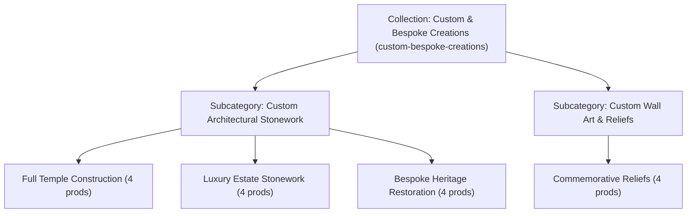
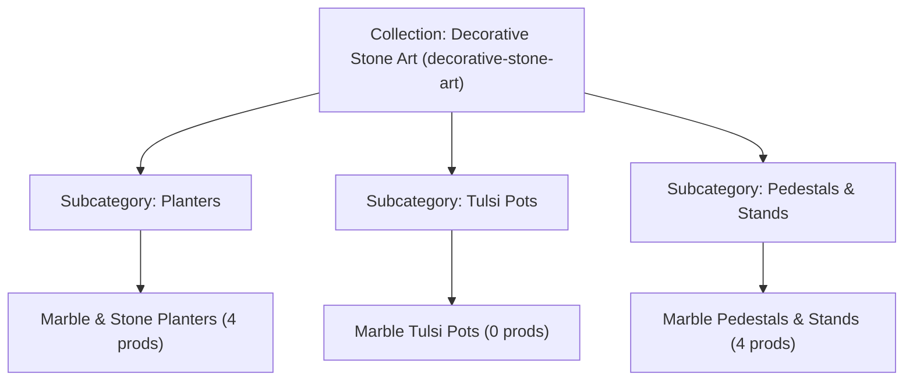
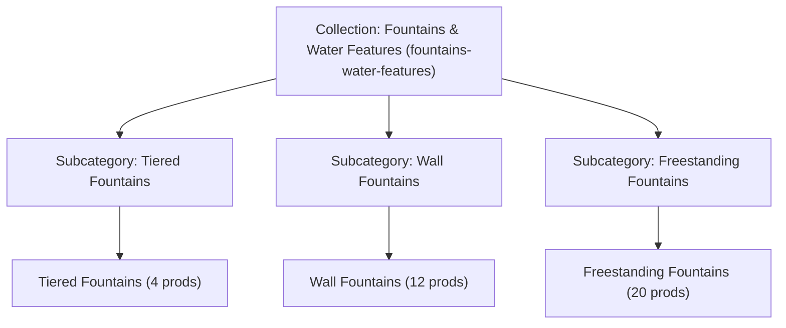
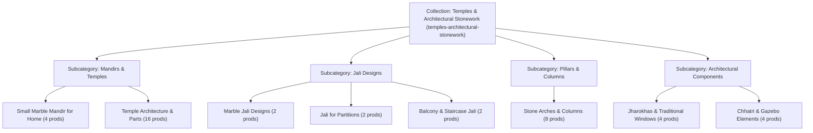
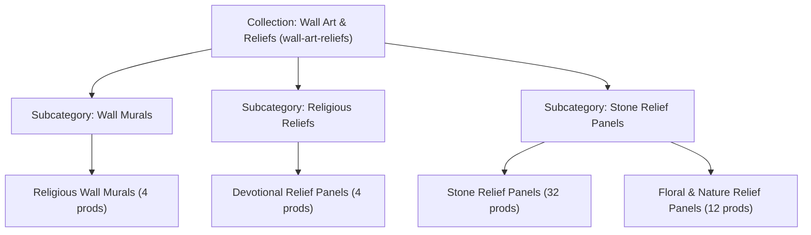
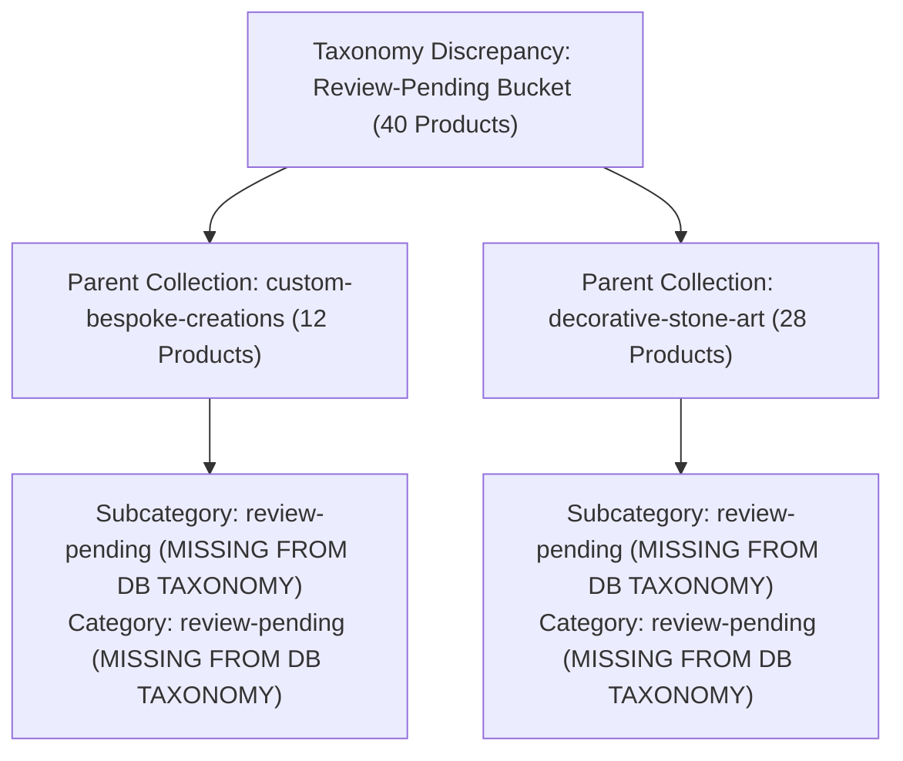

# JAIPUR STONECRAFT — MASTER CATALOG HIERARCHY

**Audit Snapshot Timestamp:** 2026-10-21T10:05:54+05:30  
**Environment:** Active Local Development & Database Snapshot (`jaipur_stonecraft`)  
**Product Count Verification:** Exactly 325 products represented. No sample truncations.

The conceptual catalog hierarchy is:
```
Homepage (/)
  └── Collection (/collections/[collection])
        └── Subcategory (/collections/[collection]/[subcategory])
              └── Category (/collections/[collection]/[subcategory]/[category])
                    └── Product Listing (Catalogue view with filters)
                          └── Individual Product Detail (/designs/[category]/[design])
                                └── Customer Interaction (Enquiry Modal, WhatsApp, Call)
```

---

## CATALOG OVERVIEW SUMMARY

| Collection Slug | Collection Name | Subcats (Act/Tot) | Cats (Act/Tot) | Published Products | Draft Products | Total Products |
|---|---|---|---|---|---|---|
| `custom-bespoke-creations` | **Custom & Bespoke Creations** | 2/5 | 4/9 | 0 | 28 | **28** |
| `decorative-stone-art` | **Decorative Stone Art** | 3/8 | 3/13 | 0 | 36 | **36** |
| `fountains-water-features` | **Fountains & Water Features** | 3/7 | 3/14 | 0 | 36 | **36** |
| `sculptures-statues` | **Sculptures & Statues** | 5/5 | 38/38 | 19 | 112 | **131** |
| `temples-architectural-stonework` | **Temples & Architectural Stonework** | 4/10 | 8/29 | 2 | 40 | **42** |
| `wall-art-reliefs` | **Wall Art & Reliefs** | 3/8 | 4/18 | 0 | 52 | **52** |
| *Unmapped / Review-Pending* | *Exception Products* | 0/0 | 0/0 | 0 | 40 | **40** |
| **TOTALS** | **6 Collections** | **20 / 43** | **60 / 121** | **21** | **304** | **325** |

> **Audit Note on 40 Unmapped Exception Products:**  
> Exactly 40 products in the database are assigned to non-existent parent taxonomy:  
> - 12 products have `parent_collection: custom-bespoke-creations`, `parent_subcategory: review-pending`, `parent_category: review-pending`.  
> - 28 products have `parent_collection: decorative-stone-art`, `parent_subcategory: review-pending`, `parent_category: review-pending`.  
> These 40 products do not appear under any active subcategory or category listing page. They are detailed in the [Dedicated Exception Section](#7-exception-section-unmapped--review-pending-products-40-items) below.

---

## 1. Collection: Custom & Bespoke Creations (`custom-bespoke-creations`)

- **Database ID:** `custom-bespoke-creations`
- **Current Status:** `active`
- **Public URL:** [https://jaipurstonecraft.com/collections/custom-bespoke-creations](/collections/custom-bespoke-creations)
- **Subcategories:** 2 active (5 total in DB)
- **Products:** 0 published, 16 draft, **16 total assigned**

### Visual Flowchart: Custom & Bespoke Creations



### Expandable Tree & Assigned Products: Custom & Bespoke Creations

<details open>
<summary><strong>Subcategory: Custom Sculptures</strong> (<code>custom-sculptures</code>) — Status: <code>inactive</code> | 3 Categories | 0 Products</summary>

> **Subcategory Route:** `/collections/custom-bespoke-creations/custom-sculptures`  
> **Description:** Bespoke deity statues, monumental stone sculptures, and commissioned artwork.  

<details>
<summary>📁 <strong>Category: Bespoke Deity Statues</strong> (<code>bespoke-deity-statues</code>) — Status: <code>inactive</code> | Products: <strong>0</strong> (0 published, 0 draft)</summary>

- **Route Path:** `/collections/custom-bespoke-creations/custom-sculptures/bespoke-deity-statues`
- **Canonical URL:** `https://jaipurstonecraft.com/collections/custom-bespoke-creations/custom-sculptures/bespoke-deity-statues`
- **Category Description:** Commissioned temple & home deity statues.

*Category has no products assigned.*

</details>

<details>
<summary>📁 <strong>Category: Custom Monumental Sculptures</strong> (<code>custom-monumental-sculptures</code>) — Status: <code>inactive</code> | Products: <strong>0</strong> (0 published, 0 draft)</summary>

- **Route Path:** `/collections/custom-bespoke-creations/custom-sculptures/custom-monumental-sculptures`
- **Canonical URL:** `https://jaipurstonecraft.com/collections/custom-bespoke-creations/custom-sculptures/custom-monumental-sculptures`
- **Category Description:** Large scale public stone monuments.

*Category has no products assigned.*

</details>

<details>
<summary>📁 <strong>Category: Commissioned Statuary</strong> (<code>commissioned-statuary</code>) — Status: <code>inactive</code> | Products: <strong>0</strong> (0 published, 0 draft)</summary>

- **Route Path:** `/collections/custom-bespoke-creations/custom-sculptures/commissioned-statuary`
- **Canonical URL:** `https://jaipurstonecraft.com/collections/custom-bespoke-creations/custom-sculptures/commissioned-statuary`
- **Category Description:** Custom art & figure commissions.

*Category has no products assigned.*

</details>

</details>

<details open>
<summary><strong>Subcategory: Custom Architectural Stonework</strong> (<code>custom-architectural-stonework</code>) — Status: <code>active</code> | 6 Categories | 12 Products</summary>

> **Subcategory Route:** `/collections/custom-bespoke-creations/custom-architectural-stonework`  
> **Description:** Full temple design and carving, luxury estate stonework, and heritage restoration.  

<details>
<summary>📁 <strong>Category: Full Temple Construction</strong> (<code>full-temple-construction</code>) — Status: <code>active</code> | Products: <strong>4</strong> (0 published, 4 draft)</summary>

- **Route Path:** `/collections/custom-bespoke-creations/custom-architectural-stonework/full-temple-construction`
- **Canonical URL:** `https://jaipurstonecraft.com/collections/custom-bespoke-creations/custom-architectural-stonework/full-temple-construction`
- **Category Description:** Bespoke full-scale marble and stone temple design, carving, and installation.

| Product ID | SKU | Product Name | Status | Product Slug | Primary Image | Public Detail URL |
|---|---|---|---|---|---|---|
| `bespoke-full-temple-construction-sculpture` | `JSC-FULL-BESP` | **Bespoke Full Temple Construction Sculpture** | `draft` | `bespoke-full-temple-construction-sculpture` | [Image](https://placehold.co/800x600/E8E4DF/1A1918?text=Bespoke%20Full%20Temple%20Construction%20Sculpture) | [`/designs/full-temple-construction/bespoke-full-temple-construction-sculpture`](/designs/full-temple-construction/bespoke-full-temple-construction-sculpture) |
| `heritage-full-temple-construction-design` | `JSC-FULL-HERI` | **Heritage Full Temple Construction Design** | `draft` | `heritage-full-temple-construction-design` | [Image](https://placehold.co/800x600/E8E4DF/1A1918?text=Heritage%20Full%20Temple%20Construction%20Design) | [`/designs/full-temple-construction/heritage-full-temple-construction-design`](/designs/full-temple-construction/heritage-full-temple-construction-design) |
| `royal-carved-full-temple-construction` | `JSC-FULL-ROYA` | **Royal Carved Full Temple Construction** | `draft` | `royal-carved-full-temple-construction` | [Image](https://placehold.co/800x600/E8E4DF/1A1918?text=Royal%20Carved%20Full%20Temple%20Construction) | [`/designs/full-temple-construction/royal-carved-full-temple-construction`](/designs/full-temple-construction/royal-carved-full-temple-construction) |
| `traditional-full-temple-construction` | `JSC-FULL-TRAD` | **Traditional Full Temple Construction** | `draft` | `traditional-full-temple-construction` | [Image](https://placehold.co/800x600/E8E4DF/1A1918?text=Traditional%20Full%20Temple%20Construction) | [`/designs/full-temple-construction/traditional-full-temple-construction`](/designs/full-temple-construction/traditional-full-temple-construction) |

</details>

<details>
<summary>📁 <strong>Category: Luxury Estate Stonework</strong> (<code>luxury-estate-stonework</code>) — Status: <code>active</code> | Products: <strong>4</strong> (0 published, 4 draft)</summary>

- **Route Path:** `/collections/custom-bespoke-creations/custom-architectural-stonework/luxury-estate-stonework`
- **Canonical URL:** `https://jaipurstonecraft.com/collections/custom-bespoke-creations/custom-architectural-stonework/luxury-estate-stonework`
- **Category Description:** Custom architectural stonework for private estates, palaces, and luxury villas.

| Product ID | SKU | Product Name | Status | Product Slug | Primary Image | Public Detail URL |
|---|---|---|---|---|---|---|
| `bespoke-luxury-estate-stonework-sculpture` | `JSC-LUXU-BESP` | **Bespoke Luxury Estate Stonework Sculpture** | `draft` | `bespoke-luxury-estate-stonework-sculpture` | [Image](https://placehold.co/800x600/E8E4DF/1A1918?text=Bespoke%20Luxury%20Estate%20Stonework%20Sculpture) | [`/designs/luxury-estate-stonework/bespoke-luxury-estate-stonework-sculpture`](/designs/luxury-estate-stonework/bespoke-luxury-estate-stonework-sculpture) |
| `heritage-luxury-estate-stonework-design` | `JSC-LUXU-HERI` | **Heritage Luxury Estate Stonework Design** | `draft` | `heritage-luxury-estate-stonework-design` | [Image](https://placehold.co/800x600/E8E4DF/1A1918?text=Heritage%20Luxury%20Estate%20Stonework%20Design) | [`/designs/luxury-estate-stonework/heritage-luxury-estate-stonework-design`](/designs/luxury-estate-stonework/heritage-luxury-estate-stonework-design) |
| `royal-carved-luxury-estate-stonework` | `JSC-LUXU-ROYA` | **Royal Carved Luxury Estate Stonework** | `draft` | `royal-carved-luxury-estate-stonework` | [Image](https://placehold.co/800x600/E8E4DF/1A1918?text=Royal%20Carved%20Luxury%20Estate%20Stonework) | [`/designs/luxury-estate-stonework/royal-carved-luxury-estate-stonework`](/designs/luxury-estate-stonework/royal-carved-luxury-estate-stonework) |
| `traditional-luxury-estate-stonework` | `JSC-LUXU-TRAD` | **Traditional Luxury Estate Stonework** | `draft` | `traditional-luxury-estate-stonework` | [Image](https://placehold.co/800x600/E8E4DF/1A1918?text=Traditional%20Luxury%20Estate%20Stonework) | [`/designs/luxury-estate-stonework/traditional-luxury-estate-stonework`](/designs/luxury-estate-stonework/traditional-luxury-estate-stonework) |

</details>

<details>
<summary>📁 <strong>Category: Bespoke Heritage Restoration</strong> (<code>bespoke-heritage-restoration</code>) — Status: <code>active</code> | Products: <strong>4</strong> (0 published, 4 draft)</summary>

- **Route Path:** `/collections/custom-bespoke-creations/custom-architectural-stonework/bespoke-heritage-restoration`
- **Canonical URL:** `https://jaipurstonecraft.com/collections/custom-bespoke-creations/custom-architectural-stonework/bespoke-heritage-restoration`
- **Category Description:** Historical stone conservation and restoration of heritage architecture.

| Product ID | SKU | Product Name | Status | Product Slug | Primary Image | Public Detail URL |
|---|---|---|---|---|---|---|
| `bespoke-bespoke-heritage-restoration-sculpture` | `JSC-BESP-BESP` | **Bespoke Bespoke Heritage Restoration Sculpture** | `draft` | `bespoke-bespoke-heritage-restoration-sculpture` | [Image](https://placehold.co/800x600/E8E4DF/1A1918?text=Bespoke%20Bespoke%20Heritage%20Restoration%20Sculpture) | [`/designs/bespoke-heritage-restoration/bespoke-bespoke-heritage-restoration-sculpture`](/designs/bespoke-heritage-restoration/bespoke-bespoke-heritage-restoration-sculpture) |
| `heritage-bespoke-heritage-restoration-design` | `JSC-BESP-HERI` | **Heritage Bespoke Heritage Restoration Design** | `draft` | `heritage-bespoke-heritage-restoration-design` | [Image](https://placehold.co/800x600/E8E4DF/1A1918?text=Heritage%20Bespoke%20Heritage%20Restoration%20Design) | [`/designs/bespoke-heritage-restoration/heritage-bespoke-heritage-restoration-design`](/designs/bespoke-heritage-restoration/heritage-bespoke-heritage-restoration-design) |
| `royal-carved-bespoke-heritage-restoration` | `JSC-BESP-ROYA` | **Royal Carved Bespoke Heritage Restoration** | `draft` | `royal-carved-bespoke-heritage-restoration` | [Image](https://placehold.co/800x600/E8E4DF/1A1918?text=Royal%20Carved%20Bespoke%20Heritage%20Restoration) | [`/designs/bespoke-heritage-restoration/royal-carved-bespoke-heritage-restoration`](/designs/bespoke-heritage-restoration/royal-carved-bespoke-heritage-restoration) |
| `traditional-bespoke-heritage-restoration` | `JSC-BESP-TRAD` | **Traditional Bespoke Heritage Restoration** | `draft` | `traditional-bespoke-heritage-restoration` | [Image](https://placehold.co/800x600/E8E4DF/1A1918?text=Traditional%20Bespoke%20Heritage%20Restoration) | [`/designs/bespoke-heritage-restoration/traditional-bespoke-heritage-restoration`](/designs/bespoke-heritage-restoration/traditional-bespoke-heritage-restoration) |

</details>

<details>
<summary>📁 <strong>Category: Bespoke Facade Elements</strong> (<code>bespoke-facade-elements</code>) — Status: <code>inactive</code> | Products: <strong>0</strong> (0 published, 0 draft)</summary>

- **Route Path:** `/collections/custom-bespoke-creations/custom-architectural-stonework/bespoke-facade-elements`
- **Canonical URL:** `https://jaipurstonecraft.com/collections/custom-bespoke-creations/custom-architectural-stonework/bespoke-facade-elements`
- **Category Description:** Architectural facade stone elements.

*Category has no products assigned.*

</details>

<details>
<summary>📁 <strong>Category: Custom Heritage Columns</strong> (<code>custom-heritage-columns</code>) — Status: <code>inactive</code> | Products: <strong>0</strong> (0 published, 0 draft)</summary>

- **Route Path:** `/collections/custom-bespoke-creations/custom-architectural-stonework/custom-heritage-columns`
- **Canonical URL:** `https://jaipurstonecraft.com/collections/custom-bespoke-creations/custom-architectural-stonework/custom-heritage-columns`
- **Category Description:** Bespoke heritage sandstone columns.

*Category has no products assigned.*

</details>

<details>
<summary>📁 <strong>Category: Portico Carvings</strong> (<code>portico-carvings</code>) — Status: <code>inactive</code> | Products: <strong>0</strong> (0 published, 0 draft)</summary>

- **Route Path:** `/collections/custom-bespoke-creations/custom-architectural-stonework/portico-carvings`
- **Canonical URL:** `https://jaipurstonecraft.com/collections/custom-bespoke-creations/custom-architectural-stonework/portico-carvings`
- **Category Description:** Carved stone portico structures.

*Category has no products assigned.*

</details>

</details>

<details open>
<summary><strong>Subcategory: Custom Portraits</strong> (<code>custom-portraits</code>) — Status: <code>inactive</code> | 2 Categories | 0 Products</summary>

> **Subcategory Route:** `/collections/custom-bespoke-creations/custom-portraits`  
> **Description:** Lifesize memorial portrait busts, ancestral stone portrait carvings, and commemorative reliefs.  

<details>
<summary>📁 <strong>Category: Lifesize Memorial Busts</strong> (<code>lifesize-memorial-busts</code>) — Status: <code>inactive</code> | Products: <strong>0</strong> (0 published, 0 draft)</summary>

- **Route Path:** `/collections/custom-bespoke-creations/custom-portraits/lifesize-memorial-busts`
- **Canonical URL:** `https://jaipurstonecraft.com/collections/custom-bespoke-creations/custom-portraits/lifesize-memorial-busts`
- **Category Description:** Life-size portrait busts from photos.

*Category has no products assigned.*

</details>

<details>
<summary>📁 <strong>Category: Ancestral Portrait Carvings</strong> (<code>ancestral-portrait-carvings</code>) — Status: <code>inactive</code> | Products: <strong>0</strong> (0 published, 0 draft)</summary>

- **Route Path:** `/collections/custom-bespoke-creations/custom-portraits/ancestral-portrait-carvings`
- **Canonical URL:** `https://jaipurstonecraft.com/collections/custom-bespoke-creations/custom-portraits/ancestral-portrait-carvings`
- **Category Description:** Ancestral tribute marble reliefs.

*Category has no products assigned.*

</details>

</details>

<details open>
<summary><strong>Subcategory: Custom Wall Art & Reliefs</strong> (<code>custom-wall-art-reliefs</code>) — Status: <code>active</code> | 1 Categories | 4 Products</summary>

> **Subcategory Route:** `/collections/custom-bespoke-creations/custom-wall-art-reliefs`  
> **Description:** Commissioned architectural feature walls, commemorative reliefs, and bespoke stone murals.  

<details>
<summary>📁 <strong>Category: Commemorative Reliefs</strong> (<code>commemorative-reliefs</code>) — Status: <code>active</code> | Products: <strong>4</strong> (0 published, 4 draft)</summary>

- **Route Path:** `/collections/custom-bespoke-creations/custom-wall-art-reliefs/commemorative-reliefs`
- **Canonical URL:** `https://jaipurstonecraft.com/collections/custom-bespoke-creations/custom-wall-art-reliefs/commemorative-reliefs`
- **Category Description:** Bespoke commissioned memorial plaques, family crests, and narrative relief art.

| Product ID | SKU | Product Name | Status | Product Slug | Primary Image | Public Detail URL |
|---|---|---|---|---|---|---|
| `bespoke-commemorative-reliefs-sculpture` | `JSC-COMM-BESP` | **Bespoke Commemorative Reliefs Sculpture** | `draft` | `bespoke-commemorative-reliefs-sculpture` | [Image](https://placehold.co/800x600/E8E4DF/1A1918?text=Bespoke%20Commemorative%20Reliefs%20Sculpture) | [`/designs/commemorative-reliefs/bespoke-commemorative-reliefs-sculpture`](/designs/commemorative-reliefs/bespoke-commemorative-reliefs-sculpture) |
| `heritage-commemorative-reliefs-design` | `JSC-COMM-HERI` | **Heritage Commemorative Reliefs Design** | `draft` | `heritage-commemorative-reliefs-design` | [Image](https://placehold.co/800x600/E8E4DF/1A1918?text=Heritage%20Commemorative%20Reliefs%20Design) | [`/designs/commemorative-reliefs/heritage-commemorative-reliefs-design`](/designs/commemorative-reliefs/heritage-commemorative-reliefs-design) |
| `royal-carved-commemorative-reliefs` | `JSC-COMM-ROYA` | **Royal Carved Commemorative Reliefs** | `draft` | `royal-carved-commemorative-reliefs` | [Image](https://placehold.co/800x600/E8E4DF/1A1918?text=Royal%20Carved%20Commemorative%20Reliefs) | [`/designs/commemorative-reliefs/royal-carved-commemorative-reliefs`](/designs/commemorative-reliefs/royal-carved-commemorative-reliefs) |
| `traditional-commemorative-reliefs` | `JSC-COMM-TRAD` | **Traditional Commemorative Reliefs** | `draft` | `traditional-commemorative-reliefs` | [Image](https://placehold.co/800x600/E8E4DF/1A1918?text=Traditional%20Commemorative%20Reliefs) | [`/designs/commemorative-reliefs/traditional-commemorative-reliefs`](/designs/commemorative-reliefs/traditional-commemorative-reliefs) |

</details>

</details>

<details open>
<summary><strong>Subcategory: Custom Architectural Projects</strong> (<code>custom-architectural-projects</code>) — Status: <code>inactive</code> | 0 Categories | 0 Products</summary>

> **Subcategory Route:** `/collections/custom-bespoke-creations/custom-architectural-projects`  
> **Description:** Full temple design and carving, luxury estate stonework, and heritage restoration.  

> *Notice: This subcategory has 0 child categories in the database.*  

</details>


## 2. Collection: Decorative Stone Art (`decorative-stone-art`)

- **Database ID:** `decorative-stone-art`
- **Current Status:** `active`
- **Public URL:** [https://jaipurstonecraft.com/collections/decorative-stone-art](/collections/decorative-stone-art)
- **Subcategories:** 3 active (8 total in DB)
- **Products:** 0 published, 8 draft, **8 total assigned**

### Visual Flowchart: Decorative Stone Art



### Expandable Tree & Assigned Products: Decorative Stone Art

<details open>
<summary><strong>Subcategory: Interior Stone Décor</strong> (<code>interior-stone-decor</code>) — Status: <code>inactive</code> | 4 Categories | 0 Products</summary>

> **Subcategory Route:** `/collections/decorative-stone-art/interior-stone-decor`  
> **Description:** Carved marble vases, pedestals, plinths, decorative bowls, and interior stone urns.  

<details>
<summary>📁 <strong>Category: Carved Stone Vases</strong> (<code>carved-stone-vases</code>) — Status: <code>inactive</code> | Products: <strong>0</strong> (0 published, 0 draft)</summary>

- **Route Path:** `/collections/decorative-stone-art/interior-stone-decor/carved-stone-vases`
- **Canonical URL:** `https://jaipurstonecraft.com/collections/decorative-stone-art/interior-stone-decor/carved-stone-vases`
- **Category Description:** Interior carved marble and stone urns.

*Category has no products assigned.*

</details>

<details>
<summary>📁 <strong>Category: Pedestals & Plinths</strong> (<code>pedestals-plinths</code>) — Status: <code>inactive</code> | Products: <strong>0</strong> (0 published, 0 draft)</summary>

- **Route Path:** `/collections/decorative-stone-art/interior-stone-decor/pedestals-plinths`
- **Canonical URL:** `https://jaipurstonecraft.com/collections/decorative-stone-art/interior-stone-decor/pedestals-plinths`
- **Category Description:** Display pedestals and stone plinths.

*Category has no products assigned.*

</details>

<details>
<summary>📁 <strong>Category: Marble Urns</strong> (<code>marble-urns</code>) — Status: <code>inactive</code> | Products: <strong>0</strong> (0 published, 0 draft)</summary>

- **Route Path:** `/collections/decorative-stone-art/interior-stone-decor/marble-urns`
- **Canonical URL:** `https://jaipurstonecraft.com/collections/decorative-stone-art/interior-stone-decor/marble-urns`
- **Category Description:** Decorative carved marble urns.

*Category has no products assigned.*

</details>

<details>
<summary>📁 <strong>Category: Decorative Bowls</strong> (<code>decorative-bowls</code>) — Status: <code>inactive</code> | Products: <strong>0</strong> (0 published, 0 draft)</summary>

- **Route Path:** `/collections/decorative-stone-art/interior-stone-decor/decorative-bowls`
- **Canonical URL:** `https://jaipurstonecraft.com/collections/decorative-stone-art/interior-stone-decor/decorative-bowls`
- **Category Description:** Hand-carved marble basins and bowls.

*Category has no products assigned.*

</details>

</details>

<details open>
<summary><strong>Subcategory: Planters</strong> (<code>planters</code>) — Status: <code>active</code> | 1 Categories | 4 Products</summary>

> **Subcategory Route:** `/collections/decorative-stone-art/planters`  
> **Description:** Hand-carved marble and sandstone planters, garden urns, and landscape stone vessels.  

<details>
<summary>📁 <strong>Category: Marble & Stone Planters</strong> (<code>marble-stone-planters</code>) — Status: <code>active</code> | Products: <strong>4</strong> (0 published, 4 draft)</summary>

- **Route Path:** `/collections/decorative-stone-art/planters/marble-stone-planters`
- **Canonical URL:** `https://jaipurstonecraft.com/collections/decorative-stone-art/planters/marble-stone-planters`
- **Category Description:** Hand-carved marble and sandstone planters and outdoor urns.

| Product ID | SKU | Product Name | Status | Product Slug | Primary Image | Public Detail URL |
|---|---|---|---|---|---|---|
| `bespoke-stone-planters-sculpture` | `JSC-STON-BESP` | **Bespoke Stone Planters Sculpture** | `draft` | `bespoke-stone-planters-sculpture` | [Image](https://placehold.co/800x600/E8E4DF/1A1918?text=Bespoke%20Stone%20Planters%20Sculpture) | [`/designs/marble-stone-planters/bespoke-stone-planters-sculpture`](/designs/marble-stone-planters/bespoke-stone-planters-sculpture) |
| `heritage-stone-planters-design` | `JSC-STON-HERI` | **Heritage Stone Planters Design** | `draft` | `heritage-stone-planters-design` | [Image](https://placehold.co/800x600/E8E4DF/1A1918?text=Heritage%20Stone%20Planters%20Design) | [`/designs/marble-stone-planters/heritage-stone-planters-design`](/designs/marble-stone-planters/heritage-stone-planters-design) |
| `royal-carved-stone-planters` | `JSC-STON-ROYA` | **Royal Carved Stone Planters** | `draft` | `royal-carved-stone-planters` | [Image](https://placehold.co/800x600/E8E4DF/1A1918?text=Royal%20Carved%20Stone%20Planters) | [`/designs/marble-stone-planters/royal-carved-stone-planters`](/designs/marble-stone-planters/royal-carved-stone-planters) |
| `traditional-stone-planters` | `JSC-STON-TRAD` | **Traditional Stone Planters** | `draft` | `traditional-stone-planters` | [Image](https://placehold.co/800x600/E8E4DF/1A1918?text=Traditional%20Stone%20Planters) | [`/designs/marble-stone-planters/traditional-stone-planters`](/designs/marble-stone-planters/traditional-stone-planters) |

</details>

</details>

<details open>
<summary><strong>Subcategory: Marble & Stone Planters & Tulsi Pots</strong> (<code>planters-tulsi-pots</code>) — Status: <code>inactive</code> | 0 Categories | 0 Products</summary>

> **Subcategory Route:** `/collections/decorative-stone-art/planters-tulsi-pots`  
> **Description:** Hand-carved marble and sandstone planters, garden urns, and sacred Tulsi pots.  

> *Notice: This subcategory has 0 child categories in the database.*  

</details>

<details open>
<summary><strong>Subcategory: Small Sculptural Art</strong> (<code>small-sculptural-art</code>) — Status: <code>inactive</code> | 3 Categories | 0 Products</summary>

> **Subcategory Route:** `/collections/decorative-stone-art/small-sculptural-art`  
> **Description:** Tabletop marble statuettes, miniature stone reliefs, and handcrafted artisan accents.  

<details>
<summary>📁 <strong>Category: Tabletop Statuettes</strong> (<code>tabletop-statuettes</code>) — Status: <code>inactive</code> | Products: <strong>0</strong> (0 published, 0 draft)</summary>

- **Route Path:** `/collections/decorative-stone-art/small-sculptural-art/tabletop-statuettes`
- **Canonical URL:** `https://jaipurstonecraft.com/collections/decorative-stone-art/small-sculptural-art/tabletop-statuettes`
- **Category Description:** Small stone tabletop sculptures.

*Category has no products assigned.*

</details>

<details>
<summary>📁 <strong>Category: Miniature Reliefs</strong> (<code>miniature-reliefs</code>) — Status: <code>inactive</code> | Products: <strong>0</strong> (0 published, 0 draft)</summary>

- **Route Path:** `/collections/decorative-stone-art/small-sculptural-art/miniature-reliefs`
- **Canonical URL:** `https://jaipurstonecraft.com/collections/decorative-stone-art/small-sculptural-art/miniature-reliefs`
- **Category Description:** Miniature framed stone relief panels.

*Category has no products assigned.*

</details>

<details>
<summary>📁 <strong>Category: Artisan Accessories</strong> (<code>artisan-accessories</code>) — Status: <code>inactive</code> | Products: <strong>0</strong> (0 published, 0 draft)</summary>

- **Route Path:** `/collections/decorative-stone-art/small-sculptural-art/artisan-accessories`
- **Canonical URL:** `https://jaipurstonecraft.com/collections/decorative-stone-art/small-sculptural-art/artisan-accessories`
- **Category Description:** Handcrafted stone home accessories.

*Category has no products assigned.*

</details>

</details>

<details open>
<summary><strong>Subcategory: Tulsi Pots</strong> (<code>tulsi-pots</code>) — Status: <code>active</code> | 1 Categories | 0 Products</summary>

> **Subcategory Route:** `/collections/decorative-stone-art/tulsi-pots`  
> **Description:** Sacred white marble and natural sandstone carved Tulsi pots for devotional home mandirs.  

<details>
<summary>📁 <strong>Category: Marble Tulsi Pots</strong> (<code>marble-tulsi-pots</code>) — Status: <code>active</code> | Products: <strong>0</strong> (0 published, 0 draft)</summary>

- **Route Path:** `/collections/decorative-stone-art/tulsi-pots/marble-tulsi-pots`
- **Canonical URL:** `https://jaipurstonecraft.com/collections/decorative-stone-art/tulsi-pots/marble-tulsi-pots`
- **Category Description:** Sacred carved marble Tulsi pots for devotional gardens and courtyards.

*Category has no products assigned.*

</details>

</details>

<details open>
<summary><strong>Subcategory: Decorative Accents</strong> (<code>decorative-accents</code>) — Status: <code>inactive</code> | 0 Categories | 0 Products</summary>

> **Subcategory Route:** `/collections/decorative-stone-art/decorative-accents`  
> **Description:** Stone decorative items and outdoor artistic elements awaiting catalogue review.  

> *Notice: This subcategory has 0 child categories in the database.*  

</details>

<details open>
<summary><strong>Subcategory: Garden & Outdoor Stone Art</strong> (<code>garden-outdoor-stone-art</code>) — Status: <code>inactive</code> | 3 Categories | 0 Products</summary>

> **Subcategory Route:** `/collections/decorative-stone-art/garden-outdoor-stone-art`  
> **Description:** Hand-carved stone planters, garden lanterns, benches, and outdoor landscape accents.  

<details>
<summary>📁 <strong>Category: Stone Planters</strong> (<code>stone-planters</code>) — Status: <code>inactive</code> | Products: <strong>0</strong> (0 published, 0 draft)</summary>

- **Route Path:** `/collections/decorative-stone-art/garden-outdoor-stone-art/stone-planters`
- **Canonical URL:** `https://jaipurstonecraft.com/collections/decorative-stone-art/garden-outdoor-stone-art/stone-planters`
- **Category Description:** Hand-carved outdoor stone planters.

*Category has no products assigned.*

</details>

<details>
<summary>📁 <strong>Category: Garden Lanterns & Lamps</strong> (<code>garden-lanterns-lamps</code>) — Status: <code>inactive</code> | Products: <strong>0</strong> (0 published, 0 draft)</summary>

- **Route Path:** `/collections/decorative-stone-art/garden-outdoor-stone-art/garden-lanterns-lamps`
- **Canonical URL:** `https://jaipurstonecraft.com/collections/decorative-stone-art/garden-outdoor-stone-art/garden-lanterns-lamps`
- **Category Description:** Carved stone outdoor lamps.

*Category has no products assigned.*

</details>

<details>
<summary>📁 <strong>Category: Benches & Seating</strong> (<code>benches-seating</code>) — Status: <code>inactive</code> | Products: <strong>0</strong> (0 published, 0 draft)</summary>

- **Route Path:** `/collections/decorative-stone-art/garden-outdoor-stone-art/benches-seating`
- **Canonical URL:** `https://jaipurstonecraft.com/collections/decorative-stone-art/garden-outdoor-stone-art/benches-seating`
- **Category Description:** Carved sandstone garden benches.

*Category has no products assigned.*

</details>

</details>

<details open>
<summary><strong>Subcategory: Pedestals & Stands</strong> (<code>pedestals-stands</code>) — Status: <code>active</code> | 1 Categories | 4 Products</summary>

> **Subcategory Route:** `/collections/decorative-stone-art/pedestals-stands`  
> **Description:** Architectural display pedestals, statue plinths, and carved stone bases.  

<details>
<summary>📁 <strong>Category: Marble Pedestals & Stands</strong> (<code>marble-pedestals-stands</code>) — Status: <code>active</code> | Products: <strong>4</strong> (0 published, 4 draft)</summary>

- **Route Path:** `/collections/decorative-stone-art/pedestals-stands/marble-pedestals-stands`
- **Canonical URL:** `https://jaipurstonecraft.com/collections/decorative-stone-art/pedestals-stands/marble-pedestals-stands`
- **Category Description:** Carved stone display plinths and statue pedestals.

| Product ID | SKU | Product Name | Status | Product Slug | Primary Image | Public Detail URL |
|---|---|---|---|---|---|---|
| `bespoke-pedestals-plinths-sculpture` | `JSC-PEDE-BESP` | **Bespoke Pedestals & Plinths Sculpture** | `draft` | `bespoke-pedestals-plinths-sculpture` | [Image](https://placehold.co/800x600/E8E4DF/1A1918?text=Bespoke%20Pedestals%20%26%20Plinths%20Sculpture) | [`/designs/marble-pedestals-stands/bespoke-pedestals-plinths-sculpture`](/designs/marble-pedestals-stands/bespoke-pedestals-plinths-sculpture) |
| `heritage-pedestals-plinths-design` | `JSC-PEDE-HERI` | **Heritage Pedestals & Plinths Design** | `draft` | `heritage-pedestals-plinths-design` | [Image](https://placehold.co/800x600/E8E4DF/1A1918?text=Heritage%20Pedestals%20%26%20Plinths%20Design) | [`/designs/marble-pedestals-stands/heritage-pedestals-plinths-design`](/designs/marble-pedestals-stands/heritage-pedestals-plinths-design) |
| `royal-carved-pedestals-plinths` | `JSC-PEDE-ROYA` | **Royal Carved Pedestals & Plinths** | `draft` | `royal-carved-pedestals-plinths` | [Image](https://placehold.co/800x600/E8E4DF/1A1918?text=Royal%20Carved%20Pedestals%20%26%20Plinths) | [`/designs/marble-pedestals-stands/royal-carved-pedestals-plinths`](/designs/marble-pedestals-stands/royal-carved-pedestals-plinths) |
| `traditional-pedestals-plinths` | `JSC-PEDE-TRAD` | **Traditional Pedestals & Plinths** | `draft` | `traditional-pedestals-plinths` | [Image](https://placehold.co/800x600/E8E4DF/1A1918?text=Traditional%20Pedestals%20%26%20Plinths) | [`/designs/marble-pedestals-stands/traditional-pedestals-plinths`](/designs/marble-pedestals-stands/traditional-pedestals-plinths) |

</details>

</details>


## 3. Collection: Fountains & Water Features (`fountains-water-features`)

- **Database ID:** `fountains-water-features`
- **Current Status:** `active`
- **Public URL:** [https://jaipurstonecraft.com/collections/fountains-water-features](/collections/fountains-water-features)
- **Subcategories:** 3 active (7 total in DB)
- **Products:** 0 published, 36 draft, **36 total assigned**

### Visual Flowchart: Fountains & Water Features



### Expandable Tree & Assigned Products: Fountains & Water Features

<details open>
<summary><strong>Subcategory: Classical Fountains</strong> (<code>classical-fountains</code>) — Status: <code>inactive</code> | 4 Categories | 0 Products</summary>

> **Subcategory Route:** `/collections/fountains-water-features/classical-fountains`  
> **Description:** Tiered marble and sandstone fountains, lotus basin fountains, and courtyard water features.  

<details>
<summary>📁 <strong>Category: Tiered Water Fountains</strong> (<code>tiered-water-fountains</code>) — Status: <code>inactive</code> | Products: <strong>0</strong> (0 published, 0 draft)</summary>

- **Route Path:** `/collections/fountains-water-features/classical-fountains/tiered-water-fountains`
- **Canonical URL:** `https://jaipurstonecraft.com/collections/fountains-water-features/classical-fountains/tiered-water-fountains`
- **Category Description:** Multi-tiered marble and sandstone courtyard fountains.

*Category has no products assigned.*

</details>

<details>
<summary>📁 <strong>Category: Central Courtyard Fountains</strong> (<code>central-courtyard-fountains</code>) — Status: <code>inactive</code> | Products: <strong>0</strong> (0 published, 0 draft)</summary>

- **Route Path:** `/collections/fountains-water-features/classical-fountains/central-courtyard-fountains`
- **Canonical URL:** `https://jaipurstonecraft.com/collections/fountains-water-features/classical-fountains/central-courtyard-fountains`
- **Category Description:** Palace courtyard central stone fountains.

*Category has no products assigned.*

</details>

<details>
<summary>📁 <strong>Category: Lotus Basin Fountains</strong> (<code>lotus-basin-fountains</code>) — Status: <code>inactive</code> | Products: <strong>0</strong> (0 published, 0 draft)</summary>

- **Route Path:** `/collections/fountains-water-features/classical-fountains/lotus-basin-fountains`
- **Canonical URL:** `https://jaipurstonecraft.com/collections/fountains-water-features/classical-fountains/lotus-basin-fountains`
- **Category Description:** Carved lotus petal water basin fountains.

*Category has no products assigned.*

</details>

<details>
<summary>📁 <strong>Category: Pedestal Fountains</strong> (<code>pedestal-fountains</code>) — Status: <code>inactive</code> | Products: <strong>0</strong> (0 published, 0 draft)</summary>

- **Route Path:** `/collections/fountains-water-features/classical-fountains/pedestal-fountains`
- **Canonical URL:** `https://jaipurstonecraft.com/collections/fountains-water-features/classical-fountains/pedestal-fountains`
- **Category Description:** Single pedestal outdoor water fountains.

*Category has no products assigned.*

</details>

</details>

<details open>
<summary><strong>Subcategory: Tiered Fountains</strong> (<code>tiered-fountains</code>) — Status: <code>active</code> | 1 Categories | 4 Products</summary>

> **Subcategory Route:** `/collections/fountains-water-features/tiered-fountains`  
> **Description:** Classical multi-tier marble and stone water fountains for gardens and courtyards.  

<details>
<summary>📁 <strong>Category: Tiered Fountains</strong> (<code>tiered-fountains</code>) — Status: <code>active</code> | Products: <strong>4</strong> (0 published, 4 draft)</summary>

- **Route Path:** `/collections/fountains-water-features/tiered-fountains/tiered-fountains`
- **Canonical URL:** `https://jaipurstonecraft.com/collections/fountains-water-features/tiered-fountains/tiered-fountains`
- **Category Description:** Multi-tier classical stone water fountains for gardens and courtyards.

| Product ID | SKU | Product Name | Status | Product Slug | Primary Image | Public Detail URL |
|---|---|---|---|---|---|---|
| `carved-scalloped-tier-fountain` | `JSC-TIER-CARV` | **Carved Scalloped Tier Fountain** | `draft` | `carved-scalloped-tier-fountain` | [Image](https://placehold.co/800x600/E8E4DF/1A1918?text=Carved%20Scalloped%20Tier%20Fountain) | [`/designs/tiered-fountains/carved-scalloped-tier-fountain`](/designs/tiered-fountains/carved-scalloped-tier-fountain) |
| `classical-pedestal-water-fountain` | `JSC-TIER-CLAS` | **Classical Pedestal Water Fountain** | `draft` | `classical-pedestal-water-fountain` | [Image](https://placehold.co/800x600/E8E4DF/1A1918?text=Classical%20Pedestal%20Water%20Fountain) | [`/designs/tiered-fountains/classical-pedestal-water-fountain`](/designs/tiered-fountains/classical-pedestal-water-fountain) |
| `royal-courtyard-tiered-fountain` | `JSC-TIER-ROYA` | **Royal Courtyard Tiered Fountain** | `draft` | `royal-courtyard-tiered-fountain` | [Image](https://placehold.co/800x600/E8E4DF/1A1918?text=Royal%20Courtyard%20Tiered%20Fountain) | [`/designs/tiered-fountains/royal-courtyard-tiered-fountain`](/designs/tiered-fountains/royal-courtyard-tiered-fountain) |
| `three-tier-lotus-fountain` | `JSC-TIER-THRE` | **Three-Tier Lotus Fountain** | `draft` | `three-tier-lotus-fountain` | [Image](https://placehold.co/800x600/E8E4DF/1A1918?text=Three-Tier%20Lotus%20Fountain) | [`/designs/tiered-fountains/three-tier-lotus-fountain`](/designs/tiered-fountains/three-tier-lotus-fountain) |

</details>

</details>

<details open>
<summary><strong>Subcategory: Garden Fountains</strong> (<code>garden-fountains</code>) — Status: <code>inactive</code> | 1 Categories | 0 Products</summary>

> **Subcategory Route:** `/collections/fountains-water-features/garden-fountains`  
> **Description:** Freestanding courtyard stone fountains, lotus basins, and sculptural water features.  

<details>
<summary>📁 <strong>Category: Garden Fountains</strong> (<code>garden-fountains</code>) — Status: <code>inactive</code> | Products: <strong>0</strong> (0 published, 0 draft)</summary>

- **Route Path:** `/collections/fountains-water-features/garden-fountains/garden-fountains`
- **Canonical URL:** `https://jaipurstonecraft.com/collections/fountains-water-features/garden-fountains/garden-fountains`
- **Category Description:** Courtyard centerpiece stone fountains, lotus basin water bodies, and sculptural garden water fountains.

*Category has no products assigned.*

</details>

</details>

<details open>
<summary><strong>Subcategory: Sculptural Fountains</strong> (<code>sculptural-fountains</code>) — Status: <code>inactive</code> | 3 Categories | 0 Products</summary>

> **Subcategory Route:** `/collections/fountains-water-features/sculptural-fountains`  
> **Description:** Figurative stone water sculptures, abstract water features, and cascading water walls.  

<details>
<summary>📁 <strong>Category: Figurative Water Sculptures</strong> (<code>figurative-water-sculptures</code>) — Status: <code>inactive</code> | Products: <strong>0</strong> (0 published, 0 draft)</summary>

- **Route Path:** `/collections/fountains-water-features/sculptural-fountains/figurative-water-sculptures`
- **Canonical URL:** `https://jaipurstonecraft.com/collections/fountains-water-features/sculptural-fountains/figurative-water-sculptures`
- **Category Description:** Sculpted figures integrated with water flow.

*Category has no products assigned.*

</details>

<details>
<summary>📁 <strong>Category: Cascading Water Walls</strong> (<code>cascading-water-walls</code>) — Status: <code>inactive</code> | Products: <strong>0</strong> (0 published, 0 draft)</summary>

- **Route Path:** `/collections/fountains-water-features/sculptural-fountains/cascading-water-walls`
- **Canonical URL:** `https://jaipurstonecraft.com/collections/fountains-water-features/sculptural-fountains/cascading-water-walls`
- **Category Description:** Vertical cascading stone water walls.

*Category has no products assigned.*

</details>

<details>
<summary>📁 <strong>Category: Abstract Water Sculptures</strong> (<code>abstract-water-sculptures</code>) — Status: <code>inactive</code> | Products: <strong>0</strong> (0 published, 0 draft)</summary>

- **Route Path:** `/collections/fountains-water-features/sculptural-fountains/abstract-water-sculptures`
- **Canonical URL:** `https://jaipurstonecraft.com/collections/fountains-water-features/sculptural-fountains/abstract-water-sculptures`
- **Category Description:** Contemporary abstract stone water features.

*Category has no products assigned.*

</details>

</details>

<details open>
<summary><strong>Subcategory: Wall Fountains</strong> (<code>wall-fountains</code>) — Status: <code>active</code> | 1 Categories | 12 Products</summary>

> **Subcategory Route:** `/collections/fountains-water-features/wall-fountains`  
> **Description:** Stone water walls, spout fountains, and poolside waterfalls for architectural installations.  

<details>
<summary>📁 <strong>Category: Wall Fountains</strong> (<code>wall-fountains</code>) — Status: <code>active</code> | Products: <strong>12</strong> (0 published, 12 draft)</summary>

- **Route Path:** `/collections/fountains-water-features/wall-fountains/wall-fountains`
- **Canonical URL:** `https://jaipurstonecraft.com/collections/fountains-water-features/wall-fountains/wall-fountains`
- **Category Description:** Architectural wall fountains, water walls, and stone spouts.

| Product ID | SKU | Product Name | Status | Product Slug | Primary Image | Public Detail URL |
|---|---|---|---|---|---|---|
| `bespoke-cascading-water-walls-sculpture` | `JSC-CASC-BESP` | **Bespoke Cascading Water Walls Sculpture** | `draft` | `bespoke-cascading-water-walls-sculpture` | [Image](https://placehold.co/800x600/E8E4DF/1A1918?text=Bespoke%20Cascading%20Water%20Walls%20Sculpture) | [`/designs/wall-fountains/bespoke-cascading-water-walls-sculpture`](/designs/wall-fountains/bespoke-cascading-water-walls-sculpture) |
| `bespoke-poolside-stone-waterfalls-sculpture` | `JSC-POOL-BESP` | **Bespoke Poolside Stone Waterfalls Sculpture** | `draft` | `bespoke-poolside-stone-waterfalls-sculpture` | [Image](https://placehold.co/800x600/E8E4DF/1A1918?text=Bespoke%20Poolside%20Stone%20Waterfalls%20Sculpture) | [`/designs/wall-fountains/bespoke-poolside-stone-waterfalls-sculpture`](/designs/wall-fountains/bespoke-poolside-stone-waterfalls-sculpture) |
| `bespoke-spout-fountains-sculpture` | `JSC-SPOU-BESP` | **Bespoke Spout Fountains Sculpture** | `draft` | `bespoke-spout-fountains-sculpture` | [Image](https://placehold.co/800x600/E8E4DF/1A1918?text=Bespoke%20Spout%20Fountains%20Sculpture) | [`/designs/wall-fountains/bespoke-spout-fountains-sculpture`](/designs/wall-fountains/bespoke-spout-fountains-sculpture) |
| `heritage-cascading-water-walls-design` | `JSC-CASC-HERI` | **Heritage Cascading Water Walls Design** | `draft` | `heritage-cascading-water-walls-design` | [Image](https://placehold.co/800x600/E8E4DF/1A1918?text=Heritage%20Cascading%20Water%20Walls%20Design) | [`/designs/wall-fountains/heritage-cascading-water-walls-design`](/designs/wall-fountains/heritage-cascading-water-walls-design) |
| `heritage-poolside-stone-waterfalls-design` | `JSC-POOL-HERI` | **Heritage Poolside Stone Waterfalls Design** | `draft` | `heritage-poolside-stone-waterfalls-design` | [Image](https://placehold.co/800x600/E8E4DF/1A1918?text=Heritage%20Poolside%20Stone%20Waterfalls%20Design) | [`/designs/wall-fountains/heritage-poolside-stone-waterfalls-design`](/designs/wall-fountains/heritage-poolside-stone-waterfalls-design) |
| `heritage-spout-fountains-design` | `JSC-SPOU-HERI` | **Heritage Spout Fountains Design** | `draft` | `heritage-spout-fountains-design` | [Image](https://placehold.co/800x600/E8E4DF/1A1918?text=Heritage%20Spout%20Fountains%20Design) | [`/designs/wall-fountains/heritage-spout-fountains-design`](/designs/wall-fountains/heritage-spout-fountains-design) |
| `royal-carved-cascading-water-walls` | `JSC-CASC-ROYA` | **Royal Carved Cascading Water Walls** | `draft` | `royal-carved-cascading-water-walls` | [Image](https://placehold.co/800x600/E8E4DF/1A1918?text=Royal%20Carved%20Cascading%20Water%20Walls) | [`/designs/wall-fountains/royal-carved-cascading-water-walls`](/designs/wall-fountains/royal-carved-cascading-water-walls) |
| `royal-carved-poolside-stone-waterfalls` | `JSC-POOL-ROYA` | **Royal Carved Poolside Stone Waterfalls** | `draft` | `royal-carved-poolside-stone-waterfalls` | [Image](https://placehold.co/800x600/E8E4DF/1A1918?text=Royal%20Carved%20Poolside%20Stone%20Waterfalls) | [`/designs/wall-fountains/royal-carved-poolside-stone-waterfalls`](/designs/wall-fountains/royal-carved-poolside-stone-waterfalls) |
| `royal-carved-spout-fountains` | `JSC-SPOU-ROYA` | **Royal Carved Spout Fountains** | `draft` | `royal-carved-spout-fountains` | [Image](https://placehold.co/800x600/E8E4DF/1A1918?text=Royal%20Carved%20Spout%20Fountains) | [`/designs/wall-fountains/royal-carved-spout-fountains`](/designs/wall-fountains/royal-carved-spout-fountains) |
| `traditional-cascading-water-walls` | `JSC-CASC-TRAD` | **Traditional Cascading Water Walls** | `draft` | `traditional-cascading-water-walls` | [Image](https://placehold.co/800x600/E8E4DF/1A1918?text=Traditional%20Cascading%20Water%20Walls) | [`/designs/wall-fountains/traditional-cascading-water-walls`](/designs/wall-fountains/traditional-cascading-water-walls) |
| `traditional-poolside-stone-waterfalls` | `JSC-POOL-TRAD` | **Traditional Poolside Stone Waterfalls** | `draft` | `traditional-poolside-stone-waterfalls` | [Image](https://placehold.co/800x600/E8E4DF/1A1918?text=Traditional%20Poolside%20Stone%20Waterfalls) | [`/designs/wall-fountains/traditional-poolside-stone-waterfalls`](/designs/wall-fountains/traditional-poolside-stone-waterfalls) |
| `traditional-spout-fountains` | `JSC-SPOU-TRAD` | **Traditional Spout Fountains** | `draft` | `traditional-spout-fountains` | [Image](https://placehold.co/800x600/E8E4DF/1A1918?text=Traditional%20Spout%20Fountains) | [`/designs/wall-fountains/traditional-spout-fountains`](/designs/wall-fountains/traditional-spout-fountains) |

</details>

</details>

<details open>
<summary><strong>Subcategory: Architectural Water Features</strong> (<code>architectural-water-features</code>) — Status: <code>inactive</code> | 3 Categories | 0 Products</summary>

> **Subcategory Route:** `/collections/fountains-water-features/architectural-water-features`  
> **Description:** Poolside stone waterfalls, heritage palace spouts, and large-scale water features.  

<details>
<summary>📁 <strong>Category: Poolside Stone Waterfalls</strong> (<code>poolside-stone-waterfalls</code>) — Status: <code>inactive</code> | Products: <strong>0</strong> (0 published, 0 draft)</summary>

- **Route Path:** `/collections/fountains-water-features/architectural-water-features/poolside-stone-waterfalls`
- **Canonical URL:** `https://jaipurstonecraft.com/collections/fountains-water-features/architectural-water-features/poolside-stone-waterfalls`
- **Category Description:** Resort and pool stone waterfalls.

*Category has no products assigned.*

</details>

<details>
<summary>📁 <strong>Category: Spout Fountains</strong> (<code>spout-fountains</code>) — Status: <code>inactive</code> | Products: <strong>0</strong> (0 published, 0 draft)</summary>

- **Route Path:** `/collections/fountains-water-features/architectural-water-features/spout-fountains`
- **Canonical URL:** `https://jaipurstonecraft.com/collections/fountains-water-features/architectural-water-features/spout-fountains`
- **Category Description:** Wall spout stone water features.

*Category has no products assigned.*

</details>

<details>
<summary>📁 <strong>Category: Heritage Palace Water Features</strong> (<code>heritage-palace-water-features</code>) — Status: <code>inactive</code> | Products: <strong>0</strong> (0 published, 0 draft)</summary>

- **Route Path:** `/collections/fountains-water-features/architectural-water-features/heritage-palace-water-features`
- **Canonical URL:** `https://jaipurstonecraft.com/collections/fountains-water-features/architectural-water-features/heritage-palace-water-features`
- **Category Description:** Grand palace courtyard water channels.

*Category has no products assigned.*

</details>

</details>

<details open>
<summary><strong>Subcategory: Freestanding Fountains</strong> (<code>freestanding-fountains</code>) — Status: <code>active</code> | 1 Categories | 20 Products</summary>

> **Subcategory Route:** `/collections/fountains-water-features/freestanding-fountains`  
> **Description:** Freestanding courtyard stone fountains, lotus basins, and sculptural water features.  

<details>
<summary>📁 <strong>Category: Freestanding Fountains</strong> (<code>freestanding-fountains</code>) — Status: <code>active</code> | Products: <strong>20</strong> (0 published, 20 draft)</summary>

- **Route Path:** `/collections/fountains-water-features/freestanding-fountains/freestanding-fountains`
- **Canonical URL:** `https://jaipurstonecraft.com/collections/fountains-water-features/freestanding-fountains/freestanding-fountains`
- **Category Description:** Freestanding courtyard stone fountains, lotus basins, and sculptural water features.

| Product ID | SKU | Product Name | Status | Product Slug | Primary Image | Public Detail URL |
|---|---|---|---|---|---|---|
| `bespoke-abstract-water-sculptures-sculpture` | `JSC-ABST-BESP` | **Bespoke Abstract Water Sculptures Sculpture** | `draft` | `bespoke-abstract-water-sculptures-sculpture` | [Image](https://placehold.co/800x600/E8E4DF/1A1918?text=Bespoke%20Abstract%20Water%20Sculptures%20Sculpture) | [`/designs/freestanding-fountains/bespoke-abstract-water-sculptures-sculpture`](/designs/freestanding-fountains/bespoke-abstract-water-sculptures-sculpture) |
| `bespoke-central-courtyard-fountains-sculpture` | `JSC-CENT-BESP` | **Bespoke Central Courtyard Fountains Sculpture** | `draft` | `bespoke-central-courtyard-fountains-sculpture` | [Image](https://placehold.co/800x600/E8E4DF/1A1918?text=Bespoke%20Central%20Courtyard%20Fountains%20Sculpture) | [`/designs/freestanding-fountains/bespoke-central-courtyard-fountains-sculpture`](/designs/freestanding-fountains/bespoke-central-courtyard-fountains-sculpture) |
| `bespoke-figurative-water-sculptures-sculpture` | `JSC-FIGU-BESP` | **Bespoke Figurative Water Sculptures Sculpture** | `draft` | `bespoke-figurative-water-sculptures-sculpture` | [Image](https://placehold.co/800x600/E8E4DF/1A1918?text=Bespoke%20Figurative%20Water%20Sculptures%20Sculpture) | [`/designs/freestanding-fountains/bespoke-figurative-water-sculptures-sculpture`](/designs/freestanding-fountains/bespoke-figurative-water-sculptures-sculpture) |
| `bespoke-heritage-palace-water-features-sculpture` | `JSC-HERI-BESP` | **Bespoke Heritage Palace Water Features Sculpture** | `draft` | `bespoke-heritage-palace-water-features-sculpture` | [Image](https://placehold.co/800x600/E8E4DF/1A1918?text=Bespoke%20Heritage%20Palace%20Water%20Features%20Sculpture) | [`/designs/freestanding-fountains/bespoke-heritage-palace-water-features-sculpture`](/designs/freestanding-fountains/bespoke-heritage-palace-water-features-sculpture) |
| `bespoke-lotus-basin-fountains-sculpture` | `JSC-LOTU-BESP` | **Bespoke Lotus Basin Fountains Sculpture** | `draft` | `bespoke-lotus-basin-fountains-sculpture` | [Image](https://placehold.co/800x600/E8E4DF/1A1918?text=Bespoke%20Lotus%20Basin%20Fountains%20Sculpture) | [`/designs/freestanding-fountains/bespoke-lotus-basin-fountains-sculpture`](/designs/freestanding-fountains/bespoke-lotus-basin-fountains-sculpture) |
| `heritage-abstract-water-sculptures-design` | `JSC-ABST-HERI` | **Heritage Abstract Water Sculptures Design** | `draft` | `heritage-abstract-water-sculptures-design` | [Image](https://placehold.co/800x600/E8E4DF/1A1918?text=Heritage%20Abstract%20Water%20Sculptures%20Design) | [`/designs/freestanding-fountains/heritage-abstract-water-sculptures-design`](/designs/freestanding-fountains/heritage-abstract-water-sculptures-design) |
| `heritage-central-courtyard-fountains-design` | `JSC-CENT-HERI` | **Heritage Central Courtyard Fountains Design** | `draft` | `heritage-central-courtyard-fountains-design` | [Image](https://placehold.co/800x600/E8E4DF/1A1918?text=Heritage%20Central%20Courtyard%20Fountains%20Design) | [`/designs/freestanding-fountains/heritage-central-courtyard-fountains-design`](/designs/freestanding-fountains/heritage-central-courtyard-fountains-design) |
| `heritage-figurative-water-sculptures-design` | `JSC-FIGU-HERI` | **Heritage Figurative Water Sculptures Design** | `draft` | `heritage-figurative-water-sculptures-design` | [Image](https://placehold.co/800x600/E8E4DF/1A1918?text=Heritage%20Figurative%20Water%20Sculptures%20Design) | [`/designs/freestanding-fountains/heritage-figurative-water-sculptures-design`](/designs/freestanding-fountains/heritage-figurative-water-sculptures-design) |
| `heritage-heritage-palace-water-features-design` | `JSC-HERI-HERI` | **Heritage Heritage Palace Water Features Design** | `draft` | `heritage-heritage-palace-water-features-design` | [Image](https://placehold.co/800x600/E8E4DF/1A1918?text=Heritage%20Heritage%20Palace%20Water%20Features%20Design) | [`/designs/freestanding-fountains/heritage-heritage-palace-water-features-design`](/designs/freestanding-fountains/heritage-heritage-palace-water-features-design) |
| `heritage-lotus-basin-fountains-design` | `JSC-LOTU-HERI` | **Heritage Lotus Basin Fountains Design** | `draft` | `heritage-lotus-basin-fountains-design` | [Image](https://placehold.co/800x600/E8E4DF/1A1918?text=Heritage%20Lotus%20Basin%20Fountains%20Design) | [`/designs/freestanding-fountains/heritage-lotus-basin-fountains-design`](/designs/freestanding-fountains/heritage-lotus-basin-fountains-design) |
| `royal-carved-abstract-water-sculptures` | `JSC-ABST-ROYA` | **Royal Carved Abstract Water Sculptures** | `draft` | `royal-carved-abstract-water-sculptures` | [Image](https://placehold.co/800x600/E8E4DF/1A1918?text=Royal%20Carved%20Abstract%20Water%20Sculptures) | [`/designs/freestanding-fountains/royal-carved-abstract-water-sculptures`](/designs/freestanding-fountains/royal-carved-abstract-water-sculptures) |
| `royal-carved-central-courtyard-fountains` | `JSC-CENT-ROYA` | **Royal Carved Central Courtyard Fountains** | `draft` | `royal-carved-central-courtyard-fountains` | [Image](https://placehold.co/800x600/E8E4DF/1A1918?text=Royal%20Carved%20Central%20Courtyard%20Fountains) | [`/designs/freestanding-fountains/royal-carved-central-courtyard-fountains`](/designs/freestanding-fountains/royal-carved-central-courtyard-fountains) |
| `royal-carved-figurative-water-sculptures` | `JSC-FIGU-ROYA` | **Royal Carved Figurative Water Sculptures** | `draft` | `royal-carved-figurative-water-sculptures` | [Image](https://placehold.co/800x600/E8E4DF/1A1918?text=Royal%20Carved%20Figurative%20Water%20Sculptures) | [`/designs/freestanding-fountains/royal-carved-figurative-water-sculptures`](/designs/freestanding-fountains/royal-carved-figurative-water-sculptures) |
| `royal-carved-heritage-palace-water-features` | `JSC-HERI-ROYA` | **Royal Carved Heritage Palace Water Features** | `draft` | `royal-carved-heritage-palace-water-features` | [Image](https://placehold.co/800x600/E8E4DF/1A1918?text=Royal%20Carved%20Heritage%20Palace%20Water%20Features) | [`/designs/freestanding-fountains/royal-carved-heritage-palace-water-features`](/designs/freestanding-fountains/royal-carved-heritage-palace-water-features) |
| `royal-carved-lotus-basin-fountains` | `JSC-LOTU-ROYA` | **Royal Carved Lotus Basin Fountains** | `draft` | `royal-carved-lotus-basin-fountains` | [Image](https://placehold.co/800x600/E8E4DF/1A1918?text=Royal%20Carved%20Lotus%20Basin%20Fountains) | [`/designs/freestanding-fountains/royal-carved-lotus-basin-fountains`](/designs/freestanding-fountains/royal-carved-lotus-basin-fountains) |
| `traditional-abstract-water-sculptures` | `JSC-ABST-TRAD` | **Traditional Abstract Water Sculptures** | `draft` | `traditional-abstract-water-sculptures` | [Image](https://placehold.co/800x600/E8E4DF/1A1918?text=Traditional%20Abstract%20Water%20Sculptures) | [`/designs/freestanding-fountains/traditional-abstract-water-sculptures`](/designs/freestanding-fountains/traditional-abstract-water-sculptures) |
| `traditional-central-courtyard-fountains` | `JSC-CENT-TRAD` | **Traditional Central Courtyard Fountains** | `draft` | `traditional-central-courtyard-fountains` | [Image](https://placehold.co/800x600/E8E4DF/1A1918?text=Traditional%20Central%20Courtyard%20Fountains) | [`/designs/freestanding-fountains/traditional-central-courtyard-fountains`](/designs/freestanding-fountains/traditional-central-courtyard-fountains) |
| `traditional-figurative-water-sculptures` | `JSC-FIGU-TRAD` | **Traditional Figurative Water Sculptures** | `draft` | `traditional-figurative-water-sculptures` | [Image](https://placehold.co/800x600/E8E4DF/1A1918?text=Traditional%20Figurative%20Water%20Sculptures) | [`/designs/freestanding-fountains/traditional-figurative-water-sculptures`](/designs/freestanding-fountains/traditional-figurative-water-sculptures) |
| `traditional-heritage-palace-water-features` | `JSC-HERI-TRAD` | **Traditional Heritage Palace Water Features** | `draft` | `traditional-heritage-palace-water-features` | [Image](https://placehold.co/800x600/E8E4DF/1A1918?text=Traditional%20Heritage%20Palace%20Water%20Features) | [`/designs/freestanding-fountains/traditional-heritage-palace-water-features`](/designs/freestanding-fountains/traditional-heritage-palace-water-features) |
| `traditional-lotus-basin-fountains` | `JSC-LOTU-TRAD` | **Traditional Lotus Basin Fountains** | `draft` | `traditional-lotus-basin-fountains` | [Image](https://placehold.co/800x600/E8E4DF/1A1918?text=Traditional%20Lotus%20Basin%20Fountains) | [`/designs/freestanding-fountains/traditional-lotus-basin-fountains`](/designs/freestanding-fountains/traditional-lotus-basin-fountains) |

</details>

</details>


## 4. Collection: Sculptures & Statues (`sculptures-statues`)

- **Database ID:** `sculptures-statues`
- **Current Status:** `active`
- **Public URL:** [https://jaipurstonecraft.com/collections/sculptures-statues](/collections/sculptures-statues)
- **Subcategories:** 5 active (5 total in DB)
- **Products:** 19 published, 112 draft, **131 total assigned**

### Visual Flowchart: Sculptures & Statues

```mermaid
flowchart TD
  COL["Collection: Sculptures & Statues (sculptures-statues)"]
  COL --> SUB_0["Subcategory: Hindu Sculptures"]
  SUB_0["Subcategory: Hindu Sculptures"] --> CAT_0_0["Khatu Shyam ji (1 prods)"]
  SUB_0["Subcategory: Hindu Sculptures"] --> CAT_0_1["Sai Baba (4 prods)"]
  SUB_0["Subcategory: Hindu Sculptures"] --> CAT_0_2["Ganesh Ji (9 prods)"]
  SUB_0["Subcategory: Hindu Sculptures"] --> CAT_0_3["Krishna Ji (6 prods)"]
  SUB_0["Subcategory: Hindu Sculptures"] --> CAT_0_4["Shiva Ji (6 prods)"]
  SUB_0["Subcategory: Hindu Sculptures"] --> CAT_0_5["Hanuman Ji (4 prods)"]
  SUB_0["Subcategory: Hindu Sculptures"] --> CAT_0_6["Radha Krishna (7 prods)"]
  SUB_0["Subcategory: Hindu Sculptures"] --> CAT_0_7["Durga Ji (4 prods)"]
  SUB_0["Subcategory: Hindu Sculptures"] --> CAT_0_8["Lakshmi Ji (0 prods)"]
  SUB_0["Subcategory: Hindu Sculptures"] --> CAT_0_9["Saraswati Ji (4 prods)"]
  SUB_0["Subcategory: Hindu Sculptures"] --> CAT_0_10["Ram Darbar (4 prods)"]
  SUB_0["Subcategory: Hindu Sculptures"] --> CAT_0_11["Vishnu Ji (4 prods)"]
  SUB_0["Subcategory: Hindu Sculptures"] --> CAT_0_12["Lakshmi Narayan (4 prods)"]
  SUB_0["Subcategory: Hindu Sculptures"] --> CAT_0_13["Jagannath (4 prods)"]
  SUB_0["Subcategory: Hindu Sculptures"] --> CAT_0_14["Kartikeya(Murugan) (4 prods)"]
  SUB_0["Subcategory: Hindu Sculptures"] --> CAT_0_15["Parvati Ji (4 prods)"]
  SUB_0["Subcategory: Hindu Sculptures"] --> CAT_0_16["Nandi (4 prods)"]
  SUB_0["Subcategory: Hindu Sculptures"] --> CAT_0_17["Other Deities (4 prods)"]
  SUB_0["Subcategory: Hindu Sculptures"] --> CAT_0_18["Modi ji (1 prods)"]
  COL --> SUB_1["Subcategory: Buddhist & Jain Sculptures"]
  SUB_1["Subcategory: Buddhist & Jain Sculptures"] --> CAT_1_0["Buddha Statues (5 prods)"]
  SUB_1["Subcategory: Buddhist & Jain Sculptures"] --> CAT_1_1["Mahavira Statues (4 prods)"]
  SUB_1["Subcategory: Buddhist & Jain Sculptures"] --> CAT_1_2["Tirthankara Sculptures (4 prods)"]
  SUB_1["Subcategory: Buddhist & Jain Sculptures"] --> CAT_1_3["Meditating Buddha (4 prods)"]
  SUB_1["Subcategory: Buddhist & Jain Sculptures"] --> CAT_1_4["Reclining Buddha (4 prods)"]
  COL --> SUB_2["Subcategory: Human & Portrait Sculptures"]
  SUB_2["Subcategory: Human & Portrait Sculptures"] --> CAT_2_0["Bespoke Portrait Busts (0 prods)"]
  SUB_2["Subcategory: Human & Portrait Sculptures"] --> CAT_2_1["Full Body Figures (0 prods)"]
  SUB_2["Subcategory: Human & Portrait Sculptures"] --> CAT_2_2["Cultural & Tribal Figures (4 prods)"]
  SUB_2["Subcategory: Human & Portrait Sculptures"] --> CAT_2_3["Artisan Figures (0 prods)"]
  COL --> SUB_3["Subcategory: Classical & Artistic Sculptures"]
  SUB_3["Subcategory: Classical & Artistic Sculptures"] --> CAT_3_0["Abstract Form Sculptures (0 prods)"]
  SUB_3["Subcategory: Classical & Artistic Sculptures"] --> CAT_3_1["Contemporary Stone Art (4 prods)"]
  SUB_3["Subcategory: Classical & Artistic Sculptures"] --> CAT_3_2["Roman & Greek Figures (4 prods)"]
  SUB_3["Subcategory: Classical & Artistic Sculptures"] --> CAT_3_3["Modernist Carvings (0 prods)"]
  COL --> SUB_4["Subcategory: Animal & Bird Sculptures"]
  SUB_4["Subcategory: Animal & Bird Sculptures"] --> CAT_4_0["Elephants (4 prods)"]
  SUB_4["Subcategory: Animal & Bird Sculptures"] --> CAT_4_1["Lions (4 prods)"]
  SUB_4["Subcategory: Animal & Bird Sculptures"] --> CAT_4_2["Peacocks (4 prods)"]
  SUB_4["Subcategory: Animal & Bird Sculptures"] --> CAT_4_3["Horses (4 prods)"]
  SUB_4["Subcategory: Animal & Bird Sculptures"] --> CAT_4_4["Swans (4 prods)"]
  SUB_4["Subcategory: Animal & Bird Sculptures"] --> CAT_4_5["Custom Animal Figures (0 prods)"]
```



### Expandable Tree & Assigned Products: Sculptures & Statues

<details open>
<summary><strong>Subcategory: Hindu Sculptures</strong> (<code>hindu-sculptures</code>) — Status: <code>active</code> | 19 Categories | 78 Products</summary>

> **Subcategory Route:** `/collections/sculptures-statues/hindu-sculptures`  
> **Description:** Devotional marble statues of Hindu deities crafted according to sacred iconography.  

<details>
<summary>📁 <strong>Category: Khatu Shyam ji</strong> (<code>khatu-shyam-ji</code>) — Status: <code>active</code> | Products: <strong>1</strong> (1 published, 0 draft)</summary>

- **Route Path:** `/collections/sculptures-statues/hindu-sculptures/khatu-shyam-ji`
- **Canonical URL:** `https://jaipurstonecraft.com/collections/sculptures-statues/hindu-sculptures/khatu-shyam-ji`
- **Category Description:** Custom artisan category added via Product Studio.

| Product ID | SKU | Product Name | Status | Product Slug | Primary Image | Public Detail URL |
|---|---|---|---|---|---|---|
| `black-marble-khatu-shyam-ji-burst` | `JSC-DRAFT-716700` | **Black marble Khatu Shyam ji burst** | `published` | `black-marble-khatu-shyam-ji-burst` | [Image](/uploads/products/display/quick-add-1792143627271-yjcb8.webp) | [`/designs/khatu-shyam-ji/black-marble-khatu-shyam-ji-burst`](/designs/khatu-shyam-ji/black-marble-khatu-shyam-ji-burst) |

</details>

<details>
<summary>📁 <strong>Category: Sai Baba</strong> (<code>sai-baba</code>) — Status: <code>active</code> | Products: <strong>4</strong> (4 published, 0 draft)</summary>

- **Route Path:** `/collections/sculptures-statues/hindu-sculptures/sai-baba`
- **Canonical URL:** `https://jaipurstonecraft.com/collections/sculptures-statues/hindu-sculptures/sai-baba`
- **Category Description:** Custom artisan category added via Product Studio.

| Product ID | SKU | Product Name | Status | Product Slug | Primary Image | Public Detail URL |
|---|---|---|---|---|---|---|
| `hand-carved-white-marble-sai-baba-idol` | `JSC-DRAFT-304796` | **Hand-Carved White Marble Sai Baba Idol** | `published` | `hand-carved-white-marble-sai-baba-idol` | [Image](/uploads/products/display/quick-add-1790595188143-nejf3.webp) | [`/designs/sai-baba/hand-carved-white-marble-sai-baba-idol`](/designs/sai-baba/hand-carved-white-marble-sai-baba-idol) |
| `marble-sai-baba` | `JSC-DRAFT-274688` | **Marble Sai Baba** | `published` | `marble-sai-baba` | [Image](/uploads/products/display/quick-add-1792135161828-pbrh9.webp) | [`/designs/sai-baba/marble-sai-baba`](/designs/sai-baba/marble-sai-baba) |
| `white-marble-sai-baba-statue` | `JSC-DRAFT-606020` | **White Marble Sai Baba Statue** | `published` | `white-marble-sai-baba-statue` | [Image](/uploads/products/display/quick-add-1790607542462-wf9ko.webp) | [`/designs/sai-baba/white-marble-sai-baba-statue`](/designs/sai-baba/white-marble-sai-baba-statue) |
| `white-vietnam-marble-sai-baba` | `JSC-DRAFT-020311` | **White Vietnam marble Sai Baba** | `published` | `white-vietnam-marble-sai-baba` | [Image](/uploads/products/display/quick-add-1792137953135-1hofy.webp) | [`/designs/sai-baba/white-vietnam-marble-sai-baba`](/designs/sai-baba/white-vietnam-marble-sai-baba) |

</details>

<details>
<summary>📁 <strong>Category: Ganesh Ji</strong> (<code>ganesh-ji</code>) — Status: <code>active</code> | Products: <strong>9</strong> (4 published, 5 draft)</summary>

- **Route Path:** `/collections/sculptures-statues/hindu-sculptures/ganesh-ji`
- **Canonical URL:** `https://jaipurstonecraft.com/collections/sculptures-statues/hindu-sculptures/ganesh-ji`
- **Category Description:** Devotional stone sculptures and iconography of Lord Ganesha.

| Product ID | SKU | Product Name | Status | Product Slug | Primary Image | Public Detail URL |
|---|---|---|---|---|---|---|
| `blessing-ganesh-statue` | `JSC-GAN-001` | **White Makrana Marble Blessing Ganesha Statue** | `published` | `blessing-ganesh-statue` | [Image](/uploads/products/blessing-ganesh-statue-1786961260375-3oy1r.jpg) | [`/designs/ganesh-ji/blessing-ganesh-statue`](/designs/ganesh-ji/blessing-ganesh-statue) |
| `dancing-ganesh-statue` | `JSC-GANE-DANC` | **Dancing Ganesh Statue** | `draft` | `dancing-ganesh-statue` | [Image](https://placehold.co/800x600/E8E4DF/1A1918?text=Dancing%20Ganesh%20Statue) | [`/designs/ganesh-ji/dancing-ganesh-statue`](/designs/ganesh-ji/dancing-ganesh-statue) |
| `ganesh-ji` | `JSC-DRAFT-315031` | **ganesh ji** | `published` | `ganesh-ji` | [Image](/uploads/products/display/ganesh-ji-1787044620564-a0efv.webp) | [`/designs/ganesh-ji/ganesh-ji`](/designs/ganesh-ji/ganesh-ji) |
| `marble-ganesh-ji-seated-on-lotus` | `JSC-DRAFT-202058` | **Marble Ganesh ji seated on lotus** | `published` | `marble-ganesh-ji-seated-on-lotus` | [Image](/uploads/products/display/draft-product-1790405302305-osedg.webp) | [`/designs/ganesh-ji/marble-ganesh-ji-seated-on-lotus`](/designs/ganesh-ji/marble-ganesh-ji-seated-on-lotus) |
| `marble-ganesh-on-choki` | `JSC-DRAFT-875716` | **Marble Ganesh on choki** | `published` | `marble-ganesh-on-choki` | [Image](/uploads/products/display/quick-add-1790591737786-4jxbq.webp) | [`/designs/ganesh-ji/marble-ganesh-on-choki`](/designs/ganesh-ji/marble-ganesh-on-choki) |
| `royal-ganesh-sculpture` | `JSC-GANE-ROYA` | **Royal Ganesh Sculpture** | `draft` | `royal-ganesh-sculpture` | [Image](https://placehold.co/800x600/E8E4DF/1A1918?text=Royal%20Ganesh%20Sculpture) | [`/designs/ganesh-ji/royal-ganesh-sculpture`](/designs/ganesh-ji/royal-ganesh-sculpture) |
| `seated-ganesh-with-modak` | `JSC-GANE-SEAT` | **Seated Ganesh with Modak Edited** | `draft` | `seated-ganesh-with-modak` | [Image](https://placehold.co/800x600/E8E4DF/1A1918?text=Seated%20Ganesh%20with%20Modak) | [`/designs/ganesh-ji/seated-ganesh-with-modak`](/designs/ganesh-ji/seated-ganesh-with-modak) |
| `standing-ganesh-statue` | `JSC-GANE-STAN` | **Standing Ganesh Statue** | `draft` | `standing-ganesh-statue` | [Image](https://placehold.co/800x600/E8E4DF/1A1918?text=Standing%20Ganesh%20Statue) | [`/designs/ganesh-ji/standing-ganesh-statue`](/designs/ganesh-ji/standing-ganesh-statue) |
| `traditional-seated-ganesh` | `JSC-GAN-002` | **Classic Seated Ganesha in Bansi Paharpur Pink Sandstone** | `draft` | `traditional-seated-ganesh` | [Image](https://placehold.co/800x600/E8E4DF/1A1918?text=Traditional%20Seated%20Ganesh) | [`/designs/ganesh-ji/traditional-seated-ganesh`](/designs/ganesh-ji/traditional-seated-ganesh) |

</details>

<details>
<summary>📁 <strong>Category: Krishna Ji</strong> (<code>krishna-ji</code>) — Status: <code>active</code> | Products: <strong>6</strong> (3 published, 3 draft)</summary>

- **Route Path:** `/collections/sculptures-statues/hindu-sculptures/krishna-ji`
- **Canonical URL:** `https://jaipurstonecraft.com/collections/sculptures-statues/hindu-sculptures/krishna-ji`
- **Category Description:** Divine marble statues and sculptures of Lord Krishna.

| Product ID | SKU | Product Name | Status | Product Slug | Primary Image | Public Detail URL |
|---|---|---|---|---|---|---|
| `flute-playing-krishna` | `JSC-KRI-001` | **Radha Krishna Jugal Jodi White Marble Sculpture** | `published` | `flute-playing-krishna` | [Image](/uploads/products/display/krishan-ji-with-clothes-coloured-1787129961792-6qs47.webp) | [`/designs/krishna-ji/flute-playing-krishna`](/designs/krishna-ji/flute-playing-krishna) |
| `krishna-ji` | `JSC-DRAFT-394139` | **krishna ji ** | `published` | `krishna-ji` | [Image](/uploads/products/display/krishna-ji-1787045164392-7zixz.webp) | [`/designs/krishna-ji/krishna-ji`](/designs/krishna-ji/krishna-ji) |
| `krishna-with-sacred-cow` | `JSC-KRIS-KRIS` | **Krishna with Sacred Cow** | `draft` | `krishna-with-sacred-cow` | [Image](https://placehold.co/800x600/E8E4DF/1A1918?text=Krishna%20with%20Sacred%20Cow) | [`/designs/krishna-ji/krishna-with-sacred-cow`](/designs/krishna-ji/krishna-with-sacred-cow) |
| `radha-krishna-pair-sculpture` | `JSC-KRIS-RADH` | **Radha Krishna Pair Sculpture** | `draft` | `radha-krishna-pair-sculpture` | [Image](https://placehold.co/800x600/E8E4DF/1A1918?text=Radha%20Krishna%20Pair%20Sculpture) | [`/designs/krishna-ji/radha-krishna-pair-sculpture`](/designs/krishna-ji/radha-krishna-pair-sculpture) |
| `standing-bal-krishna` | `JSC-KRIS-STAN` | **Standing Bal Krishna Idol** | `draft` | `standing-bal-krishna` | [Image](https://placehold.co/800x600/E8E4DF/1A1918?text=Standing%20Bal%20Krishna%20Idol) | [`/designs/krishna-ji/standing-bal-krishna`](/designs/krishna-ji/standing-bal-krishna) |
| `white-marble-shree-krishna-with-chakra` | `JSC-DRAFT-029439` | **White marble Shree Krishna with chakra** | `published` | `white-marble-shree-krishna-with-chakra` | [Image](/uploads/products/display/quick-add-1790930802085-stej2.webp) | [`/designs/krishna-ji/white-marble-shree-krishna-with-chakra`](/designs/krishna-ji/white-marble-shree-krishna-with-chakra) |

</details>

<details>
<summary>📁 <strong>Category: Shiva Ji</strong> (<code>shiva-ji</code>) — Status: <code>active</code> | Products: <strong>6</strong> (2 published, 4 draft)</summary>

- **Route Path:** `/collections/sculptures-statues/hindu-sculptures/shiva-ji`
- **Canonical URL:** `https://jaipurstonecraft.com/collections/sculptures-statues/hindu-sculptures/shiva-ji`
- **Category Description:** Hand-carved marble Lord Shiva statues, lingams, and meditational idols.

| Product ID | SKU | Product Name | Status | Product Slug | Primary Image | Public Detail URL |
|---|---|---|---|---|---|---|
| `hand-carved-shiva-lingam` | `JSC-SHIV-HAND` | **Hand-Carved Shiva Lingam & Yoni** | `draft` | `hand-carved-shiva-lingam` | [Image](https://placehold.co/800x600/E8E4DF/1A1918?text=Hand-Carved%20Shiva%20Lingam%20%26%20Yoni) | [`/designs/shiva-ji/hand-carved-shiva-lingam`](/designs/shiva-ji/hand-carved-shiva-lingam) |
| `mahadev-ji-with-4-hands` | `JSC-DRAFT-866453` | **Mahadev ji with 4 hands** | `published` | `mahadev-ji-with-4-hands` | [Image](/uploads/products/display/draft-product-1787164983018-y3wef.webp) | [`/designs/shiva-ji/mahadev-ji-with-4-hands`](/designs/shiva-ji/mahadev-ji-with-4-hands) |
| `meditating-shiva-statue` | `JSC-SHIV-MEDI` | **Meditating Shiva Statue** | `draft` | `meditating-shiva-statue` | [Image](https://placehold.co/800x600/E8E4DF/1A1918?text=Meditating%20Shiva%20Statue) | [`/designs/shiva-ji/meditating-shiva-statue`](/designs/shiva-ji/meditating-shiva-statue) |
| `nataraja-cosmic-dancer` | `JSC-SHIV-NATA` | **Nataraja Cosmic Dancer Statue** | `draft` | `nataraja-cosmic-dancer` | [Image](https://placehold.co/800x600/E8E4DF/1A1918?text=Nataraja%20Cosmic%20Dancer%20Statue) | [`/designs/shiva-ji/nataraja-cosmic-dancer`](/designs/shiva-ji/nataraja-cosmic-dancer) |
| `shiv-pariwar` | `JSC-DRAFT-985954` | **Shiv pariwar** | `published` | `shiv-pariwar` | [Image](/uploads/products/display/shiv-pariwar-1787133126529-unpmn.webp) | [`/designs/shiva-ji/shiv-pariwar`](/designs/shiva-ji/shiv-pariwar) |
| `shiva-parvati-family-statue` | `JSC-SHIV-SHIV` | **Shiva Parvati Family Statue** | `draft` | `shiva-parvati-family-statue` | [Image](https://placehold.co/800x600/E8E4DF/1A1918?text=Shiva%20Parvati%20Family%20Statue) | [`/designs/shiva-ji/shiva-parvati-family-statue`](/designs/shiva-ji/shiva-parvati-family-statue) |

</details>

<details>
<summary>📁 <strong>Category: Hanuman Ji</strong> (<code>hanuman-ji</code>) — Status: <code>active</code> | Products: <strong>4</strong> (0 published, 4 draft)</summary>

- **Route Path:** `/collections/sculptures-statues/hindu-sculptures/hanuman-ji`
- **Canonical URL:** `https://jaipurstonecraft.com/collections/sculptures-statues/hindu-sculptures/hanuman-ji`
- **Category Description:** Devotional masonic statues of Lord Hanuman in premium marble and natural sandstone.

| Product ID | SKU | Product Name | Status | Product Slug | Primary Image | Public Detail URL |
|---|---|---|---|---|---|---|
| `bespoke-hanuman-ji-sculpture` | `JSC-HANU-BESP` | **Bespoke Hanuman Ji Sculpture** | `draft` | `bespoke-hanuman-ji-sculpture` | [Image](https://placehold.co/800x600/E8E4DF/1A1918?text=Bespoke%20Hanuman%20Ji%20Sculpture) | [`/designs/hanuman-ji/bespoke-hanuman-ji-sculpture`](/designs/hanuman-ji/bespoke-hanuman-ji-sculpture) |
| `heritage-hanuman-ji-design` | `JSC-HANU-HERI` | **Heritage Hanuman Ji Design** | `draft` | `heritage-hanuman-ji-design` | [Image](https://placehold.co/800x600/E8E4DF/1A1918?text=Heritage%20Hanuman%20Ji%20Design) | [`/designs/hanuman-ji/heritage-hanuman-ji-design`](/designs/hanuman-ji/heritage-hanuman-ji-design) |
| `royal-carved-hanuman-ji` | `JSC-HANU-ROYA` | **Royal Carved Hanuman Ji** | `draft` | `royal-carved-hanuman-ji` | [Image](https://placehold.co/800x600/E8E4DF/1A1918?text=Royal%20Carved%20Hanuman%20Ji) | [`/designs/hanuman-ji/royal-carved-hanuman-ji`](/designs/hanuman-ji/royal-carved-hanuman-ji) |
| `traditional-hanuman-ji` | `JSC-HANU-TRAD` | **Traditional Hanuman Ji** | `draft` | `traditional-hanuman-ji` | [Image](https://placehold.co/800x600/E8E4DF/1A1918?text=Traditional%20Hanuman%20Ji) | [`/designs/hanuman-ji/traditional-hanuman-ji`](/designs/hanuman-ji/traditional-hanuman-ji) |

</details>

<details>
<summary>📁 <strong>Category: Radha Krishna</strong> (<code>radha-krishna</code>) — Status: <code>active</code> | Products: <strong>7</strong> (3 published, 4 draft)</summary>

- **Route Path:** `/collections/sculptures-statues/hindu-sculptures/radha-krishna`
- **Canonical URL:** `https://jaipurstonecraft.com/collections/sculptures-statues/hindu-sculptures/radha-krishna`
- **Category Description:** Intricately detailed Radha Krishna pair statues.

| Product ID | SKU | Product Name | Status | Product Slug | Primary Image | Public Detail URL |
|---|---|---|---|---|---|---|
| `bespoke-radha-krishna-sculpture` | `JSC-RADH-BESP` | **Bespoke Radha Krishna Sculpture** | `draft` | `bespoke-radha-krishna-sculpture` | [Image](https://placehold.co/800x600/E8E4DF/1A1918?text=Bespoke%20Radha%20Krishna%20Sculpture) | [`/designs/radha-krishna/bespoke-radha-krishna-sculpture`](/designs/radha-krishna/bespoke-radha-krishna-sculpture) |
| `hand-carved-marble-sculpture` | `JSC-DRAFT-255512` | **Hand-Carved Marble Sculpture** | `published` | `hand-carved-marble-sculpture` | [Image](/uploads/products/display/quick-add-1792136180578-mtem1.webp) | [`/designs/radha-krishna/hand-carved-marble-sculpture`](/designs/radha-krishna/hand-carved-marble-sculpture) |
| `heritage-radha-krishna-design` | `JSC-RADH-HERI` | **Heritage Radha Krishna Design** | `draft` | `heritage-radha-krishna-design` | [Image](https://placehold.co/800x600/E8E4DF/1A1918?text=Heritage%20Radha%20Krishna%20Design) | [`/designs/radha-krishna/heritage-radha-krishna-design`](/designs/radha-krishna/heritage-radha-krishna-design) |
| `radha-krishna-jugal-roop-with-gau-mata` | `JSC-DRAFT-844783` | **Radha Krishna Jugal Roop with Gau Mata** | `published` | `radha-krishna-jugal-roop-with-gau-mata` | [Image](/uploads/products/display/quick-add-1791822296453-00pj8.webp) | [`/designs/radha-krishna/radha-krishna-jugal-roop-with-gau-mata`](/designs/radha-krishna/radha-krishna-jugal-roop-with-gau-mata) |
| `royal-carved-radha-krishna` | `JSC-RADH-ROYA` | **Royal Carved Radha Krishna** | `draft` | `royal-carved-radha-krishna` | [Image](https://placehold.co/800x600/E8E4DF/1A1918?text=Royal%20Carved%20Radha%20Krishna) | [`/designs/radha-krishna/royal-carved-radha-krishna`](/designs/radha-krishna/royal-carved-radha-krishna) |
| `traditional-radha-krishna` | `JSC-RADH-TRAD` | **Traditional Radha Krishna** | `draft` | `traditional-radha-krishna` | [Image](https://placehold.co/800x600/E8E4DF/1A1918?text=Traditional%20Radha%20Krishna) | [`/designs/radha-krishna/traditional-radha-krishna`](/designs/radha-krishna/traditional-radha-krishna) |
| `white-marble-radha-krishna` | `JSC-DRAFT-997411` | **White marble Radha Krishna** | `published` | `white-marble-radha-krishna` | [Image](/uploads/products/display/quick-add-1792135851822-r0cs9.webp) | [`/designs/radha-krishna/white-marble-radha-krishna`](/designs/radha-krishna/white-marble-radha-krishna) |

</details>

<details>
<summary>📁 <strong>Category: Durga Ji</strong> (<code>durga-ji</code>) — Status: <code>active</code> | Products: <strong>4</strong> (0 published, 4 draft)</summary>

- **Route Path:** `/collections/sculptures-statues/hindu-sculptures/durga-ji`
- **Canonical URL:** `https://jaipurstonecraft.com/collections/sculptures-statues/hindu-sculptures/durga-ji`
- **Category Description:** Mata Durga deity idols with traditional weapons and lion mount.

| Product ID | SKU | Product Name | Status | Product Slug | Primary Image | Public Detail URL |
|---|---|---|---|---|---|---|
| `bespoke-durga-ji-sculpture` | `JSC-DURG-BESP` | **Bespoke Durga Ji Sculpture** | `draft` | `bespoke-durga-ji-sculpture` | [Image](https://placehold.co/800x600/E8E4DF/1A1918?text=Bespoke%20Durga%20Ji%20Sculpture) | [`/designs/durga-ji/bespoke-durga-ji-sculpture`](/designs/durga-ji/bespoke-durga-ji-sculpture) |
| `heritage-durga-ji-design` | `JSC-DURG-HERI` | **Heritage Durga Ji Design** | `draft` | `heritage-durga-ji-design` | [Image](https://placehold.co/800x600/E8E4DF/1A1918?text=Heritage%20Durga%20Ji%20Design) | [`/designs/durga-ji/heritage-durga-ji-design`](/designs/durga-ji/heritage-durga-ji-design) |
| `royal-carved-durga-ji` | `JSC-DURG-ROYA` | **Royal Carved Durga Ji** | `draft` | `royal-carved-durga-ji` | [Image](https://placehold.co/800x600/E8E4DF/1A1918?text=Royal%20Carved%20Durga%20Ji) | [`/designs/durga-ji/royal-carved-durga-ji`](/designs/durga-ji/royal-carved-durga-ji) |
| `traditional-durga-ji` | `JSC-DURG-TRAD` | **Traditional Durga Ji** | `draft` | `traditional-durga-ji` | [Image](https://placehold.co/800x600/E8E4DF/1A1918?text=Traditional%20Durga%20Ji) | [`/designs/durga-ji/traditional-durga-ji`](/designs/durga-ji/traditional-durga-ji) |

</details>

<details>
<summary>📁 <strong>Category: Lakshmi Ji</strong> (<code>lakshmi-ji</code>) — Status: <code>active</code> | Products: <strong>0</strong> (0 published, 0 draft)</summary>

- **Route Path:** `/collections/sculptures-statues/hindu-sculptures/lakshmi-ji`
- **Canonical URL:** `https://jaipurstonecraft.com/collections/sculptures-statues/hindu-sculptures/lakshmi-ji`
- **Category Description:** Goddess Lakshmi wealth & prosperity marble sculptures.

*Category has no products assigned.*

</details>

<details>
<summary>📁 <strong>Category: Saraswati Ji</strong> (<code>saraswati-ji</code>) — Status: <code>active</code> | Products: <strong>4</strong> (0 published, 4 draft)</summary>

- **Route Path:** `/collections/sculptures-statues/hindu-sculptures/saraswati-ji`
- **Canonical URL:** `https://jaipurstonecraft.com/collections/sculptures-statues/hindu-sculptures/saraswati-ji`
- **Category Description:** Hand-carved Goddess Saraswati statues with veena iconography.

| Product ID | SKU | Product Name | Status | Product Slug | Primary Image | Public Detail URL |
|---|---|---|---|---|---|---|
| `bespoke-saraswati-ji-sculpture` | `JSC-SARA-BESP` | **Bespoke Saraswati Ji Sculpture** | `draft` | `bespoke-saraswati-ji-sculpture` | [Image](https://placehold.co/800x600/E8E4DF/1A1918?text=Bespoke%20Saraswati%20Ji%20Sculpture) | [`/designs/saraswati-ji/bespoke-saraswati-ji-sculpture`](/designs/saraswati-ji/bespoke-saraswati-ji-sculpture) |
| `heritage-saraswati-ji-design` | `JSC-SARA-HERI` | **Heritage Saraswati Ji Design** | `draft` | `heritage-saraswati-ji-design` | [Image](https://placehold.co/800x600/E8E4DF/1A1918?text=Heritage%20Saraswati%20Ji%20Design) | [`/designs/saraswati-ji/heritage-saraswati-ji-design`](/designs/saraswati-ji/heritage-saraswati-ji-design) |
| `royal-carved-saraswati-ji` | `JSC-SARA-ROYA` | **Royal Carved Saraswati Ji** | `draft` | `royal-carved-saraswati-ji` | [Image](https://placehold.co/800x600/E8E4DF/1A1918?text=Royal%20Carved%20Saraswati%20Ji) | [`/designs/saraswati-ji/royal-carved-saraswati-ji`](/designs/saraswati-ji/royal-carved-saraswati-ji) |
| `traditional-saraswati-ji` | `JSC-SARA-TRAD` | **Traditional Saraswati Ji** | `draft` | `traditional-saraswati-ji` | [Image](https://placehold.co/800x600/E8E4DF/1A1918?text=Traditional%20Saraswati%20Ji) | [`/designs/saraswati-ji/traditional-saraswati-ji`](/designs/saraswati-ji/traditional-saraswati-ji) |

</details>

<details>
<summary>📁 <strong>Category: Ram Darbar</strong> (<code>ram-darbar</code>) — Status: <code>active</code> | Products: <strong>4</strong> (0 published, 4 draft)</summary>

- **Route Path:** `/collections/sculptures-statues/hindu-sculptures/ram-darbar`
- **Canonical URL:** `https://jaipurstonecraft.com/collections/sculptures-statues/hindu-sculptures/ram-darbar`
- **Category Description:** Lord Ram, Sita, Lakshman, and Hanuman complete marble set.

| Product ID | SKU | Product Name | Status | Product Slug | Primary Image | Public Detail URL |
|---|---|---|---|---|---|---|
| `bespoke-ram-darbar-sculpture` | `JSC-RAM--BESP` | **Bespoke Ram Darbar Sculpture** | `draft` | `bespoke-ram-darbar-sculpture` | [Image](https://placehold.co/800x600/E8E4DF/1A1918?text=Bespoke%20Ram%20Darbar%20Sculpture) | [`/designs/ram-darbar/bespoke-ram-darbar-sculpture`](/designs/ram-darbar/bespoke-ram-darbar-sculpture) |
| `heritage-ram-darbar-design` | `JSC-RAM--HERI` | **Heritage Ram Darbar Design** | `draft` | `heritage-ram-darbar-design` | [Image](https://placehold.co/800x600/E8E4DF/1A1918?text=Heritage%20Ram%20Darbar%20Design) | [`/designs/ram-darbar/heritage-ram-darbar-design`](/designs/ram-darbar/heritage-ram-darbar-design) |
| `royal-carved-ram-darbar` | `JSC-RAM--ROYA` | **Royal Carved Ram Darbar** | `draft` | `royal-carved-ram-darbar` | [Image](https://placehold.co/800x600/E8E4DF/1A1918?text=Royal%20Carved%20Ram%20Darbar) | [`/designs/ram-darbar/royal-carved-ram-darbar`](/designs/ram-darbar/royal-carved-ram-darbar) |
| `traditional-ram-darbar` | `JSC-RAM--TRAD` | **Traditional Ram Darbar** | `draft` | `traditional-ram-darbar` | [Image](https://placehold.co/800x600/E8E4DF/1A1918?text=Traditional%20Ram%20Darbar) | [`/designs/ram-darbar/traditional-ram-darbar`](/designs/ram-darbar/traditional-ram-darbar) |

</details>

<details>
<summary>📁 <strong>Category: Vishnu Ji</strong> (<code>vishnu-ji</code>) — Status: <code>active</code> | Products: <strong>4</strong> (0 published, 4 draft)</summary>

- **Route Path:** `/collections/sculptures-statues/hindu-sculptures/vishnu-ji`
- **Canonical URL:** `https://jaipurstonecraft.com/collections/sculptures-statues/hindu-sculptures/vishnu-ji`
- **Category Description:** Lord Vishnu statues in various avatars and traditional poses.

| Product ID | SKU | Product Name | Status | Product Slug | Primary Image | Public Detail URL |
|---|---|---|---|---|---|---|
| `bespoke-vishnu-ji-sculpture` | `JSC-VISH-BESP` | **Bespoke Vishnu Ji Sculpture** | `draft` | `bespoke-vishnu-ji-sculpture` | [Image](https://placehold.co/800x600/E8E4DF/1A1918?text=Bespoke%20Vishnu%20Ji%20Sculpture) | [`/designs/vishnu-ji/bespoke-vishnu-ji-sculpture`](/designs/vishnu-ji/bespoke-vishnu-ji-sculpture) |
| `heritage-vishnu-ji-design` | `JSC-VISH-HERI` | **Heritage Vishnu Ji Design** | `draft` | `heritage-vishnu-ji-design` | [Image](https://placehold.co/800x600/E8E4DF/1A1918?text=Heritage%20Vishnu%20Ji%20Design) | [`/designs/vishnu-ji/heritage-vishnu-ji-design`](/designs/vishnu-ji/heritage-vishnu-ji-design) |
| `royal-carved-vishnu-ji` | `JSC-VISH-ROYA` | **Royal Carved Vishnu Ji** | `draft` | `royal-carved-vishnu-ji` | [Image](https://placehold.co/800x600/E8E4DF/1A1918?text=Royal%20Carved%20Vishnu%20Ji) | [`/designs/vishnu-ji/royal-carved-vishnu-ji`](/designs/vishnu-ji/royal-carved-vishnu-ji) |
| `traditional-vishnu-ji` | `JSC-VISH-TRAD` | **Traditional Vishnu Ji** | `draft` | `traditional-vishnu-ji` | [Image](https://placehold.co/800x600/E8E4DF/1A1918?text=Traditional%20Vishnu%20Ji) | [`/designs/vishnu-ji/traditional-vishnu-ji`](/designs/vishnu-ji/traditional-vishnu-ji) |

</details>

<details>
<summary>📁 <strong>Category: Lakshmi Narayan</strong> (<code>lakshmi-narayan</code>) — Status: <code>active</code> | Products: <strong>4</strong> (0 published, 4 draft)</summary>

- **Route Path:** `/collections/sculptures-statues/hindu-sculptures/lakshmi-narayan`
- **Canonical URL:** `https://jaipurstonecraft.com/collections/sculptures-statues/hindu-sculptures/lakshmi-narayan`
- **Category Description:** Divine Lord Vishnu and Goddess Lakshmi joint idol.

| Product ID | SKU | Product Name | Status | Product Slug | Primary Image | Public Detail URL |
|---|---|---|---|---|---|---|
| `bespoke-lakshmi-narayan-sculpture` | `JSC-LAKS-BESP` | **Bespoke Lakshmi Narayan Sculpture** | `draft` | `bespoke-lakshmi-narayan-sculpture` | [Image](https://placehold.co/800x600/E8E4DF/1A1918?text=Bespoke%20Lakshmi%20Narayan%20Sculpture) | [`/designs/lakshmi-narayan/bespoke-lakshmi-narayan-sculpture`](/designs/lakshmi-narayan/bespoke-lakshmi-narayan-sculpture) |
| `heritage-lakshmi-narayan-design` | `JSC-LAKS-HERI` | **Heritage Lakshmi Narayan Design** | `draft` | `heritage-lakshmi-narayan-design` | [Image](https://placehold.co/800x600/E8E4DF/1A1918?text=Heritage%20Lakshmi%20Narayan%20Design) | [`/designs/lakshmi-narayan/heritage-lakshmi-narayan-design`](/designs/lakshmi-narayan/heritage-lakshmi-narayan-design) |
| `royal-carved-lakshmi-narayan` | `JSC-LAKS-ROYA` | **Royal Carved Lakshmi Narayan** | `draft` | `royal-carved-lakshmi-narayan` | [Image](https://placehold.co/800x600/E8E4DF/1A1918?text=Royal%20Carved%20Lakshmi%20Narayan) | [`/designs/lakshmi-narayan/royal-carved-lakshmi-narayan`](/designs/lakshmi-narayan/royal-carved-lakshmi-narayan) |
| `traditional-lakshmi-narayan` | `JSC-LAKS-TRAD` | **Traditional Lakshmi Narayan** | `draft` | `traditional-lakshmi-narayan` | [Image](https://placehold.co/800x600/E8E4DF/1A1918?text=Traditional%20Lakshmi%20Narayan) | [`/designs/lakshmi-narayan/traditional-lakshmi-narayan`](/designs/lakshmi-narayan/traditional-lakshmi-narayan) |

</details>

<details>
<summary>📁 <strong>Category: Jagannath</strong> (<code>jagannath</code>) — Status: <code>active</code> | Products: <strong>4</strong> (0 published, 4 draft)</summary>

- **Route Path:** `/collections/sculptures-statues/hindu-sculptures/jagannath`
- **Canonical URL:** `https://jaipurstonecraft.com/collections/sculptures-statues/hindu-sculptures/jagannath`
- **Category Description:** Lord Jagannath, Balabhadra, and Subhadra stone icons.

| Product ID | SKU | Product Name | Status | Product Slug | Primary Image | Public Detail URL |
|---|---|---|---|---|---|---|
| `bespoke-jagannath-sculpture` | `JSC-JAGA-BESP` | **Bespoke Jagannath Sculpture** | `draft` | `bespoke-jagannath-sculpture` | [Image](https://placehold.co/800x600/E8E4DF/1A1918?text=Bespoke%20Jagannath%20Sculpture) | [`/designs/jagannath/bespoke-jagannath-sculpture`](/designs/jagannath/bespoke-jagannath-sculpture) |
| `heritage-jagannath-design` | `JSC-JAGA-HERI` | **Heritage Jagannath Design** | `draft` | `heritage-jagannath-design` | [Image](https://placehold.co/800x600/E8E4DF/1A1918?text=Heritage%20Jagannath%20Design) | [`/designs/jagannath/heritage-jagannath-design`](/designs/jagannath/heritage-jagannath-design) |
| `royal-carved-jagannath` | `JSC-JAGA-ROYA` | **Royal Carved Jagannath** | `draft` | `royal-carved-jagannath` | [Image](https://placehold.co/800x600/E8E4DF/1A1918?text=Royal%20Carved%20Jagannath) | [`/designs/jagannath/royal-carved-jagannath`](/designs/jagannath/royal-carved-jagannath) |
| `traditional-jagannath` | `JSC-JAGA-TRAD` | **Traditional Jagannath** | `draft` | `traditional-jagannath` | [Image](https://placehold.co/800x600/E8E4DF/1A1918?text=Traditional%20Jagannath) | [`/designs/jagannath/traditional-jagannath`](/designs/jagannath/traditional-jagannath) |

</details>

<details>
<summary>📁 <strong>Category: Kartikeya(Murugan)</strong> (<code>kartikeya</code>) — Status: <code>active</code> | Products: <strong>4</strong> (0 published, 4 draft)</summary>

- **Route Path:** `/collections/sculptures-statues/hindu-sculptures/kartikeya`
- **Canonical URL:** `https://jaipurstonecraft.com/collections/sculptures-statues/hindu-sculptures/kartikeya`
- **Category Description:** Lord Kartikeya / Murugan statues with peacock mount.

| Product ID | SKU | Product Name | Status | Product Slug | Primary Image | Public Detail URL |
|---|---|---|---|---|---|---|
| `bespoke-kartikeya-sculpture` | `JSC-KART-BESP` | **Bespoke Kartikeya Sculpture** | `draft` | `bespoke-kartikeya-sculpture` | [Image](https://placehold.co/800x600/E8E4DF/1A1918?text=Bespoke%20Kartikeya%20Sculpture) | [`/designs/kartikeya/bespoke-kartikeya-sculpture`](/designs/kartikeya/bespoke-kartikeya-sculpture) |
| `heritage-kartikeya-design` | `JSC-KART-HERI` | **Heritage Kartikeya Design** | `draft` | `heritage-kartikeya-design` | [Image](https://placehold.co/800x600/E8E4DF/1A1918?text=Heritage%20Kartikeya%20Design) | [`/designs/kartikeya/heritage-kartikeya-design`](/designs/kartikeya/heritage-kartikeya-design) |
| `royal-carved-kartikeya` | `JSC-KART-ROYA` | **Royal Carved Kartikeya** | `draft` | `royal-carved-kartikeya` | [Image](https://placehold.co/800x600/E8E4DF/1A1918?text=Royal%20Carved%20Kartikeya) | [`/designs/kartikeya/royal-carved-kartikeya`](/designs/kartikeya/royal-carved-kartikeya) |
| `traditional-kartikeya` | `JSC-KART-TRAD` | **Traditional Kartikeya** | `draft` | `traditional-kartikeya` | [Image](https://placehold.co/800x600/E8E4DF/1A1918?text=Traditional%20Kartikeya) | [`/designs/kartikeya/traditional-kartikeya`](/designs/kartikeya/traditional-kartikeya) |

</details>

<details>
<summary>📁 <strong>Category: Parvati Ji</strong> (<code>parvati-ji</code>) — Status: <code>active</code> | Products: <strong>4</strong> (0 published, 4 draft)</summary>

- **Route Path:** `/collections/sculptures-statues/hindu-sculptures/parvati-ji`
- **Canonical URL:** `https://jaipurstonecraft.com/collections/sculptures-statues/hindu-sculptures/parvati-ji`
- **Category Description:** Goddess Parvati white marble idols.

| Product ID | SKU | Product Name | Status | Product Slug | Primary Image | Public Detail URL |
|---|---|---|---|---|---|---|
| `bespoke-parvati-ji-sculpture` | `JSC-PARV-BESP` | **Bespoke Parvati Ji Sculpture** | `draft` | `bespoke-parvati-ji-sculpture` | [Image](https://placehold.co/800x600/E8E4DF/1A1918?text=Bespoke%20Parvati%20Ji%20Sculpture) | [`/designs/parvati-ji/bespoke-parvati-ji-sculpture`](/designs/parvati-ji/bespoke-parvati-ji-sculpture) |
| `heritage-parvati-ji-design` | `JSC-PARV-HERI` | **Heritage Parvati Ji Design** | `draft` | `heritage-parvati-ji-design` | [Image](https://placehold.co/800x600/E8E4DF/1A1918?text=Heritage%20Parvati%20Ji%20Design) | [`/designs/parvati-ji/heritage-parvati-ji-design`](/designs/parvati-ji/heritage-parvati-ji-design) |
| `royal-carved-parvati-ji` | `JSC-PARV-ROYA` | **Royal Carved Parvati Ji** | `draft` | `royal-carved-parvati-ji` | [Image](https://placehold.co/800x600/E8E4DF/1A1918?text=Royal%20Carved%20Parvati%20Ji) | [`/designs/parvati-ji/royal-carved-parvati-ji`](/designs/parvati-ji/royal-carved-parvati-ji) |
| `traditional-parvati-ji` | `JSC-PARV-TRAD` | **Traditional Parvati Ji** | `draft` | `traditional-parvati-ji` | [Image](https://placehold.co/800x600/E8E4DF/1A1918?text=Traditional%20Parvati%20Ji) | [`/designs/parvati-ji/traditional-parvati-ji`](/designs/parvati-ji/traditional-parvati-ji) |

</details>

<details>
<summary>📁 <strong>Category: Nandi</strong> (<code>nandi</code>) — Status: <code>active</code> | Products: <strong>4</strong> (0 published, 4 draft)</summary>

- **Route Path:** `/collections/sculptures-statues/hindu-sculptures/nandi`
- **Canonical URL:** `https://jaipurstonecraft.com/collections/sculptures-statues/hindu-sculptures/nandi`
- **Category Description:** Sacred Nandi bull sculptures in white marble and black stone.

| Product ID | SKU | Product Name | Status | Product Slug | Primary Image | Public Detail URL |
|---|---|---|---|---|---|---|
| `bespoke-nandi-sculpture` | `JSC-NAND-BESP` | **Bespoke Nandi Sculpture** | `draft` | `bespoke-nandi-sculpture` | [Image](https://placehold.co/800x600/E8E4DF/1A1918?text=Bespoke%20Nandi%20Sculpture) | [`/designs/nandi/bespoke-nandi-sculpture`](/designs/nandi/bespoke-nandi-sculpture) |
| `heritage-nandi-design` | `JSC-NAND-HERI` | **Heritage Nandi Design** | `draft` | `heritage-nandi-design` | [Image](https://placehold.co/800x600/E8E4DF/1A1918?text=Heritage%20Nandi%20Design) | [`/designs/nandi/heritage-nandi-design`](/designs/nandi/heritage-nandi-design) |
| `royal-carved-nandi` | `JSC-NAND-ROYA` | **Royal Carved Nandi** | `draft` | `royal-carved-nandi` | [Image](https://placehold.co/800x600/E8E4DF/1A1918?text=Royal%20Carved%20Nandi) | [`/designs/nandi/royal-carved-nandi`](/designs/nandi/royal-carved-nandi) |
| `traditional-nandi` | `JSC-NAND-TRAD` | **Traditional Nandi** | `draft` | `traditional-nandi` | [Image](https://placehold.co/800x600/E8E4DF/1A1918?text=Traditional%20Nandi) | [`/designs/nandi/traditional-nandi`](/designs/nandi/traditional-nandi) |

</details>

<details>
<summary>📁 <strong>Category: Other Deities</strong> (<code>other-deities</code>) — Status: <code>active</code> | Products: <strong>4</strong> (0 published, 4 draft)</summary>

- **Route Path:** `/collections/sculptures-statues/hindu-sculptures/other-deities`
- **Canonical URL:** `https://jaipurstonecraft.com/collections/sculptures-statues/hindu-sculptures/other-deities`
- **Category Description:** Bespoke sacred icons of traditional Hindu pantheon figures.

| Product ID | SKU | Product Name | Status | Product Slug | Primary Image | Public Detail URL |
|---|---|---|---|---|---|---|
| `bespoke-other-deities-sculpture` | `JSC-OTHE-BESP` | **Bespoke Other Deities Sculpture** | `draft` | `bespoke-other-deities-sculpture` | [Image](https://placehold.co/800x600/E8E4DF/1A1918?text=Bespoke%20Other%20Deities%20Sculpture) | [`/designs/other-deities/bespoke-other-deities-sculpture`](/designs/other-deities/bespoke-other-deities-sculpture) |
| `heritage-other-deities-design` | `JSC-OTHE-HERI` | **Heritage Other Deities Design** | `draft` | `heritage-other-deities-design` | [Image](https://placehold.co/800x600/E8E4DF/1A1918?text=Heritage%20Other%20Deities%20Design) | [`/designs/other-deities/heritage-other-deities-design`](/designs/other-deities/heritage-other-deities-design) |
| `royal-carved-other-deities` | `JSC-OTHE-ROYA` | **Royal Carved Other Deities** | `draft` | `royal-carved-other-deities` | [Image](https://placehold.co/800x600/E8E4DF/1A1918?text=Royal%20Carved%20Other%20Deities) | [`/designs/other-deities/royal-carved-other-deities`](/designs/other-deities/royal-carved-other-deities) |
| `traditional-other-deities` | `JSC-OTHE-TRAD` | **Traditional Other Deities** | `draft` | `traditional-other-deities` | [Image](https://placehold.co/800x600/E8E4DF/1A1918?text=Traditional%20Other%20Deities) | [`/designs/other-deities/traditional-other-deities`](/designs/other-deities/traditional-other-deities) |

</details>

<details>
<summary>📁 <strong>Category: Modi ji</strong> (<code>modi-ji</code>) — Status: <code>active</code> | Products: <strong>1</strong> (1 published, 0 draft)</summary>

- **Route Path:** `/collections/sculptures-statues/hindu-sculptures/modi-ji`
- **Canonical URL:** `https://jaipurstonecraft.com/collections/sculptures-statues/hindu-sculptures/modi-ji`
- **Category Description:** Custom artisan category added via Product Studio.

| Product ID | SKU | Product Name | Status | Product Slug | Primary Image | Public Detail URL |
|---|---|---|---|---|---|---|
| `modi-ji` | `JSC-DRAFT-455432` | **modi ji** | `published` | `modi-ji` | [Image](/uploads/products/display/modi-ji-1787050518226-ybx0n.webp) | [`/designs/modi-ji/modi-ji`](/designs/modi-ji/modi-ji) |

</details>

</details>

<details open>
<summary><strong>Subcategory: Buddhist & Jain Sculptures</strong> (<code>buddhist-jain-sculptures</code>) — Status: <code>active</code> | 5 Categories | 21 Products</summary>

> **Subcategory Route:** `/collections/sculptures-statues/buddhist-jain-sculptures`  
> **Description:** Serene Buddha and Jain Tirthankara statues carved from white marble and stone.  

<details>
<summary>📁 <strong>Category: Buddha Statues</strong> (<code>buddha-statues</code>) — Status: <code>active</code> | Products: <strong>5</strong> (1 published, 4 draft)</summary>

- **Route Path:** `/collections/sculptures-statues/buddhist-jain-sculptures/buddha-statues`
- **Canonical URL:** `https://jaipurstonecraft.com/collections/sculptures-statues/buddhist-jain-sculptures/buddha-statues`
- **Category Description:** Hand-carved serene Buddha statues.

| Product ID | SKU | Product Name | Status | Product Slug | Primary Image | Public Detail URL |
|---|---|---|---|---|---|---|
| `bespoke-buddha-statues-sculpture` | `JSC-BUDD-BESP` | **Bespoke Buddha Statues Sculpture** | `draft` | `bespoke-buddha-statues-sculpture` | [Image](https://placehold.co/800x600/E8E4DF/1A1918?text=Bespoke%20Buddha%20Statues%20Sculpture) | [`/designs/buddha-statues/bespoke-buddha-statues-sculpture`](/designs/buddha-statues/bespoke-buddha-statues-sculpture) |
| `heritage-buddha-statues-design` | `JSC-BUDD-HERI` | **Heritage Buddha Statues Design** | `draft` | `heritage-buddha-statues-design` | [Image](https://placehold.co/800x600/E8E4DF/1A1918?text=Heritage%20Buddha%20Statues%20Design) | [`/designs/buddha-statues/heritage-buddha-statues-design`](/designs/buddha-statues/heritage-buddha-statues-design) |
| `royal-carved-buddha-statues` | `JSC-BUDD-ROYA` | **Royal Carved Buddha Statues** | `draft` | `royal-carved-buddha-statues` | [Image](https://placehold.co/800x600/E8E4DF/1A1918?text=Royal%20Carved%20Buddha%20Statues) | [`/designs/buddha-statues/royal-carved-buddha-statues`](/designs/buddha-statues/royal-carved-buddha-statues) |
| `traditional-buddha-statues` | `JSC-BUDD-TRAD` | **Traditional Buddha Statues** | `draft` | `traditional-buddha-statues` | [Image](https://placehold.co/800x600/E8E4DF/1A1918?text=Traditional%20Buddha%20Statues) | [`/designs/buddha-statues/traditional-buddha-statues`](/designs/buddha-statues/traditional-buddha-statues) |
| `white-marble-buddha-statue` | `JSC-DRAFT-920104` | **White marble Buddha statue** | `published` | `white-marble-buddha-statue` | [Image](/uploads/products/display/quick-add-1790937675352-0oz66.webp) | [`/designs/buddha-statues/white-marble-buddha-statue`](/designs/buddha-statues/white-marble-buddha-statue) |

</details>

<details>
<summary>📁 <strong>Category: Mahavira Statues</strong> (<code>mahavira-statues</code>) — Status: <code>active</code> | Products: <strong>4</strong> (0 published, 4 draft)</summary>

- **Route Path:** `/collections/sculptures-statues/buddhist-jain-sculptures/mahavira-statues`
- **Canonical URL:** `https://jaipurstonecraft.com/collections/sculptures-statues/buddhist-jain-sculptures/mahavira-statues`
- **Category Description:** Lord Mahavira Jain idols in white marble.

| Product ID | SKU | Product Name | Status | Product Slug | Primary Image | Public Detail URL |
|---|---|---|---|---|---|---|
| `bespoke-mahavira-statues-sculpture` | `JSC-MAHA-BESP` | **Bespoke Mahavira Statues Sculpture** | `draft` | `bespoke-mahavira-statues-sculpture` | [Image](https://placehold.co/800x600/E8E4DF/1A1918?text=Bespoke%20Mahavira%20Statues%20Sculpture) | [`/designs/mahavira-statues/bespoke-mahavira-statues-sculpture`](/designs/mahavira-statues/bespoke-mahavira-statues-sculpture) |
| `heritage-mahavira-statues-design` | `JSC-MAHA-HERI` | **Heritage Mahavira Statues Design** | `draft` | `heritage-mahavira-statues-design` | [Image](https://placehold.co/800x600/E8E4DF/1A1918?text=Heritage%20Mahavira%20Statues%20Design) | [`/designs/mahavira-statues/heritage-mahavira-statues-design`](/designs/mahavira-statues/heritage-mahavira-statues-design) |
| `royal-carved-mahavira-statues` | `JSC-MAHA-ROYA` | **Royal Carved Mahavira Statues** | `draft` | `royal-carved-mahavira-statues` | [Image](https://placehold.co/800x600/E8E4DF/1A1918?text=Royal%20Carved%20Mahavira%20Statues) | [`/designs/mahavira-statues/royal-carved-mahavira-statues`](/designs/mahavira-statues/royal-carved-mahavira-statues) |
| `traditional-mahavira-statues` | `JSC-MAHA-TRAD` | **Traditional Mahavira Statues** | `draft` | `traditional-mahavira-statues` | [Image](https://placehold.co/800x600/E8E4DF/1A1918?text=Traditional%20Mahavira%20Statues) | [`/designs/mahavira-statues/traditional-mahavira-statues`](/designs/mahavira-statues/traditional-mahavira-statues) |

</details>

<details>
<summary>📁 <strong>Category: Tirthankara Sculptures</strong> (<code>tirthankara-sculptures</code>) — Status: <code>active</code> | Products: <strong>4</strong> (0 published, 4 draft)</summary>

- **Route Path:** `/collections/sculptures-statues/buddhist-jain-sculptures/tirthankara-sculptures`
- **Canonical URL:** `https://jaipurstonecraft.com/collections/sculptures-statues/buddhist-jain-sculptures/tirthankara-sculptures`
- **Category Description:** Jain Tirthankara statues.

| Product ID | SKU | Product Name | Status | Product Slug | Primary Image | Public Detail URL |
|---|---|---|---|---|---|---|
| `bespoke-tirthankara-sculptures-sculpture` | `JSC-TIRT-BESP` | **Bespoke Tirthankara Sculptures Sculpture** | `draft` | `bespoke-tirthankara-sculptures-sculpture` | [Image](https://placehold.co/800x600/E8E4DF/1A1918?text=Bespoke%20Tirthankara%20Sculptures%20Sculpture) | [`/designs/tirthankara-sculptures/bespoke-tirthankara-sculptures-sculpture`](/designs/tirthankara-sculptures/bespoke-tirthankara-sculptures-sculpture) |
| `heritage-tirthankara-sculptures-design` | `JSC-TIRT-HERI` | **Heritage Tirthankara Sculptures Design** | `draft` | `heritage-tirthankara-sculptures-design` | [Image](https://placehold.co/800x600/E8E4DF/1A1918?text=Heritage%20Tirthankara%20Sculptures%20Design) | [`/designs/tirthankara-sculptures/heritage-tirthankara-sculptures-design`](/designs/tirthankara-sculptures/heritage-tirthankara-sculptures-design) |
| `royal-carved-tirthankara-sculptures` | `JSC-TIRT-ROYA` | **Royal Carved Tirthankara Sculptures** | `draft` | `royal-carved-tirthankara-sculptures` | [Image](https://placehold.co/800x600/E8E4DF/1A1918?text=Royal%20Carved%20Tirthankara%20Sculptures) | [`/designs/tirthankara-sculptures/royal-carved-tirthankara-sculptures`](/designs/tirthankara-sculptures/royal-carved-tirthankara-sculptures) |
| `traditional-tirthankara-sculptures` | `JSC-TIRT-TRAD` | **Traditional Tirthankara Sculptures** | `draft` | `traditional-tirthankara-sculptures` | [Image](https://placehold.co/800x600/E8E4DF/1A1918?text=Traditional%20Tirthankara%20Sculptures) | [`/designs/tirthankara-sculptures/traditional-tirthankara-sculptures`](/designs/tirthankara-sculptures/traditional-tirthankara-sculptures) |

</details>

<details>
<summary>📁 <strong>Category: Meditating Buddha</strong> (<code>meditating-buddha</code>) — Status: <code>active</code> | Products: <strong>4</strong> (0 published, 4 draft)</summary>

- **Route Path:** `/collections/sculptures-statues/buddhist-jain-sculptures/meditating-buddha`
- **Canonical URL:** `https://jaipurstonecraft.com/collections/sculptures-statues/buddhist-jain-sculptures/meditating-buddha`
- **Category Description:** Dhyana mudra seated Buddha statues.

| Product ID | SKU | Product Name | Status | Product Slug | Primary Image | Public Detail URL |
|---|---|---|---|---|---|---|
| `bespoke-meditating-buddha-sculpture` | `JSC-MEDI-BESP` | **Bespoke Meditating Buddha Sculpture** | `draft` | `bespoke-meditating-buddha-sculpture` | [Image](https://placehold.co/800x600/E8E4DF/1A1918?text=Bespoke%20Meditating%20Buddha%20Sculpture) | [`/designs/meditating-buddha/bespoke-meditating-buddha-sculpture`](/designs/meditating-buddha/bespoke-meditating-buddha-sculpture) |
| `heritage-meditating-buddha-design` | `JSC-MEDI-HERI` | **Heritage Meditating Buddha Design** | `draft` | `heritage-meditating-buddha-design` | [Image](https://placehold.co/800x600/E8E4DF/1A1918?text=Heritage%20Meditating%20Buddha%20Design) | [`/designs/meditating-buddha/heritage-meditating-buddha-design`](/designs/meditating-buddha/heritage-meditating-buddha-design) |
| `royal-carved-meditating-buddha` | `JSC-MEDI-ROYA` | **Royal Carved Meditating Buddha** | `draft` | `royal-carved-meditating-buddha` | [Image](https://placehold.co/800x600/E8E4DF/1A1918?text=Royal%20Carved%20Meditating%20Buddha) | [`/designs/meditating-buddha/royal-carved-meditating-buddha`](/designs/meditating-buddha/royal-carved-meditating-buddha) |
| `traditional-meditating-buddha` | `JSC-MEDI-TRAD` | **Traditional Meditating Buddha** | `draft` | `traditional-meditating-buddha` | [Image](https://placehold.co/800x600/E8E4DF/1A1918?text=Traditional%20Meditating%20Buddha) | [`/designs/meditating-buddha/traditional-meditating-buddha`](/designs/meditating-buddha/traditional-meditating-buddha) |

</details>

<details>
<summary>📁 <strong>Category: Reclining Buddha</strong> (<code>reclining-buddha</code>) — Status: <code>active</code> | Products: <strong>4</strong> (0 published, 4 draft)</summary>

- **Route Path:** `/collections/sculptures-statues/buddhist-jain-sculptures/reclining-buddha`
- **Canonical URL:** `https://jaipurstonecraft.com/collections/sculptures-statues/buddhist-jain-sculptures/reclining-buddha`
- **Category Description:** Parinirvana posture reclining Buddha sculptures.

| Product ID | SKU | Product Name | Status | Product Slug | Primary Image | Public Detail URL |
|---|---|---|---|---|---|---|
| `bespoke-reclining-buddha-sculpture` | `JSC-RECL-BESP` | **Bespoke Reclining Buddha Sculpture** | `draft` | `bespoke-reclining-buddha-sculpture` | [Image](https://placehold.co/800x600/E8E4DF/1A1918?text=Bespoke%20Reclining%20Buddha%20Sculpture) | [`/designs/reclining-buddha/bespoke-reclining-buddha-sculpture`](/designs/reclining-buddha/bespoke-reclining-buddha-sculpture) |
| `heritage-reclining-buddha-design` | `JSC-RECL-HERI` | **Heritage Reclining Buddha Design** | `draft` | `heritage-reclining-buddha-design` | [Image](https://placehold.co/800x600/E8E4DF/1A1918?text=Heritage%20Reclining%20Buddha%20Design) | [`/designs/reclining-buddha/heritage-reclining-buddha-design`](/designs/reclining-buddha/heritage-reclining-buddha-design) |
| `royal-carved-reclining-buddha` | `JSC-RECL-ROYA` | **Royal Carved Reclining Buddha** | `draft` | `royal-carved-reclining-buddha` | [Image](https://placehold.co/800x600/E8E4DF/1A1918?text=Royal%20Carved%20Reclining%20Buddha) | [`/designs/reclining-buddha/royal-carved-reclining-buddha`](/designs/reclining-buddha/royal-carved-reclining-buddha) |
| `traditional-reclining-buddha` | `JSC-RECL-TRAD` | **Traditional Reclining Buddha** | `draft` | `traditional-reclining-buddha` | [Image](https://placehold.co/800x600/E8E4DF/1A1918?text=Traditional%20Reclining%20Buddha) | [`/designs/reclining-buddha/traditional-reclining-buddha`](/designs/reclining-buddha/traditional-reclining-buddha) |

</details>

</details>

<details open>
<summary><strong>Subcategory: Human & Portrait Sculptures</strong> (<code>human-portrait-sculptures</code>) — Status: <code>active</code> | 4 Categories | 4 Products</summary>

> **Subcategory Route:** `/collections/sculptures-statues/human-portrait-sculptures`  
> **Description:** Custom portrait busts, figurative statues, and cultural human sculptures.  

<details>
<summary>📁 <strong>Category: Bespoke Portrait Busts</strong> (<code>bespoke-portrait-busts</code>) — Status: <code>active</code> | Products: <strong>0</strong> (0 published, 0 draft)</summary>

- **Route Path:** `/collections/sculptures-statues/human-portrait-sculptures/bespoke-portrait-busts`
- **Canonical URL:** `https://jaipurstonecraft.com/collections/sculptures-statues/human-portrait-sculptures/bespoke-portrait-busts`
- **Category Description:** Hand-sculpted memorial portrait busts.

*Category has no products assigned.*

</details>

<details>
<summary>📁 <strong>Category: Full Body Figures</strong> (<code>full-body-figures</code>) — Status: <code>active</code> | Products: <strong>0</strong> (0 published, 0 draft)</summary>

- **Route Path:** `/collections/sculptures-statues/human-portrait-sculptures/full-body-figures`
- **Canonical URL:** `https://jaipurstonecraft.com/collections/sculptures-statues/human-portrait-sculptures/full-body-figures`
- **Category Description:** Life-size human figure statues.

*Category has no products assigned.*

</details>

<details>
<summary>📁 <strong>Category: Cultural & Tribal Figures</strong> (<code>cultural-tribal-figures</code>) — Status: <code>active</code> | Products: <strong>4</strong> (0 published, 4 draft)</summary>

- **Route Path:** `/collections/sculptures-statues/human-portrait-sculptures/cultural-tribal-figures`
- **Canonical URL:** `https://jaipurstonecraft.com/collections/sculptures-statues/human-portrait-sculptures/cultural-tribal-figures`
- **Category Description:** Traditional Rajasthani and Indian heritage figures.

| Product ID | SKU | Product Name | Status | Product Slug | Primary Image | Public Detail URL |
|---|---|---|---|---|---|---|
| `bespoke-cultural-tribal-figures-sculpture` | `JSC-CULT-BESP` | **Bespoke Cultural & Tribal Figures Sculpture** | `draft` | `bespoke-cultural-tribal-figures-sculpture` | [Image](https://placehold.co/800x600/E8E4DF/1A1918?text=Bespoke%20Cultural%20%26%20Tribal%20Figures%20Sculpture) | [`/designs/cultural-tribal-figures/bespoke-cultural-tribal-figures-sculpture`](/designs/cultural-tribal-figures/bespoke-cultural-tribal-figures-sculpture) |
| `heritage-cultural-tribal-figures-design` | `JSC-CULT-HERI` | **Heritage Cultural & Tribal Figures Design** | `draft` | `heritage-cultural-tribal-figures-design` | [Image](https://placehold.co/800x600/E8E4DF/1A1918?text=Heritage%20Cultural%20%26%20Tribal%20Figures%20Design) | [`/designs/cultural-tribal-figures/heritage-cultural-tribal-figures-design`](/designs/cultural-tribal-figures/heritage-cultural-tribal-figures-design) |
| `royal-carved-cultural-tribal-figures` | `JSC-CULT-ROYA` | **Royal Carved Cultural & Tribal Figures** | `draft` | `royal-carved-cultural-tribal-figures` | [Image](https://placehold.co/800x600/E8E4DF/1A1918?text=Royal%20Carved%20Cultural%20%26%20Tribal%20Figures) | [`/designs/cultural-tribal-figures/royal-carved-cultural-tribal-figures`](/designs/cultural-tribal-figures/royal-carved-cultural-tribal-figures) |
| `traditional-cultural-tribal-figures` | `JSC-CULT-TRAD` | **Traditional Cultural & Tribal Figures** | `draft` | `traditional-cultural-tribal-figures` | [Image](https://placehold.co/800x600/E8E4DF/1A1918?text=Traditional%20Cultural%20%26%20Tribal%20Figures) | [`/designs/cultural-tribal-figures/traditional-cultural-tribal-figures`](/designs/cultural-tribal-figures/traditional-cultural-tribal-figures) |

</details>

<details>
<summary>📁 <strong>Category: Artisan Figures</strong> (<code>artisan-figures</code>) — Status: <code>active</code> | Products: <strong>0</strong> (0 published, 0 draft)</summary>

- **Route Path:** `/collections/sculptures-statues/human-portrait-sculptures/artisan-figures`
- **Canonical URL:** `https://jaipurstonecraft.com/collections/sculptures-statues/human-portrait-sculptures/artisan-figures`
- **Category Description:** Sculptures honoring traditional craftsmen.

*Category has no products assigned.*

</details>

</details>

<details open>
<summary><strong>Subcategory: Classical & Artistic Sculptures</strong> (<code>classical-artistic-sculptures</code>) — Status: <code>active</code> | 4 Categories | 8 Products</summary>

> **Subcategory Route:** `/collections/sculptures-statues/classical-artistic-sculptures`  
> **Description:** Abstract forms, modernist carvings, and classical Western figure sculptures.  

<details>
<summary>📁 <strong>Category: Abstract Form Sculptures</strong> (<code>abstract-form-sculptures</code>) — Status: <code>active</code> | Products: <strong>0</strong> (0 published, 0 draft)</summary>

- **Route Path:** `/collections/sculptures-statues/classical-artistic-sculptures/abstract-form-sculptures`
- **Canonical URL:** `https://jaipurstonecraft.com/collections/sculptures-statues/classical-artistic-sculptures/abstract-form-sculptures`
- **Category Description:** Modern fluid abstract stone sculptures.

*Category has no products assigned.*

</details>

<details>
<summary>📁 <strong>Category: Contemporary Stone Art</strong> (<code>contemporary-stone-art</code>) — Status: <code>active</code> | Products: <strong>4</strong> (0 published, 4 draft)</summary>

- **Route Path:** `/collections/sculptures-statues/classical-artistic-sculptures/contemporary-stone-art`
- **Canonical URL:** `https://jaipurstonecraft.com/collections/sculptures-statues/classical-artistic-sculptures/contemporary-stone-art`
- **Category Description:** Avant-garde architectural stone art.

| Product ID | SKU | Product Name | Status | Product Slug | Primary Image | Public Detail URL |
|---|---|---|---|---|---|---|
| `bespoke-contemporary-stone-art-sculpture` | `JSC-CONT-BESP` | **Bespoke Contemporary Stone Art Sculpture** | `draft` | `bespoke-contemporary-stone-art-sculpture` | [Image](https://placehold.co/800x600/E8E4DF/1A1918?text=Bespoke%20Contemporary%20Stone%20Art%20Sculpture) | [`/designs/contemporary-stone-art/bespoke-contemporary-stone-art-sculpture`](/designs/contemporary-stone-art/bespoke-contemporary-stone-art-sculpture) |
| `heritage-contemporary-stone-art-design` | `JSC-CONT-HERI` | **Heritage Contemporary Stone Art Design** | `draft` | `heritage-contemporary-stone-art-design` | [Image](https://placehold.co/800x600/E8E4DF/1A1918?text=Heritage%20Contemporary%20Stone%20Art%20Design) | [`/designs/contemporary-stone-art/heritage-contemporary-stone-art-design`](/designs/contemporary-stone-art/heritage-contemporary-stone-art-design) |
| `royal-carved-contemporary-stone-art` | `JSC-CONT-ROYA` | **Royal Carved Contemporary Stone Art** | `draft` | `royal-carved-contemporary-stone-art` | [Image](https://placehold.co/800x600/E8E4DF/1A1918?text=Royal%20Carved%20Contemporary%20Stone%20Art) | [`/designs/contemporary-stone-art/royal-carved-contemporary-stone-art`](/designs/contemporary-stone-art/royal-carved-contemporary-stone-art) |
| `traditional-contemporary-stone-art` | `JSC-CONT-TRAD` | **Traditional Contemporary Stone Art** | `draft` | `traditional-contemporary-stone-art` | [Image](https://placehold.co/800x600/E8E4DF/1A1918?text=Traditional%20Contemporary%20Stone%20Art) | [`/designs/contemporary-stone-art/traditional-contemporary-stone-art`](/designs/contemporary-stone-art/traditional-contemporary-stone-art) |

</details>

<details>
<summary>📁 <strong>Category: Roman & Greek Figures</strong> (<code>roman-greek-figures</code>) — Status: <code>active</code> | Products: <strong>4</strong> (0 published, 4 draft)</summary>

- **Route Path:** `/collections/sculptures-statues/classical-artistic-sculptures/roman-greek-figures`
- **Canonical URL:** `https://jaipurstonecraft.com/collections/sculptures-statues/classical-artistic-sculptures/roman-greek-figures`
- **Category Description:** Classical European marble statuary.

| Product ID | SKU | Product Name | Status | Product Slug | Primary Image | Public Detail URL |
|---|---|---|---|---|---|---|
| `bespoke-roman-greek-figures-sculpture` | `JSC-ROMA-BESP` | **Bespoke Roman & Greek Figures Sculpture** | `draft` | `bespoke-roman-greek-figures-sculpture` | [Image](https://placehold.co/800x600/E8E4DF/1A1918?text=Bespoke%20Roman%20%26%20Greek%20Figures%20Sculpture) | [`/designs/roman-greek-figures/bespoke-roman-greek-figures-sculpture`](/designs/roman-greek-figures/bespoke-roman-greek-figures-sculpture) |
| `heritage-roman-greek-figures-design` | `JSC-ROMA-HERI` | **Heritage Roman & Greek Figures Design** | `draft` | `heritage-roman-greek-figures-design` | [Image](https://placehold.co/800x600/E8E4DF/1A1918?text=Heritage%20Roman%20%26%20Greek%20Figures%20Design) | [`/designs/roman-greek-figures/heritage-roman-greek-figures-design`](/designs/roman-greek-figures/heritage-roman-greek-figures-design) |
| `royal-carved-roman-greek-figures` | `JSC-ROMA-ROYA` | **Royal Carved Roman & Greek Figures** | `draft` | `royal-carved-roman-greek-figures` | [Image](https://placehold.co/800x600/E8E4DF/1A1918?text=Royal%20Carved%20Roman%20%26%20Greek%20Figures) | [`/designs/roman-greek-figures/royal-carved-roman-greek-figures`](/designs/roman-greek-figures/royal-carved-roman-greek-figures) |
| `traditional-roman-greek-figures` | `JSC-ROMA-TRAD` | **Traditional Roman & Greek Figures** | `draft` | `traditional-roman-greek-figures` | [Image](https://placehold.co/800x600/E8E4DF/1A1918?text=Traditional%20Roman%20%26%20Greek%20Figures) | [`/designs/roman-greek-figures/traditional-roman-greek-figures`](/designs/roman-greek-figures/traditional-roman-greek-figures) |

</details>

<details>
<summary>📁 <strong>Category: Modernist Carvings</strong> (<code>modernist-carvings</code>) — Status: <code>active</code> | Products: <strong>0</strong> (0 published, 0 draft)</summary>

- **Route Path:** `/collections/sculptures-statues/classical-artistic-sculptures/modernist-carvings`
- **Canonical URL:** `https://jaipurstonecraft.com/collections/sculptures-statues/classical-artistic-sculptures/modernist-carvings`
- **Category Description:** Minimalist stone carving forms.

*Category has no products assigned.*

</details>

</details>

<details open>
<summary><strong>Subcategory: Animal & Bird Sculptures</strong> (<code>animal-bird-sculptures</code>) — Status: <code>active</code> | 6 Categories | 20 Products</summary>

> **Subcategory Route:** `/collections/sculptures-statues/animal-bird-sculptures`  
> **Description:** Hand-carved stone elephants, lions, peacocks, horses, and wildlife statuary.  

<details>
<summary>📁 <strong>Category: Elephants</strong> (<code>elephants</code>) — Status: <code>active</code> | Products: <strong>4</strong> (0 published, 4 draft)</summary>

- **Route Path:** `/collections/sculptures-statues/animal-bird-sculptures/elephants`
- **Canonical URL:** `https://jaipurstonecraft.com/collections/sculptures-statues/animal-bird-sculptures/elephants`
- **Category Description:** Carved stone royal elephants.

| Product ID | SKU | Product Name | Status | Product Slug | Primary Image | Public Detail URL |
|---|---|---|---|---|---|---|
| `bespoke-elephants-sculpture` | `JSC-ELEP-BESP` | **Bespoke Elephants Sculpture** | `draft` | `bespoke-elephants-sculpture` | [Image](https://placehold.co/800x600/E8E4DF/1A1918?text=Bespoke%20Elephants%20Sculpture) | [`/designs/elephants/bespoke-elephants-sculpture`](/designs/elephants/bespoke-elephants-sculpture) |
| `heritage-elephants-design` | `JSC-ELEP-HERI` | **Heritage Elephants Design** | `draft` | `heritage-elephants-design` | [Image](https://placehold.co/800x600/E8E4DF/1A1918?text=Heritage%20Elephants%20Design) | [`/designs/elephants/heritage-elephants-design`](/designs/elephants/heritage-elephants-design) |
| `royal-carved-elephants` | `JSC-ELEP-ROYA` | **Royal Carved Elephants** | `draft` | `royal-carved-elephants` | [Image](https://placehold.co/800x600/E8E4DF/1A1918?text=Royal%20Carved%20Elephants) | [`/designs/elephants/royal-carved-elephants`](/designs/elephants/royal-carved-elephants) |
| `traditional-elephants` | `JSC-ELEP-TRAD` | **Traditional Elephants** | `draft` | `traditional-elephants` | [Image](https://placehold.co/800x600/E8E4DF/1A1918?text=Traditional%20Elephants) | [`/designs/elephants/traditional-elephants`](/designs/elephants/traditional-elephants) |

</details>

<details>
<summary>📁 <strong>Category: Lions</strong> (<code>lions</code>) — Status: <code>active</code> | Products: <strong>4</strong> (0 published, 4 draft)</summary>

- **Route Path:** `/collections/sculptures-statues/animal-bird-sculptures/lions`
- **Canonical URL:** `https://jaipurstonecraft.com/collections/sculptures-statues/animal-bird-sculptures/lions`
- **Category Description:** Guardian lion stone statues.

| Product ID | SKU | Product Name | Status | Product Slug | Primary Image | Public Detail URL |
|---|---|---|---|---|---|---|
| `bespoke-lions-sculpture` | `JSC-LION-BESP` | **Bespoke Lions Sculpture** | `draft` | `bespoke-lions-sculpture` | [Image](https://placehold.co/800x600/E8E4DF/1A1918?text=Bespoke%20Lions%20Sculpture) | [`/designs/lions/bespoke-lions-sculpture`](/designs/lions/bespoke-lions-sculpture) |
| `heritage-lions-design` | `JSC-LION-HERI` | **Heritage Lions Design** | `draft` | `heritage-lions-design` | [Image](https://placehold.co/800x600/E8E4DF/1A1918?text=Heritage%20Lions%20Design) | [`/designs/lions/heritage-lions-design`](/designs/lions/heritage-lions-design) |
| `royal-carved-lions` | `JSC-LION-ROYA` | **Royal Carved Lions** | `draft` | `royal-carved-lions` | [Image](https://placehold.co/800x600/E8E4DF/1A1918?text=Royal%20Carved%20Lions) | [`/designs/lions/royal-carved-lions`](/designs/lions/royal-carved-lions) |
| `traditional-lions` | `JSC-LION-TRAD` | **Traditional Lions** | `draft` | `traditional-lions` | [Image](https://placehold.co/800x600/E8E4DF/1A1918?text=Traditional%20Lions) | [`/designs/lions/traditional-lions`](/designs/lions/traditional-lions) |

</details>

<details>
<summary>📁 <strong>Category: Peacocks</strong> (<code>peacocks</code>) — Status: <code>active</code> | Products: <strong>4</strong> (0 published, 4 draft)</summary>

- **Route Path:** `/collections/sculptures-statues/animal-bird-sculptures/peacocks`
- **Canonical URL:** `https://jaipurstonecraft.com/collections/sculptures-statues/animal-bird-sculptures/peacocks`
- **Category Description:** Carved marble peacock statues.

| Product ID | SKU | Product Name | Status | Product Slug | Primary Image | Public Detail URL |
|---|---|---|---|---|---|---|
| `bespoke-peacocks-sculpture` | `JSC-PEAC-BESP` | **Bespoke Peacocks Sculpture** | `draft` | `bespoke-peacocks-sculpture` | [Image](https://placehold.co/800x600/E8E4DF/1A1918?text=Bespoke%20Peacocks%20Sculpture) | [`/designs/peacocks/bespoke-peacocks-sculpture`](/designs/peacocks/bespoke-peacocks-sculpture) |
| `heritage-peacocks-design` | `JSC-PEAC-HERI` | **Heritage Peacocks Design** | `draft` | `heritage-peacocks-design` | [Image](https://placehold.co/800x600/E8E4DF/1A1918?text=Heritage%20Peacocks%20Design) | [`/designs/peacocks/heritage-peacocks-design`](/designs/peacocks/heritage-peacocks-design) |
| `royal-carved-peacocks` | `JSC-PEAC-ROYA` | **Royal Carved Peacocks** | `draft` | `royal-carved-peacocks` | [Image](https://placehold.co/800x600/E8E4DF/1A1918?text=Royal%20Carved%20Peacocks) | [`/designs/peacocks/royal-carved-peacocks`](/designs/peacocks/royal-carved-peacocks) |
| `traditional-peacocks` | `JSC-PEAC-TRAD` | **Traditional Peacocks** | `draft` | `traditional-peacocks` | [Image](https://placehold.co/800x600/E8E4DF/1A1918?text=Traditional%20Peacocks) | [`/designs/peacocks/traditional-peacocks`](/designs/peacocks/traditional-peacocks) |

</details>

<details>
<summary>📁 <strong>Category: Horses</strong> (<code>horses</code>) — Status: <code>active</code> | Products: <strong>4</strong> (0 published, 4 draft)</summary>

- **Route Path:** `/collections/sculptures-statues/animal-bird-sculptures/horses`
- **Canonical URL:** `https://jaipurstonecraft.com/collections/sculptures-statues/animal-bird-sculptures/horses`
- **Category Description:** Masonic horse sculptures.

| Product ID | SKU | Product Name | Status | Product Slug | Primary Image | Public Detail URL |
|---|---|---|---|---|---|---|
| `bespoke-horses-sculpture` | `JSC-HORS-BESP` | **Bespoke Horses Sculpture** | `draft` | `bespoke-horses-sculpture` | [Image](https://placehold.co/800x600/E8E4DF/1A1918?text=Bespoke%20Horses%20Sculpture) | [`/designs/horses/bespoke-horses-sculpture`](/designs/horses/bespoke-horses-sculpture) |
| `heritage-horses-design` | `JSC-HORS-HERI` | **Heritage Horses Design** | `draft` | `heritage-horses-design` | [Image](https://placehold.co/800x600/E8E4DF/1A1918?text=Heritage%20Horses%20Design) | [`/designs/horses/heritage-horses-design`](/designs/horses/heritage-horses-design) |
| `royal-carved-horses` | `JSC-HORS-ROYA` | **Royal Carved Horses** | `draft` | `royal-carved-horses` | [Image](https://placehold.co/800x600/E8E4DF/1A1918?text=Royal%20Carved%20Horses) | [`/designs/horses/royal-carved-horses`](/designs/horses/royal-carved-horses) |
| `traditional-horses` | `JSC-HORS-TRAD` | **Traditional Horses** | `draft` | `traditional-horses` | [Image](https://placehold.co/800x600/E8E4DF/1A1918?text=Traditional%20Horses) | [`/designs/horses/traditional-horses`](/designs/horses/traditional-horses) |

</details>

<details>
<summary>📁 <strong>Category: Swans</strong> (<code>swans</code>) — Status: <code>active</code> | Products: <strong>4</strong> (0 published, 4 draft)</summary>

- **Route Path:** `/collections/sculptures-statues/animal-bird-sculptures/swans`
- **Canonical URL:** `https://jaipurstonecraft.com/collections/sculptures-statues/animal-bird-sculptures/swans`
- **Category Description:** Hamsa / swan marble carvings.

| Product ID | SKU | Product Name | Status | Product Slug | Primary Image | Public Detail URL |
|---|---|---|---|---|---|---|
| `bespoke-swans-sculpture` | `JSC-SWAN-BESP` | **Bespoke Swans Sculpture** | `draft` | `bespoke-swans-sculpture` | [Image](https://placehold.co/800x600/E8E4DF/1A1918?text=Bespoke%20Swans%20Sculpture) | [`/designs/swans/bespoke-swans-sculpture`](/designs/swans/bespoke-swans-sculpture) |
| `heritage-swans-design` | `JSC-SWAN-HERI` | **Heritage Swans Design** | `draft` | `heritage-swans-design` | [Image](https://placehold.co/800x600/E8E4DF/1A1918?text=Heritage%20Swans%20Design) | [`/designs/swans/heritage-swans-design`](/designs/swans/heritage-swans-design) |
| `royal-carved-swans` | `JSC-SWAN-ROYA` | **Royal Carved Swans** | `draft` | `royal-carved-swans` | [Image](https://placehold.co/800x600/E8E4DF/1A1918?text=Royal%20Carved%20Swans) | [`/designs/swans/royal-carved-swans`](/designs/swans/royal-carved-swans) |
| `traditional-swans` | `JSC-SWAN-TRAD` | **Traditional Swans** | `draft` | `traditional-swans` | [Image](https://placehold.co/800x600/E8E4DF/1A1918?text=Traditional%20Swans) | [`/designs/swans/traditional-swans`](/designs/swans/traditional-swans) |

</details>

<details>
<summary>📁 <strong>Category: Custom Animal Figures</strong> (<code>custom-animal-figures</code>) — Status: <code>active</code> | Products: <strong>0</strong> (0 published, 0 draft)</summary>

- **Route Path:** `/collections/sculptures-statues/animal-bird-sculptures/custom-animal-figures`
- **Canonical URL:** `https://jaipurstonecraft.com/collections/sculptures-statues/animal-bird-sculptures/custom-animal-figures`
- **Category Description:** Bespoke wildlife stone sculptures.

*Category has no products assigned.*

</details>

</details>


## 5. Collection: Temples & Architectural Stonework (`temples-architectural-stonework`)

- **Database ID:** `temples-architectural-stonework`
- **Current Status:** `active`
- **Public URL:** [https://jaipurstonecraft.com/collections/temples-architectural-stonework](/collections/temples-architectural-stonework)
- **Subcategories:** 4 active (10 total in DB)
- **Products:** 2 published, 40 draft, **42 total assigned**

### Visual Flowchart: Temples & Architectural Stonework



### Expandable Tree & Assigned Products: Temples & Architectural Stonework

<details open>
<summary><strong>Subcategory: Home Mandirs</strong> (<code>home-mandirs</code>) — Status: <code>inactive</code> | 4 Categories | 0 Products</summary>

> **Subcategory Route:** `/collections/temples-architectural-stonework/home-mandirs`  
> **Description:** Bespoke white marble home temples, mandir arches, and pooja room stonework.  

<details>
<summary>📁 <strong>Category: Marble Home Temples</strong> (<code>marble-home-temples</code>) — Status: <code>inactive</code> | Products: <strong>0</strong> (0 published, 0 draft)</summary>

- **Route Path:** `/collections/temples-architectural-stonework/home-mandirs/marble-home-temples`
- **Canonical URL:** `https://jaipurstonecraft.com/collections/temples-architectural-stonework/home-mandirs/marble-home-temples`
- **Category Description:** Handcrafted white marble home temples.

*Category has no products assigned.*

</details>

<details>
<summary>📁 <strong>Category: Carved Mandir Arches</strong> (<code>carved-mandir-arches</code>) — Status: <code>inactive</code> | Products: <strong>0</strong> (0 published, 0 draft)</summary>

- **Route Path:** `/collections/temples-architectural-stonework/home-mandirs/carved-mandir-arches`
- **Canonical URL:** `https://jaipurstonecraft.com/collections/temples-architectural-stonework/home-mandirs/carved-mandir-arches`
- **Category Description:** Custom carved marble arches for mandirs.

*Category has no products assigned.*

</details>

<details>
<summary>📁 <strong>Category: Pooja Room Panels</strong> (<code>pooja-room-panels</code>) — Status: <code>inactive</code> | Products: <strong>0</strong> (0 published, 0 draft)</summary>

- **Route Path:** `/collections/temples-architectural-stonework/home-mandirs/pooja-room-panels`
- **Canonical URL:** `https://jaipurstonecraft.com/collections/temples-architectural-stonework/home-mandirs/pooja-room-panels`
- **Category Description:** Backdrop stone panels for pooja sanctuaries.

*Category has no products assigned.*

</details>

<details>
<summary>📁 <strong>Category: Compact Wall Mandirs</strong> (<code>compact-wall-mandirs</code>) — Status: <code>inactive</code> | Products: <strong>0</strong> (0 published, 0 draft)</summary>

- **Route Path:** `/collections/temples-architectural-stonework/home-mandirs/compact-wall-mandirs`
- **Canonical URL:** `https://jaipurstonecraft.com/collections/temples-architectural-stonework/home-mandirs/compact-wall-mandirs`
- **Category Description:** Wall-mounted marble prayer shrines.

*Category has no products assigned.*

</details>

</details>

<details open>
<summary><strong>Subcategory: Mandir & Temple</strong> (<code>mandir-temple</code>) — Status: <code>inactive</code> | 2 Categories | 0 Products</summary>

> **Subcategory Route:** `/collections/temples-architectural-stonework/mandir-temple`  
> **Description:** Handcrafted marble home mandirs, temple architecture, and sacred pooja room stonework.  

<details>
<summary>📁 <strong>Category: Floor-Standing Marble Mandir</strong> (<code>floor-standing-marble-mandir</code>) — Status: <code>inactive</code> | Products: <strong>0</strong> (0 published, 0 draft)</summary>

- **Route Path:** `/collections/temples-architectural-stonework/mandir-temple/floor-standing-marble-mandir`
- **Canonical URL:** `https://jaipurstonecraft.com/collections/temples-architectural-stonework/mandir-temple/floor-standing-marble-mandir`
- **Category Description:** Freestanding floor-placed marble mandirs with intricate carved pillars, shikharas, and storage drawers.

*Category has no products assigned.*

</details>

<details>
<summary>📁 <strong>Category: Large Marble Temple</strong> (<code>large-marble-temple</code>) — Status: <code>inactive</code> | Products: <strong>0</strong> (0 published, 0 draft)</summary>

- **Route Path:** `/collections/temples-architectural-stonework/mandir-temple/large-marble-temple`
- **Canonical URL:** `https://jaipurstonecraft.com/collections/temples-architectural-stonework/mandir-temple/large-marble-temple`
- **Category Description:** Grand architectural marble temples with multi-tier domes, pillared mandapas, and sanctum sanctorum.

*Category has no products assigned.*

</details>

</details>

<details open>
<summary><strong>Subcategory: Mandirs & Temples</strong> (<code>mandirs-temples</code>) — Status: <code>active</code> | 2 Categories | 20 Products</summary>

> **Subcategory Route:** `/collections/temples-architectural-stonework/mandirs-temples`  
> **Description:** Handcrafted marble home mandirs, temple architecture, and sacred pooja room stonework.  

<details>
<summary>📁 <strong>Category: Small Marble Mandir for Home</strong> (<code>small-marble-mandir-for-home</code>) — Status: <code>active</code> | Products: <strong>4</strong> (0 published, 4 draft)</summary>

- **Route Path:** `/collections/temples-architectural-stonework/mandirs-temples/small-marble-mandir-for-home`
- **Canonical URL:** `https://jaipurstonecraft.com/collections/temples-architectural-stonework/mandirs-temples/small-marble-mandir-for-home`
- **Category Description:** Handcrafted compact and wall-mounted white marble temples designed for home pooja rooms.

| Product ID | SKU | Product Name | Status | Product Slug | Primary Image | Public Detail URL |
|---|---|---|---|---|---|---|
| `bespoke-compact-wall-mandirs-sculpture` | `JSC-COMP-BESP` | **Bespoke Compact Wall Mandirs Sculpture** | `draft` | `bespoke-compact-wall-mandirs-sculpture` | [Image](https://placehold.co/800x600/E8E4DF/1A1918?text=Bespoke%20Compact%20Wall%20Mandirs%20Sculpture) | [`/designs/small-marble-mandir-for-home/bespoke-compact-wall-mandirs-sculpture`](/designs/small-marble-mandir-for-home/bespoke-compact-wall-mandirs-sculpture) |
| `heritage-compact-wall-mandirs-design` | `JSC-COMP-HERI` | **Heritage Compact Wall Mandirs Design** | `draft` | `heritage-compact-wall-mandirs-design` | [Image](https://placehold.co/800x600/E8E4DF/1A1918?text=Heritage%20Compact%20Wall%20Mandirs%20Design) | [`/designs/small-marble-mandir-for-home/heritage-compact-wall-mandirs-design`](/designs/small-marble-mandir-for-home/heritage-compact-wall-mandirs-design) |
| `royal-carved-compact-wall-mandirs` | `JSC-COMP-ROYA` | **Royal Carved Compact Wall Mandirs** | `draft` | `royal-carved-compact-wall-mandirs` | [Image](https://placehold.co/800x600/E8E4DF/1A1918?text=Royal%20Carved%20Compact%20Wall%20Mandirs) | [`/designs/small-marble-mandir-for-home/royal-carved-compact-wall-mandirs`](/designs/small-marble-mandir-for-home/royal-carved-compact-wall-mandirs) |
| `traditional-compact-wall-mandirs` | `JSC-COMP-TRAD` | **Traditional Compact Wall Mandirs** | `draft` | `traditional-compact-wall-mandirs` | [Image](https://placehold.co/800x600/E8E4DF/1A1918?text=Traditional%20Compact%20Wall%20Mandirs) | [`/designs/small-marble-mandir-for-home/traditional-compact-wall-mandirs`](/designs/small-marble-mandir-for-home/traditional-compact-wall-mandirs) |

</details>

<details>
<summary>📁 <strong>Category: Temple Architecture & Parts</strong> (<code>temple-parts-designs</code>) — Status: <code>active</code> | Products: <strong>16</strong> (0 published, 16 draft)</summary>

- **Route Path:** `/collections/temples-architectural-stonework/mandirs-temples/temple-parts-designs`
- **Canonical URL:** `https://jaipurstonecraft.com/collections/temples-architectural-stonework/mandirs-temples/temple-parts-designs`
- **Category Description:** Shikharas, domes, sanctum doorways, and sacred architectural components.

| Product ID | SKU | Product Name | Status | Product Slug | Primary Image | Public Detail URL |
|---|---|---|---|---|---|---|
| `bespoke-garbhagriha-architecture-sculpture` | `JSC-GARB-BESP` | **Bespoke Garbhagriha Architecture Sculpture** | `draft` | `bespoke-garbhagriha-architecture-sculpture` | [Image](https://placehold.co/800x600/E8E4DF/1A1918?text=Bespoke%20Garbhagriha%20Architecture%20Sculpture) | [`/designs/temple-parts-designs/bespoke-garbhagriha-architecture-sculpture`](/designs/temple-parts-designs/bespoke-garbhagriha-architecture-sculpture) |
| `bespoke-pillared-mandapas-sculpture` | `JSC-PILL-BESP` | **Bespoke Pillared Mandapas Sculpture** | `draft` | `bespoke-pillared-mandapas-sculpture` | [Image](https://placehold.co/800x600/E8E4DF/1A1918?text=Bespoke%20Pillared%20Mandapas%20Sculpture) | [`/designs/temple-parts-designs/bespoke-pillared-mandapas-sculpture`](/designs/temple-parts-designs/bespoke-pillared-mandapas-sculpture) |
| `bespoke-pooja-room-panels-sculpture` | `JSC-POOJ-BESP` | **Bespoke Pooja Room Panels Sculpture** | `draft` | `bespoke-pooja-room-panels-sculpture` | [Image](https://placehold.co/800x600/E8E4DF/1A1918?text=Bespoke%20Pooja%20Room%20Panels%20Sculpture) | [`/designs/temple-parts-designs/bespoke-pooja-room-panels-sculpture`](/designs/temple-parts-designs/bespoke-pooja-room-panels-sculpture) |
| `bespoke-shikhara-domes-sculpture` | `JSC-SHIK-BESP` | **Bespoke Shikhara & Domes Sculpture** | `draft` | `bespoke-shikhara-domes-sculpture` | [Image](https://placehold.co/800x600/E8E4DF/1A1918?text=Bespoke%20Shikhara%20%26%20Domes%20Sculpture) | [`/designs/temple-parts-designs/bespoke-shikhara-domes-sculpture`](/designs/temple-parts-designs/bespoke-shikhara-domes-sculpture) |
| `heritage-garbhagriha-architecture-design` | `JSC-GARB-HERI` | **Heritage Garbhagriha Architecture Design** | `draft` | `heritage-garbhagriha-architecture-design` | [Image](https://placehold.co/800x600/E8E4DF/1A1918?text=Heritage%20Garbhagriha%20Architecture%20Design) | [`/designs/temple-parts-designs/heritage-garbhagriha-architecture-design`](/designs/temple-parts-designs/heritage-garbhagriha-architecture-design) |
| `heritage-pillared-mandapas-design` | `JSC-PILL-HERI` | **Heritage Pillared Mandapas Design** | `draft` | `heritage-pillared-mandapas-design` | [Image](https://placehold.co/800x600/E8E4DF/1A1918?text=Heritage%20Pillared%20Mandapas%20Design) | [`/designs/temple-parts-designs/heritage-pillared-mandapas-design`](/designs/temple-parts-designs/heritage-pillared-mandapas-design) |
| `heritage-pooja-room-panels-design` | `JSC-POOJ-HERI` | **Heritage Pooja Room Panels Design** | `draft` | `heritage-pooja-room-panels-design` | [Image](https://placehold.co/800x600/E8E4DF/1A1918?text=Heritage%20Pooja%20Room%20Panels%20Design) | [`/designs/temple-parts-designs/heritage-pooja-room-panels-design`](/designs/temple-parts-designs/heritage-pooja-room-panels-design) |
| `heritage-shikhara-domes-design` | `JSC-SHIK-HERI` | **Heritage Shikhara & Domes Design** | `draft` | `heritage-shikhara-domes-design` | [Image](https://placehold.co/800x600/E8E4DF/1A1918?text=Heritage%20Shikhara%20%26%20Domes%20Design) | [`/designs/temple-parts-designs/heritage-shikhara-domes-design`](/designs/temple-parts-designs/heritage-shikhara-domes-design) |
| `royal-carved-garbhagriha-architecture` | `JSC-GARB-ROYA` | **Royal Carved Garbhagriha Architecture** | `draft` | `royal-carved-garbhagriha-architecture` | [Image](https://placehold.co/800x600/E8E4DF/1A1918?text=Royal%20Carved%20Garbhagriha%20Architecture) | [`/designs/temple-parts-designs/royal-carved-garbhagriha-architecture`](/designs/temple-parts-designs/royal-carved-garbhagriha-architecture) |
| `royal-carved-pillared-mandapas` | `JSC-PILL-ROYA` | **Royal Carved Pillared Mandapas** | `draft` | `royal-carved-pillared-mandapas` | [Image](https://placehold.co/800x600/E8E4DF/1A1918?text=Royal%20Carved%20Pillared%20Mandapas) | [`/designs/temple-parts-designs/royal-carved-pillared-mandapas`](/designs/temple-parts-designs/royal-carved-pillared-mandapas) |
| `royal-carved-pooja-room-panels` | `JSC-POOJ-ROYA` | **Royal Carved Pooja Room Panels** | `draft` | `royal-carved-pooja-room-panels` | [Image](https://placehold.co/800x600/E8E4DF/1A1918?text=Royal%20Carved%20Pooja%20Room%20Panels) | [`/designs/temple-parts-designs/royal-carved-pooja-room-panels`](/designs/temple-parts-designs/royal-carved-pooja-room-panels) |
| `royal-carved-shikhara-domes` | `JSC-SHIK-ROYA` | **Royal Carved Shikhara & Domes** | `draft` | `royal-carved-shikhara-domes` | [Image](https://placehold.co/800x600/E8E4DF/1A1918?text=Royal%20Carved%20Shikhara%20%26%20Domes) | [`/designs/temple-parts-designs/royal-carved-shikhara-domes`](/designs/temple-parts-designs/royal-carved-shikhara-domes) |
| `traditional-garbhagriha-architecture` | `JSC-GARB-TRAD` | **Traditional Garbhagriha Architecture** | `draft` | `traditional-garbhagriha-architecture` | [Image](https://placehold.co/800x600/E8E4DF/1A1918?text=Traditional%20Garbhagriha%20Architecture) | [`/designs/temple-parts-designs/traditional-garbhagriha-architecture`](/designs/temple-parts-designs/traditional-garbhagriha-architecture) |
| `traditional-pillared-mandapas` | `JSC-PILL-TRAD` | **Traditional Pillared Mandapas** | `draft` | `traditional-pillared-mandapas` | [Image](https://placehold.co/800x600/E8E4DF/1A1918?text=Traditional%20Pillared%20Mandapas) | [`/designs/temple-parts-designs/traditional-pillared-mandapas`](/designs/temple-parts-designs/traditional-pillared-mandapas) |
| `traditional-pooja-room-panels` | `JSC-POOJ-TRAD` | **Traditional Pooja Room Panels** | `draft` | `traditional-pooja-room-panels` | [Image](https://placehold.co/800x600/E8E4DF/1A1918?text=Traditional%20Pooja%20Room%20Panels) | [`/designs/temple-parts-designs/traditional-pooja-room-panels`](/designs/temple-parts-designs/traditional-pooja-room-panels) |
| `traditional-shikhara-domes` | `JSC-SHIK-TRAD` | **Traditional Shikhara & Domes** | `draft` | `traditional-shikhara-domes` | [Image](https://placehold.co/800x600/E8E4DF/1A1918?text=Traditional%20Shikhara%20%26%20Domes) | [`/designs/temple-parts-designs/traditional-shikhara-domes`](/designs/temple-parts-designs/traditional-shikhara-domes) |

</details>

</details>

<details open>
<summary><strong>Subcategory: Jali</strong> (<code>jali</code>) — Status: <code>inactive</code> | 1 Categories | 0 Products</summary>

> **Subcategory Route:** `/collections/temples-architectural-stonework/jali`  
> **Description:** Perforated stone lattice screens for partitions, balconies, facades, and windows.  

<details>
<summary>📁 <strong>Category: Window Jali</strong> (<code>window-jali</code>) — Status: <code>inactive</code> | Products: <strong>0</strong> (0 published, 0 draft)</summary>

- **Route Path:** `/collections/temples-architectural-stonework/jali/window-jali`
- **Canonical URL:** `https://jaipurstonecraft.com/collections/temples-architectural-stonework/jali/window-jali`
- **Category Description:** Hand-carved decorative stone jali screens for window openings, providing natural light, air flow, and privacy.

*Category has no products assigned.*

</details>

</details>

<details open>
<summary><strong>Subcategory: Jali Designs</strong> (<code>jali-designs</code>) — Status: <code>active</code> | 3 Categories | 6 Products</summary>

> **Subcategory Route:** `/collections/temples-architectural-stonework/jali-designs`  
> **Description:** Perforated stone lattice screens for partitions, balconies, facades, and windows.  

<details>
<summary>📁 <strong>Category: Marble Jali Designs</strong> (<code>marble-jali-designs</code>) — Status: <code>active</code> | Products: <strong>2</strong> (1 published, 1 draft)</summary>

- **Route Path:** `/collections/temples-architectural-stonework/jali-designs/marble-jali-designs`
- **Canonical URL:** `https://jaipurstonecraft.com/collections/temples-architectural-stonework/jali-designs/marble-jali-designs`
- **Category Description:** Hand-carved geometric and floral marble lattice screens for interior accents.

| Product ID | SKU | Product Name | Status | Product Slug | Primary Image | Public Detail URL |
|---|---|---|---|---|---|---|
| `botanical-lotus-lattice-screen` | `JSC-JAL-002` | **White Marble Floral Lotus Jali Panel** | `draft` | `botanical-lotus-lattice-screen` | [Image](https://placehold.co/800x600/E8E4DF/1A1918?text=Botanical%20Lotus%20Lattice%20Screen) | [`/designs/marble-jali-designs/botanical-lotus-lattice-screen`](/designs/marble-jali-designs/botanical-lotus-lattice-screen) |
| `stones-jali` | `JSC-DRAFT-248478` | **Stones Jali** | `published` | `stones-jali` | [Image](/uploads/products/display/quick-add-1790608067424-rloqf.webp) | [`/designs/marble-jali-designs/stones-jali`](/designs/marble-jali-designs/stones-jali) |

</details>

<details>
<summary>📁 <strong>Category: Jali for Partitions</strong> (<code>jali-for-partitions</code>) — Status: <code>active</code> | Products: <strong>2</strong> (0 published, 2 draft)</summary>

- **Route Path:** `/collections/temples-architectural-stonework/jali-designs/jali-for-partitions`
- **Canonical URL:** `https://jaipurstonecraft.com/collections/temples-architectural-stonework/jali-designs/jali-for-partitions`
- **Category Description:** Architectural stone partition screens for elegant residential and temple dividers.

| Product ID | SKU | Product Name | Status | Product Slug | Primary Image | Public Detail URL |
|---|---|---|---|---|---|---|
| `geometric-star-pattern-jali` | `JSC-JAL-001` | **Hand-Carved Stone Jali & Lattice Architectural Screen** | `draft` | `geometric-star-pattern-jali` | [Image](https://placehold.co/800x600/E8E4DF/1A1918?text=Geometric%20Star%20Pattern%20Jali) | [`/designs/jali-for-partitions/geometric-star-pattern-jali`](/designs/jali-for-partitions/geometric-star-pattern-jali) |
| `modern-slatted-stone-screen` | `JSC-JALI-MODE` | **Modern Slatted Stone Screen** | `draft` | `modern-slatted-stone-screen` | [Image](https://placehold.co/800x600/E8E4DF/1A1918?text=Modern%20Slatted%20Stone%20Screen) | [`/designs/jali-for-partitions/modern-slatted-stone-screen`](/designs/jali-for-partitions/modern-slatted-stone-screen) |

</details>

<details>
<summary>📁 <strong>Category: Balcony & Staircase Jali</strong> (<code>balcony-staircase-jali</code>) — Status: <code>active</code> | Products: <strong>2</strong> (1 published, 1 draft)</summary>

- **Route Path:** `/collections/temples-architectural-stonework/jali-designs/balcony-staircase-jali`
- **Canonical URL:** `https://jaipurstonecraft.com/collections/temples-architectural-stonework/jali-designs/balcony-staircase-jali`
- **Category Description:** Durable natural stone lattice balustrades and staircase railings.

| Product ID | SKU | Product Name | Status | Product Slug | Primary Image | Public Detail URL |
|---|---|---|---|---|---|---|
| `hand-carved-marble-sculpture-7369` | `JSC-DRAFT-487369` | **Hand-Carved Marble Sculpture** | `published` | `hand-carved-marble-sculpture-7369` | [Image](/uploads/products/display/quick-add-1792138405243-w5nzc.webp) | [`/designs/balcony-staircase-jali/hand-carved-marble-sculpture-7369`](/designs/balcony-staircase-jali/hand-carved-marble-sculpture-7369) |
| `traditional-rajasthani-arch-jali` | `JSC-JALI-TRAD` | **Traditional Rajasthani Arch Jali** | `draft` | `traditional-rajasthani-arch-jali` | [Image](https://placehold.co/800x600/E8E4DF/1A1918?text=Traditional%20Rajasthani%20Arch%20Jali) | [`/designs/balcony-staircase-jali/traditional-rajasthani-arch-jali`](/designs/balcony-staircase-jali/traditional-rajasthani-arch-jali) |

</details>

</details>

<details open>
<summary><strong>Subcategory: Temple Architecture</strong> (<code>temple-architecture</code>) — Status: <code>inactive</code> | 4 Categories | 0 Products</summary>

> **Subcategory Route:** `/collections/temples-architectural-stonework/temple-architecture`  
> **Description:** Structural shikhara domes, garbhagriha designs, and pillared mandapas for public and private temples.  

<details>
<summary>📁 <strong>Category: Shikhara & Domes</strong> (<code>shikhara-domes</code>) — Status: <code>inactive</code> | Products: <strong>0</strong> (0 published, 0 draft)</summary>

- **Route Path:** `/collections/temples-architectural-stonework/temple-architecture/shikhara-domes`
- **Canonical URL:** `https://jaipurstonecraft.com/collections/temples-architectural-stonework/temple-architecture/shikhara-domes`
- **Category Description:** Structural stone shikharas and domes.

*Category has no products assigned.*

</details>

<details>
<summary>📁 <strong>Category: Garbhagriha Architecture</strong> (<code>garbhagriha-architecture</code>) — Status: <code>inactive</code> | Products: <strong>0</strong> (0 published, 0 draft)</summary>

- **Route Path:** `/collections/temples-architectural-stonework/temple-architecture/garbhagriha-architecture`
- **Canonical URL:** `https://jaipurstonecraft.com/collections/temples-architectural-stonework/temple-architecture/garbhagriha-architecture`
- **Category Description:** Inner sanctum stone architectural components.

*Category has no products assigned.*

</details>

<details>
<summary>📁 <strong>Category: Pillared Mandapas</strong> (<code>pillared-mandapas</code>) — Status: <code>inactive</code> | Products: <strong>0</strong> (0 published, 0 draft)</summary>

- **Route Path:** `/collections/temples-architectural-stonework/temple-architecture/pillared-mandapas`
- **Canonical URL:** `https://jaipurstonecraft.com/collections/temples-architectural-stonework/temple-architecture/pillared-mandapas`
- **Category Description:** Carved temple mandapa halls.

*Category has no products assigned.*

</details>

<details>
<summary>📁 <strong>Category: Intricate Torans</strong> (<code>intricate-torans</code>) — Status: <code>inactive</code> | Products: <strong>0</strong> (0 published, 0 draft)</summary>

- **Route Path:** `/collections/temples-architectural-stonework/temple-architecture/intricate-torans`
- **Canonical URL:** `https://jaipurstonecraft.com/collections/temples-architectural-stonework/temple-architecture/intricate-torans`
- **Category Description:** Carved stone archways and torans.

*Category has no products assigned.*

</details>

</details>

<details open>
<summary><strong>Subcategory: Architectural Elements</strong> (<code>architectural-elements</code>) — Status: <code>inactive</code> | 4 Categories | 0 Products</summary>

> **Subcategory Route:** `/collections/temples-architectural-stonework/architectural-elements`  
> **Description:** Carved stone columns, lattice jali screens, balustrades, jharokha windows, and door frames.  

<details>
<summary>📁 <strong>Category: Carved Pillars & Columns</strong> (<code>carved-pillars-columns</code>) — Status: <code>inactive</code> | Products: <strong>0</strong> (0 published, 0 draft)</summary>

- **Route Path:** `/collections/temples-architectural-stonework/architectural-elements/carved-pillars-columns`
- **Canonical URL:** `https://jaipurstonecraft.com/collections/temples-architectural-stonework/architectural-elements/carved-pillars-columns`
- **Category Description:** Structural stone pillars and columns.

*Category has no products assigned.*

</details>

<details>
<summary>📁 <strong>Category: Jali Screens</strong> (<code>jali-screens</code>) — Status: <code>inactive</code> | Products: <strong>0</strong> (0 published, 0 draft)</summary>

- **Route Path:** `/collections/temples-architectural-stonework/architectural-elements/jali-screens`
- **Canonical URL:** `https://jaipurstonecraft.com/collections/temples-architectural-stonework/architectural-elements/jali-screens`
- **Category Description:** Hand-carved lattice jali screens.

*Category has no products assigned.*

</details>

<details>
<summary>📁 <strong>Category: Stone Balustrades</strong> (<code>stone-balustrades</code>) — Status: <code>inactive</code> | Products: <strong>0</strong> (0 published, 0 draft)</summary>

- **Route Path:** `/collections/temples-architectural-stonework/architectural-elements/stone-balustrades`
- **Canonical URL:** `https://jaipurstonecraft.com/collections/temples-architectural-stonework/architectural-elements/stone-balustrades`
- **Category Description:** Carved stone railings and balustrades.

*Category has no products assigned.*

</details>

<details>
<summary>📁 <strong>Category: Stone Door Frames</strong> (<code>stone-door-frames</code>) — Status: <code>inactive</code> | Products: <strong>0</strong> (0 published, 0 draft)</summary>

- **Route Path:** `/collections/temples-architectural-stonework/architectural-elements/stone-door-frames`
- **Canonical URL:** `https://jaipurstonecraft.com/collections/temples-architectural-stonework/architectural-elements/stone-door-frames`
- **Category Description:** Carved stone door surrounds.

*Category has no products assigned.*

</details>

</details>

<details open>
<summary><strong>Subcategory: Pillars & Columns</strong> (<code>pillars-columns</code>) — Status: <code>active</code> | 4 Categories | 8 Products</summary>

> **Subcategory Route:** `/collections/temples-architectural-stonework/pillars-columns`  
> **Description:** Hand-carved marble pillars, structural stone columns, torans, and architectural arches.  

<details>
<summary>📁 <strong>Category: Marble Pillars</strong> (<code>marble-pillars</code>) — Status: <code>inactive</code> | Products: <strong>0</strong> (0 published, 0 draft)</summary>

- **Route Path:** `/collections/temples-architectural-stonework/pillars-columns/marble-pillars`
- **Canonical URL:** `https://jaipurstonecraft.com/collections/temples-architectural-stonework/pillars-columns/marble-pillars`
- **Category Description:** Solid Makrana white marble pillars carved with traditional fluted, floral, and heritage temple motifs.

*Category has no products assigned.*

</details>

<details>
<summary>📁 <strong>Category: Stone Arches & Columns</strong> (<code>stone-arches-door-frames</code>) — Status: <code>active</code> | Products: <strong>8</strong> (0 published, 8 draft)</summary>

- **Route Path:** `/collections/temples-architectural-stonework/pillars-columns/stone-arches-door-frames`
- **Canonical URL:** `https://jaipurstonecraft.com/collections/temples-architectural-stonework/pillars-columns/stone-arches-door-frames`
- **Category Description:** Hand-carved marble pillars, structural stone columns, and entrance arches.

| Product ID | SKU | Product Name | Status | Product Slug | Primary Image | Public Detail URL |
|---|---|---|---|---|---|---|
| `bespoke-intricate-torans-sculpture` | `JSC-INTR-BESP` | **Bespoke Intricate Torans Sculpture** | `draft` | `bespoke-intricate-torans-sculpture` | [Image](https://placehold.co/800x600/E8E4DF/1A1918?text=Bespoke%20Intricate%20Torans%20Sculpture) | [`/designs/stone-arches-door-frames/bespoke-intricate-torans-sculpture`](/designs/stone-arches-door-frames/bespoke-intricate-torans-sculpture) |
| `bespoke-portico-carvings-sculpture` | `JSC-PORT-BESP` | **Bespoke Portico Carvings Sculpture** | `draft` | `bespoke-portico-carvings-sculpture` | [Image](https://placehold.co/800x600/E8E4DF/1A1918?text=Bespoke%20Portico%20Carvings%20Sculpture) | [`/designs/stone-arches-door-frames/bespoke-portico-carvings-sculpture`](/designs/stone-arches-door-frames/bespoke-portico-carvings-sculpture) |
| `heritage-intricate-torans-design` | `JSC-INTR-HERI` | **Heritage Intricate Torans Design** | `draft` | `heritage-intricate-torans-design` | [Image](https://placehold.co/800x600/E8E4DF/1A1918?text=Heritage%20Intricate%20Torans%20Design) | [`/designs/stone-arches-door-frames/heritage-intricate-torans-design`](/designs/stone-arches-door-frames/heritage-intricate-torans-design) |
| `heritage-portico-carvings-design` | `JSC-PORT-HERI` | **Heritage Portico Carvings Design** | `draft` | `heritage-portico-carvings-design` | [Image](https://placehold.co/800x600/E8E4DF/1A1918?text=Heritage%20Portico%20Carvings%20Design) | [`/designs/stone-arches-door-frames/heritage-portico-carvings-design`](/designs/stone-arches-door-frames/heritage-portico-carvings-design) |
| `royal-carved-intricate-torans` | `JSC-INTR-ROYA` | **Royal Carved Intricate Torans** | `draft` | `royal-carved-intricate-torans` | [Image](https://placehold.co/800x600/E8E4DF/1A1918?text=Royal%20Carved%20Intricate%20Torans) | [`/designs/stone-arches-door-frames/royal-carved-intricate-torans`](/designs/stone-arches-door-frames/royal-carved-intricate-torans) |
| `royal-carved-portico-carvings` | `JSC-PORT-ROYA` | **Royal Carved Portico Carvings** | `draft` | `royal-carved-portico-carvings` | [Image](https://placehold.co/800x600/E8E4DF/1A1918?text=Royal%20Carved%20Portico%20Carvings) | [`/designs/stone-arches-door-frames/royal-carved-portico-carvings`](/designs/stone-arches-door-frames/royal-carved-portico-carvings) |
| `traditional-intricate-torans` | `JSC-INTR-TRAD` | **Traditional Intricate Torans** | `draft` | `traditional-intricate-torans` | [Image](https://placehold.co/800x600/E8E4DF/1A1918?text=Traditional%20Intricate%20Torans) | [`/designs/stone-arches-door-frames/traditional-intricate-torans`](/designs/stone-arches-door-frames/traditional-intricate-torans) |
| `traditional-portico-carvings` | `JSC-PORT-TRAD` | **Traditional Portico Carvings** | `draft` | `traditional-portico-carvings` | [Image](https://placehold.co/800x600/E8E4DF/1A1918?text=Traditional%20Portico%20Carvings) | [`/designs/stone-arches-door-frames/traditional-portico-carvings`](/designs/stone-arches-door-frames/traditional-portico-carvings) |

</details>

<details>
<summary>📁 <strong>Category: Stone Pillars</strong> (<code>stone-pillars</code>) — Status: <code>inactive</code> | Products: <strong>0</strong> (0 published, 0 draft)</summary>

- **Route Path:** `/collections/temples-architectural-stonework/pillars-columns/stone-pillars`
- **Canonical URL:** `https://jaipurstonecraft.com/collections/temples-architectural-stonework/pillars-columns/stone-pillars`
- **Category Description:** Architectural sandstone and limestone columns for exterior porticos, verandas, and structural colonnades.

*Category has no products assigned.*

</details>

<details>
<summary>📁 <strong>Category: Decorative Pillars</strong> (<code>decorative-pillars</code>) — Status: <code>inactive</code> | Products: <strong>0</strong> (0 published, 0 draft)</summary>

- **Route Path:** `/collections/temples-architectural-stonework/pillars-columns/decorative-pillars`
- **Canonical URL:** `https://jaipurstonecraft.com/collections/temples-architectural-stonework/pillars-columns/decorative-pillars`
- **Category Description:** Ornamental carved stone pillars featuring decorative capitals, bases, and intricate relief patterns.

*Category has no products assigned.*

</details>

</details>

<details open>
<summary><strong>Subcategory: Architectural Components</strong> (<code>architectural-components</code>) — Status: <code>active</code> | 2 Categories | 8 Products</summary>

> **Subcategory Route:** `/collections/temples-architectural-stonework/architectural-components`  
> **Description:** Traditional stone jharokhas, heritage balconies, chhatri gazebos, and structural components.  

<details>
<summary>📁 <strong>Category: Jharokhas & Traditional Windows</strong> (<code>jharokhas-windows</code>) — Status: <code>active</code> | Products: <strong>4</strong> (0 published, 4 draft)</summary>

- **Route Path:** `/collections/temples-architectural-stonework/architectural-components/jharokhas-windows`
- **Canonical URL:** `https://jaipurstonecraft.com/collections/temples-architectural-stonework/architectural-components/jharokhas-windows`
- **Category Description:** Traditional Rajasthani stone jharokha balconies and ornamental windows.

| Product ID | SKU | Product Name | Status | Product Slug | Primary Image | Public Detail URL |
|---|---|---|---|---|---|---|
| `bespoke-jharokhas-windows-sculpture` | `JSC-JHAR-BESP` | **Bespoke Jharokhas & Windows Sculpture** | `draft` | `bespoke-jharokhas-windows-sculpture` | [Image](https://placehold.co/800x600/E8E4DF/1A1918?text=Bespoke%20Jharokhas%20%26%20Windows%20Sculpture) | [`/designs/jharokhas-windows/bespoke-jharokhas-windows-sculpture`](/designs/jharokhas-windows/bespoke-jharokhas-windows-sculpture) |
| `heritage-jharokhas-windows-design` | `JSC-JHAR-HERI` | **Heritage Jharokhas & Windows Design** | `draft` | `heritage-jharokhas-windows-design` | [Image](https://placehold.co/800x600/E8E4DF/1A1918?text=Heritage%20Jharokhas%20%26%20Windows%20Design) | [`/designs/jharokhas-windows/heritage-jharokhas-windows-design`](/designs/jharokhas-windows/heritage-jharokhas-windows-design) |
| `royal-carved-jharokhas-windows` | `JSC-JHAR-ROYA` | **Royal Carved Jharokhas & Windows** | `draft` | `royal-carved-jharokhas-windows` | [Image](https://placehold.co/800x600/E8E4DF/1A1918?text=Royal%20Carved%20Jharokhas%20%26%20Windows) | [`/designs/jharokhas-windows/royal-carved-jharokhas-windows`](/designs/jharokhas-windows/royal-carved-jharokhas-windows) |
| `traditional-jharokhas-windows` | `JSC-JHAR-TRAD` | **Traditional Jharokhas & Windows** | `draft` | `traditional-jharokhas-windows` | [Image](https://placehold.co/800x600/E8E4DF/1A1918?text=Traditional%20Jharokhas%20%26%20Windows) | [`/designs/jharokhas-windows/traditional-jharokhas-windows`](/designs/jharokhas-windows/traditional-jharokhas-windows) |

</details>

<details>
<summary>📁 <strong>Category: Chhatri & Gazebo Elements</strong> (<code>gazebo-sculptural-elements</code>) — Status: <code>active</code> | Products: <strong>4</strong> (0 published, 4 draft)</summary>

- **Route Path:** `/collections/temples-architectural-stonework/architectural-components/gazebo-sculptural-elements`
- **Canonical URL:** `https://jaipurstonecraft.com/collections/temples-architectural-stonework/architectural-components/gazebo-sculptural-elements`
- **Category Description:** Carved stone chhatri pavilions, domed cupolas, and garden gazebos.

| Product ID | SKU | Product Name | Status | Product Slug | Primary Image | Public Detail URL |
|---|---|---|---|---|---|---|
| `bespoke-gazebo-sculptural-elements-sculpture` | `JSC-GAZE-BESP` | **Bespoke Gazebo Sculptural Elements Sculpture** | `draft` | `bespoke-gazebo-sculptural-elements-sculpture` | [Image](https://placehold.co/800x600/E8E4DF/1A1918?text=Bespoke%20Gazebo%20Sculptural%20Elements%20Sculpture) | [`/designs/gazebo-sculptural-elements/bespoke-gazebo-sculptural-elements-sculpture`](/designs/gazebo-sculptural-elements/bespoke-gazebo-sculptural-elements-sculpture) |
| `heritage-gazebo-sculptural-elements-design` | `JSC-GAZE-HERI` | **Heritage Gazebo Sculptural Elements Design** | `draft` | `heritage-gazebo-sculptural-elements-design` | [Image](https://placehold.co/800x600/E8E4DF/1A1918?text=Heritage%20Gazebo%20Sculptural%20Elements%20Design) | [`/designs/gazebo-sculptural-elements/heritage-gazebo-sculptural-elements-design`](/designs/gazebo-sculptural-elements/heritage-gazebo-sculptural-elements-design) |
| `royal-carved-gazebo-sculptural-elements` | `JSC-GAZE-ROYA` | **Royal Carved Gazebo Sculptural Elements** | `draft` | `royal-carved-gazebo-sculptural-elements` | [Image](https://placehold.co/800x600/E8E4DF/1A1918?text=Royal%20Carved%20Gazebo%20Sculptural%20Elements) | [`/designs/gazebo-sculptural-elements/royal-carved-gazebo-sculptural-elements`](/designs/gazebo-sculptural-elements/royal-carved-gazebo-sculptural-elements) |
| `traditional-gazebo-sculptural-elements` | `JSC-GAZE-TRAD` | **Traditional Gazebo Sculptural Elements** | `draft` | `traditional-gazebo-sculptural-elements` | [Image](https://placehold.co/800x600/E8E4DF/1A1918?text=Traditional%20Gazebo%20Sculptural%20Elements) | [`/designs/gazebo-sculptural-elements/traditional-gazebo-sculptural-elements`](/designs/gazebo-sculptural-elements/traditional-gazebo-sculptural-elements) |

</details>

</details>

<details open>
<summary><strong>Subcategory: Other Temple & Stone Parts</strong> (<code>other-temple-stone-parts</code>) — Status: <code>inactive</code> | 0 Categories | 0 Products</summary>

> **Subcategory Route:** `/collections/temples-architectural-stonework/other-temple-stone-parts`  
> **Description:** Traditional stone jharokhas, heritage balconies, chhatri pavilions, and architectural stonework.  

> *Notice: This subcategory has 0 child categories in the database.*  

</details>


## 6. Collection: Wall Art & Reliefs (`wall-art-reliefs`)

- **Database ID:** `wall-art-reliefs`
- **Current Status:** `active`
- **Public URL:** [https://jaipurstonecraft.com/collections/wall-art-reliefs](/collections/wall-art-reliefs)
- **Subcategories:** 3 active (8 total in DB)
- **Products:** 0 published, 52 draft, **52 total assigned**

### Visual Flowchart: Wall Art & Reliefs



### Expandable Tree & Assigned Products: Wall Art & Reliefs

<details open>
<summary><strong>Subcategory: Religious & Spiritual Reliefs</strong> (<code>religious-spiritual-reliefs</code>) — Status: <code>inactive</code> | 3 Categories | 0 Products</summary>

> **Subcategory Route:** `/collections/wall-art-reliefs/religious-spiritual-reliefs`  
> **Description:** Hand-carved temple wall murals and devotional stone relief panels.  

<details>
<summary>📁 <strong>Category: Temple Wall Murals</strong> (<code>temple-wall-murals</code>) — Status: <code>inactive</code> | Products: <strong>0</strong> (0 published, 0 draft)</summary>

- **Route Path:** `/collections/wall-art-reliefs/religious-spiritual-reliefs/temple-wall-murals`
- **Canonical URL:** `https://jaipurstonecraft.com/collections/wall-art-reliefs/religious-spiritual-reliefs/temple-wall-murals`
- **Category Description:** Devotional wall murals carved from stone slabs.

*Category has no products assigned.*

</details>

<details>
<summary>📁 <strong>Category: Mandala Wall Art</strong> (<code>mandala-wall-art</code>) — Status: <code>inactive</code> | Products: <strong>0</strong> (0 published, 0 draft)</summary>

- **Route Path:** `/collections/wall-art-reliefs/religious-spiritual-reliefs/mandala-wall-art`
- **Canonical URL:** `https://jaipurstonecraft.com/collections/wall-art-reliefs/religious-spiritual-reliefs/mandala-wall-art`
- **Category Description:** Circular carved mandala stone relief plaques.

*Category has no products assigned.*

</details>

<details>
<summary>📁 <strong>Category: Tree of Life Relief</strong> (<code>tree-of-life-relief</code>) — Status: <code>inactive</code> | Products: <strong>0</strong> (0 published, 0 draft)</summary>

- **Route Path:** `/collections/wall-art-reliefs/religious-spiritual-reliefs/tree-of-life-relief`
- **Canonical URL:** `https://jaipurstonecraft.com/collections/wall-art-reliefs/religious-spiritual-reliefs/tree-of-life-relief`
- **Category Description:** Intricate Tree of Life stone relief art.

*Category has no products assigned.*

</details>

</details>

<details open>
<summary><strong>Subcategory: Wall Murals</strong> (<code>wall-murals</code>) — Status: <code>active</code> | 1 Categories | 4 Products</summary>

> **Subcategory Route:** `/collections/wall-art-reliefs/wall-murals`  
> **Description:** Grand spiritual and devotional stone wall murals hand-carved in high relief.  

<details>
<summary>📁 <strong>Category: Religious Wall Murals</strong> (<code>religious-wall-murals</code>) — Status: <code>active</code> | Products: <strong>4</strong> (0 published, 4 draft)</summary>

- **Route Path:** `/collections/wall-art-reliefs/wall-murals/religious-wall-murals`
- **Canonical URL:** `https://jaipurstonecraft.com/collections/wall-art-reliefs/wall-murals/religious-wall-murals`
- **Category Description:** Devotional stone wall murals depicting sacred narratives and temples.

| Product ID | SKU | Product Name | Status | Product Slug | Primary Image | Public Detail URL |
|---|---|---|---|---|---|---|
| `bespoke-temple-wall-murals-sculpture` | `JSC-TEMP-BESP` | **Bespoke Temple Wall Murals Sculpture** | `draft` | `bespoke-temple-wall-murals-sculpture` | [Image](https://placehold.co/800x600/E8E4DF/1A1918?text=Bespoke%20Temple%20Wall%20Murals%20Sculpture) | [`/designs/religious-wall-murals/bespoke-temple-wall-murals-sculpture`](/designs/religious-wall-murals/bespoke-temple-wall-murals-sculpture) |
| `heritage-temple-wall-murals-design` | `JSC-TEMP-HERI` | **Heritage Temple Wall Murals Design** | `draft` | `heritage-temple-wall-murals-design` | [Image](https://placehold.co/800x600/E8E4DF/1A1918?text=Heritage%20Temple%20Wall%20Murals%20Design) | [`/designs/religious-wall-murals/heritage-temple-wall-murals-design`](/designs/religious-wall-murals/heritage-temple-wall-murals-design) |
| `royal-carved-temple-wall-murals` | `JSC-TEMP-ROYA` | **Royal Carved Temple Wall Murals** | `draft` | `royal-carved-temple-wall-murals` | [Image](https://placehold.co/800x600/E8E4DF/1A1918?text=Royal%20Carved%20Temple%20Wall%20Murals) | [`/designs/religious-wall-murals/royal-carved-temple-wall-murals`](/designs/religious-wall-murals/royal-carved-temple-wall-murals) |
| `traditional-temple-wall-murals` | `JSC-TEMP-TRAD` | **Traditional Temple Wall Murals** | `draft` | `traditional-temple-wall-murals` | [Image](https://placehold.co/800x600/E8E4DF/1A1918?text=Traditional%20Temple%20Wall%20Murals) | [`/designs/religious-wall-murals/traditional-temple-wall-murals`](/designs/religious-wall-murals/traditional-temple-wall-murals) |

</details>

</details>

<details open>
<summary><strong>Subcategory: Indian Heritage & Cultural Murals</strong> (<code>indian-heritage-cultural-murals</code>) — Status: <code>inactive</code> | 4 Categories | 0 Products</summary>

> **Subcategory Route:** `/collections/wall-art-reliefs/indian-heritage-cultural-murals`  
> **Description:** Traditional Rajasthani court scenes, royal processions, and heritage stone murals.  

<details>
<summary>📁 <strong>Category: Royal Court Panels</strong> (<code>royal-court-panels</code>) — Status: <code>inactive</code> | Products: <strong>0</strong> (0 published, 0 draft)</summary>

- **Route Path:** `/collections/wall-art-reliefs/indian-heritage-cultural-murals/royal-court-panels`
- **Canonical URL:** `https://jaipurstonecraft.com/collections/wall-art-reliefs/indian-heritage-cultural-murals/royal-court-panels`
- **Category Description:** Historic court scene stone relief panels.

*Category has no products assigned.*

</details>

<details>
<summary>📁 <strong>Category: Traditional Procession Murals</strong> (<code>traditional-procession-murals</code>) — Status: <code>inactive</code> | Products: <strong>0</strong> (0 published, 0 draft)</summary>

- **Route Path:** `/collections/wall-art-reliefs/indian-heritage-cultural-murals/traditional-procession-murals`
- **Canonical URL:** `https://jaipurstonecraft.com/collections/wall-art-reliefs/indian-heritage-cultural-murals/traditional-procession-murals`
- **Category Description:** Procession scene stone wall murals.

*Category has no products assigned.*

</details>

<details>
<summary>📁 <strong>Category: Rajasthani Heritage Scenes</strong> (<code>rajasthani-heritage-scenes</code>) — Status: <code>inactive</code> | Products: <strong>0</strong> (0 published, 0 draft)</summary>

- **Route Path:** `/collections/wall-art-reliefs/indian-heritage-cultural-murals/rajasthani-heritage-scenes`
- **Canonical URL:** `https://jaipurstonecraft.com/collections/wall-art-reliefs/indian-heritage-cultural-murals/rajasthani-heritage-scenes`
- **Category Description:** Rajasthan cultural life relief murals.

*Category has no products assigned.*

</details>

<details>
<summary>📁 <strong>Category: Jharokha Relief Panels</strong> (<code>jharokha-relief-panels</code>) — Status: <code>inactive</code> | Products: <strong>0</strong> (0 published, 0 draft)</summary>

- **Route Path:** `/collections/wall-art-reliefs/indian-heritage-cultural-murals/jharokha-relief-panels`
- **Canonical URL:** `https://jaipurstonecraft.com/collections/wall-art-reliefs/indian-heritage-cultural-murals/jharokha-relief-panels`
- **Category Description:** Wall-mounted jharokha window relief art.

*Category has no products assigned.*

</details>

</details>

<details open>
<summary><strong>Subcategory: Stone Relief Panels</strong> (<code>relief-panels</code>) — Status: <code>inactive</code> | 0 Categories | 0 Products</summary>

> **Subcategory Route:** `/collections/wall-art-reliefs/relief-panels`  
> **Description:** Intricately carved stone relief panels, botanical carvings, and decorative wall art.  

> *Notice: This subcategory has 0 child categories in the database.*  

</details>

<details open>
<summary><strong>Subcategory: Religious Reliefs</strong> (<code>religious-reliefs</code>) — Status: <code>active</code> | 1 Categories | 4 Products</summary>

> **Subcategory Route:** `/collections/wall-art-reliefs/religious-reliefs`  
> **Description:** Carved religious wall artwork, deity-themed reliefs, and devotional stone narrative relief panels.  

<details>
<summary>📁 <strong>Category: Devotional Relief Panels</strong> (<code>devotional-relief-panels</code>) — Status: <code>active</code> | Products: <strong>4</strong> (0 published, 4 draft)</summary>

- **Route Path:** `/collections/wall-art-reliefs/religious-reliefs/devotional-relief-panels`
- **Canonical URL:** `https://jaipurstonecraft.com/collections/wall-art-reliefs/religious-reliefs/devotional-relief-panels`
- **Category Description:** Hand-carved deity relief panels and sacred spiritual wall carvings.

| Product ID | SKU | Product Name | Status | Product Slug | Primary Image | Public Detail URL |
|---|---|---|---|---|---|---|
| `bespoke-devotional-relief-panels-sculpture` | `JSC-DEVO-BESP` | **Bespoke Devotional Relief Panels Sculpture** | `draft` | `bespoke-devotional-relief-panels-sculpture` | [Image](https://placehold.co/800x600/E8E4DF/1A1918?text=Bespoke%20Devotional%20Relief%20Panels%20Sculpture) | [`/designs/devotional-relief-panels/bespoke-devotional-relief-panels-sculpture`](/designs/devotional-relief-panels/bespoke-devotional-relief-panels-sculpture) |
| `heritage-devotional-relief-panels-design` | `JSC-DEVO-HERI` | **Heritage Devotional Relief Panels Design** | `draft` | `heritage-devotional-relief-panels-design` | [Image](https://placehold.co/800x600/E8E4DF/1A1918?text=Heritage%20Devotional%20Relief%20Panels%20Design) | [`/designs/devotional-relief-panels/heritage-devotional-relief-panels-design`](/designs/devotional-relief-panels/heritage-devotional-relief-panels-design) |
| `royal-carved-devotional-relief-panels` | `JSC-DEVO-ROYA` | **Royal Carved Devotional Relief Panels** | `draft` | `royal-carved-devotional-relief-panels` | [Image](https://placehold.co/800x600/E8E4DF/1A1918?text=Royal%20Carved%20Devotional%20Relief%20Panels) | [`/designs/devotional-relief-panels/royal-carved-devotional-relief-panels`](/designs/devotional-relief-panels/royal-carved-devotional-relief-panels) |
| `traditional-devotional-relief-panels` | `JSC-DEVO-TRAD` | **Traditional Devotional Relief Panels** | `draft` | `traditional-devotional-relief-panels` | [Image](https://placehold.co/800x600/E8E4DF/1A1918?text=Traditional%20Devotional%20Relief%20Panels) | [`/designs/devotional-relief-panels/traditional-devotional-relief-panels`](/designs/devotional-relief-panels/traditional-devotional-relief-panels) |

</details>

</details>

<details open>
<summary><strong>Subcategory: Custom Wall Art</strong> (<code>custom-wall-art</code>) — Status: <code>inactive</code> | 3 Categories | 0 Products</summary>

> **Subcategory Route:** `/collections/wall-art-reliefs/custom-wall-art`  
> **Description:** Bespoke architectural feature walls, custom crests, and commission murals.  

<details>
<summary>📁 <strong>Category: Architectural Accent Murals</strong> (<code>architectural-accent-murals</code>) — Status: <code>inactive</code> | Products: <strong>0</strong> (0 published, 0 draft)</summary>

- **Route Path:** `/collections/wall-art-reliefs/custom-wall-art/architectural-accent-murals`
- **Canonical URL:** `https://jaipurstonecraft.com/collections/wall-art-reliefs/custom-wall-art/architectural-accent-murals`
- **Category Description:** Custom architectural stone feature walls and decorative murals for luxury residences and hotels.

*Category has no products assigned.*

</details>

<details>
<summary>📁 <strong>Category: Bespoke Feature Walls</strong> (<code>bespoke-feature-walls</code>) — Status: <code>inactive</code> | Products: <strong>0</strong> (0 published, 0 draft)</summary>

- **Route Path:** `/collections/wall-art-reliefs/custom-wall-art/bespoke-feature-walls`
- **Canonical URL:** `https://jaipurstonecraft.com/collections/wall-art-reliefs/custom-wall-art/bespoke-feature-walls`
- **Category Description:** Custom commissioned stone feature walls.

*Category has no products assigned.*

</details>

<details>
<summary>📁 <strong>Category: Custom Crests & Logos</strong> (<code>custom-crests-logos</code>) — Status: <code>inactive</code> | Products: <strong>0</strong> (0 published, 0 draft)</summary>

- **Route Path:** `/collections/wall-art-reliefs/custom-wall-art/custom-crests-logos`
- **Canonical URL:** `https://jaipurstonecraft.com/collections/wall-art-reliefs/custom-wall-art/custom-crests-logos`
- **Category Description:** Hand-carved family crests and corporate stone logos.

*Category has no products assigned.*

</details>

</details>

<details open>
<summary><strong>Subcategory: Decorative Reliefs</strong> (<code>decorative-reliefs</code>) — Status: <code>inactive</code> | 4 Categories | 0 Products</summary>

> **Subcategory Route:** `/collections/wall-art-reliefs/decorative-reliefs`  
> **Description:** Floral patterns, geometric carved stone panels, and botanical relief walls.  

<details>
<summary>📁 <strong>Category: Floral Pattern Panels</strong> (<code>floral-pattern-panels</code>) — Status: <code>inactive</code> | Products: <strong>0</strong> (0 published, 0 draft)</summary>

- **Route Path:** `/collections/wall-art-reliefs/decorative-reliefs/floral-pattern-panels`
- **Canonical URL:** `https://jaipurstonecraft.com/collections/wall-art-reliefs/decorative-reliefs/floral-pattern-panels`
- **Category Description:** Botanical floral stone relief panels.

*Category has no products assigned.*

</details>

<details>
<summary>📁 <strong>Category: Geometric Carved Walls</strong> (<code>geometric-carved-walls</code>) — Status: <code>inactive</code> | Products: <strong>0</strong> (0 published, 0 draft)</summary>

- **Route Path:** `/collections/wall-art-reliefs/decorative-reliefs/geometric-carved-walls`
- **Canonical URL:** `https://jaipurstonecraft.com/collections/wall-art-reliefs/decorative-reliefs/geometric-carved-walls`
- **Category Description:** Modern geometric relief wall tiles.

*Category has no products assigned.*

</details>

<details>
<summary>📁 <strong>Category: Botanical Reliefs</strong> (<code>botanical-reliefs</code>) — Status: <code>inactive</code> | Products: <strong>0</strong> (0 published, 0 draft)</summary>

- **Route Path:** `/collections/wall-art-reliefs/decorative-reliefs/botanical-reliefs`
- **Canonical URL:** `https://jaipurstonecraft.com/collections/wall-art-reliefs/decorative-reliefs/botanical-reliefs`
- **Category Description:** Hand-carved leaf and vine stone panels.

*Category has no products assigned.*

</details>

<details>
<summary>📁 <strong>Category: Modern Textured Stone Walls</strong> (<code>modern-textured-stone-walls</code>) — Status: <code>inactive</code> | Products: <strong>0</strong> (0 published, 0 draft)</summary>

- **Route Path:** `/collections/wall-art-reliefs/decorative-reliefs/modern-textured-stone-walls`
- **Canonical URL:** `https://jaipurstonecraft.com/collections/wall-art-reliefs/decorative-reliefs/modern-textured-stone-walls`
- **Category Description:** Textured architectural stone accent walls.

*Category has no products assigned.*

</details>

</details>

<details open>
<summary><strong>Subcategory: Stone Relief Panels</strong> (<code>stone-relief-panels</code>) — Status: <code>active</code> | 2 Categories | 44 Products</summary>

> **Subcategory Route:** `/collections/wall-art-reliefs/stone-relief-panels`  
> **Description:** Intricately carved stone relief panels, botanical carvings, geometric walls, and heritage art.  

<details>
<summary>📁 <strong>Category: Stone Relief Panels</strong> (<code>stone-relief-panels</code>) — Status: <code>active</code> | Products: <strong>32</strong> (0 published, 32 draft)</summary>

- **Route Path:** `/collections/wall-art-reliefs/stone-relief-panels/stone-relief-panels`
- **Canonical URL:** `https://jaipurstonecraft.com/collections/wall-art-reliefs/stone-relief-panels/stone-relief-panels`
- **Category Description:** Decorative, geometric, and heritage carved stone relief panels.

| Product ID | SKU | Product Name | Status | Product Slug | Primary Image | Public Detail URL |
|---|---|---|---|---|---|---|
| `bespoke-architectural-accent-murals-sculpture` | `JSC-ARCH-BESP` | **Bespoke Architectural Accent Murals Sculpture** | `draft` | `bespoke-architectural-accent-murals-sculpture` | [Image](https://placehold.co/800x600/E8E4DF/1A1918?text=Bespoke%20Architectural%20Accent%20Murals%20Sculpture) | [`/designs/stone-relief-panels/bespoke-architectural-accent-murals-sculpture`](/designs/stone-relief-panels/bespoke-architectural-accent-murals-sculpture) |
| `bespoke-geometric-carved-walls-sculpture` | `JSC-GEOM-BESP` | **Bespoke Geometric Carved Walls Sculpture** | `draft` | `bespoke-geometric-carved-walls-sculpture` | [Image](https://placehold.co/800x600/E8E4DF/1A1918?text=Bespoke%20Geometric%20Carved%20Walls%20Sculpture) | [`/designs/stone-relief-panels/bespoke-geometric-carved-walls-sculpture`](/designs/stone-relief-panels/bespoke-geometric-carved-walls-sculpture) |
| `bespoke-mandala-wall-art-sculpture` | `JSC-MAND-BESP` | **Bespoke Mandala Wall Art Sculpture** | `draft` | `bespoke-mandala-wall-art-sculpture` | [Image](https://placehold.co/800x600/E8E4DF/1A1918?text=Bespoke%20Mandala%20Wall%20Art%20Sculpture) | [`/designs/stone-relief-panels/bespoke-mandala-wall-art-sculpture`](/designs/stone-relief-panels/bespoke-mandala-wall-art-sculpture) |
| `bespoke-miniature-reliefs-sculpture` | `JSC-MINI-BESP` | **Bespoke Miniature Reliefs Sculpture** | `draft` | `bespoke-miniature-reliefs-sculpture` | [Image](https://placehold.co/800x600/E8E4DF/1A1918?text=Bespoke%20Miniature%20Reliefs%20Sculpture) | [`/designs/stone-relief-panels/bespoke-miniature-reliefs-sculpture`](/designs/stone-relief-panels/bespoke-miniature-reliefs-sculpture) |
| `bespoke-modern-textured-stone-walls-sculpture` | `JSC-MODE-BESP` | **Bespoke Modern Textured Stone Walls Sculpture** | `draft` | `bespoke-modern-textured-stone-walls-sculpture` | [Image](https://placehold.co/800x600/E8E4DF/1A1918?text=Bespoke%20Modern%20Textured%20Stone%20Walls%20Sculpture) | [`/designs/stone-relief-panels/bespoke-modern-textured-stone-walls-sculpture`](/designs/stone-relief-panels/bespoke-modern-textured-stone-walls-sculpture) |
| `bespoke-rajasthani-heritage-scenes-sculpture` | `JSC-RAJA-BESP` | **Bespoke Rajasthani Heritage Scenes Sculpture** | `draft` | `bespoke-rajasthani-heritage-scenes-sculpture` | [Image](https://placehold.co/800x600/E8E4DF/1A1918?text=Bespoke%20Rajasthani%20Heritage%20Scenes%20Sculpture) | [`/designs/stone-relief-panels/bespoke-rajasthani-heritage-scenes-sculpture`](/designs/stone-relief-panels/bespoke-rajasthani-heritage-scenes-sculpture) |
| `bespoke-royal-court-panels-sculpture` | `JSC-ROYA-BESP` | **Bespoke Royal Court Panels Sculpture** | `draft` | `bespoke-royal-court-panels-sculpture` | [Image](https://placehold.co/800x600/E8E4DF/1A1918?text=Bespoke%20Royal%20Court%20Panels%20Sculpture) | [`/designs/stone-relief-panels/bespoke-royal-court-panels-sculpture`](/designs/stone-relief-panels/bespoke-royal-court-panels-sculpture) |
| `bespoke-traditional-procession-murals-sculpture` | `JSC-TRAD-BESP` | **Bespoke Traditional Procession Murals Sculpture** | `draft` | `bespoke-traditional-procession-murals-sculpture` | [Image](https://placehold.co/800x600/E8E4DF/1A1918?text=Bespoke%20Traditional%20Procession%20Murals%20Sculpture) | [`/designs/stone-relief-panels/bespoke-traditional-procession-murals-sculpture`](/designs/stone-relief-panels/bespoke-traditional-procession-murals-sculpture) |
| `heritage-architectural-accent-murals-design` | `JSC-ARCH-HERI` | **Heritage Architectural Accent Murals Design** | `draft` | `heritage-architectural-accent-murals-design` | [Image](https://placehold.co/800x600/E8E4DF/1A1918?text=Heritage%20Architectural%20Accent%20Murals%20Design) | [`/designs/stone-relief-panels/heritage-architectural-accent-murals-design`](/designs/stone-relief-panels/heritage-architectural-accent-murals-design) |
| `heritage-geometric-carved-walls-design` | `JSC-GEOM-HERI` | **Heritage Geometric Carved Walls Design** | `draft` | `heritage-geometric-carved-walls-design` | [Image](https://placehold.co/800x600/E8E4DF/1A1918?text=Heritage%20Geometric%20Carved%20Walls%20Design) | [`/designs/stone-relief-panels/heritage-geometric-carved-walls-design`](/designs/stone-relief-panels/heritage-geometric-carved-walls-design) |
| `heritage-mandala-wall-art-design` | `JSC-MAND-HERI` | **Heritage Mandala Wall Art Design** | `draft` | `heritage-mandala-wall-art-design` | [Image](https://placehold.co/800x600/E8E4DF/1A1918?text=Heritage%20Mandala%20Wall%20Art%20Design) | [`/designs/stone-relief-panels/heritage-mandala-wall-art-design`](/designs/stone-relief-panels/heritage-mandala-wall-art-design) |
| `heritage-miniature-reliefs-design` | `JSC-MINI-HERI` | **Heritage Miniature Reliefs Design** | `draft` | `heritage-miniature-reliefs-design` | [Image](https://placehold.co/800x600/E8E4DF/1A1918?text=Heritage%20Miniature%20Reliefs%20Design) | [`/designs/stone-relief-panels/heritage-miniature-reliefs-design`](/designs/stone-relief-panels/heritage-miniature-reliefs-design) |
| `heritage-modern-textured-stone-walls-design` | `JSC-MODE-HERI` | **Heritage Modern Textured Stone Walls Design** | `draft` | `heritage-modern-textured-stone-walls-design` | [Image](https://placehold.co/800x600/E8E4DF/1A1918?text=Heritage%20Modern%20Textured%20Stone%20Walls%20Design) | [`/designs/stone-relief-panels/heritage-modern-textured-stone-walls-design`](/designs/stone-relief-panels/heritage-modern-textured-stone-walls-design) |
| `heritage-rajasthani-heritage-scenes-design` | `JSC-RAJA-HERI` | **Heritage Rajasthani Heritage Scenes Design** | `draft` | `heritage-rajasthani-heritage-scenes-design` | [Image](https://placehold.co/800x600/E8E4DF/1A1918?text=Heritage%20Rajasthani%20Heritage%20Scenes%20Design) | [`/designs/stone-relief-panels/heritage-rajasthani-heritage-scenes-design`](/designs/stone-relief-panels/heritage-rajasthani-heritage-scenes-design) |
| `heritage-royal-court-panels-design` | `JSC-ROYA-HERI` | **Heritage Royal Court Panels Design** | `draft` | `heritage-royal-court-panels-design` | [Image](https://placehold.co/800x600/E8E4DF/1A1918?text=Heritage%20Royal%20Court%20Panels%20Design) | [`/designs/stone-relief-panels/heritage-royal-court-panels-design`](/designs/stone-relief-panels/heritage-royal-court-panels-design) |
| `heritage-traditional-procession-murals-design` | `JSC-TRAD-HERI` | **Heritage Traditional Procession Murals Design** | `draft` | `heritage-traditional-procession-murals-design` | [Image](https://placehold.co/800x600/E8E4DF/1A1918?text=Heritage%20Traditional%20Procession%20Murals%20Design) | [`/designs/stone-relief-panels/heritage-traditional-procession-murals-design`](/designs/stone-relief-panels/heritage-traditional-procession-murals-design) |
| `royal-carved-architectural-accent-murals` | `JSC-ARCH-ROYA` | **Royal Carved Architectural Accent Murals** | `draft` | `royal-carved-architectural-accent-murals` | [Image](https://placehold.co/800x600/E8E4DF/1A1918?text=Royal%20Carved%20Architectural%20Accent%20Murals) | [`/designs/stone-relief-panels/royal-carved-architectural-accent-murals`](/designs/stone-relief-panels/royal-carved-architectural-accent-murals) |
| `royal-carved-geometric-carved-walls` | `JSC-GEOM-ROYA` | **Royal Carved Geometric Carved Walls** | `draft` | `royal-carved-geometric-carved-walls` | [Image](https://placehold.co/800x600/E8E4DF/1A1918?text=Royal%20Carved%20Geometric%20Carved%20Walls) | [`/designs/stone-relief-panels/royal-carved-geometric-carved-walls`](/designs/stone-relief-panels/royal-carved-geometric-carved-walls) |
| `royal-carved-mandala-wall-art` | `JSC-MAND-ROYA` | **Royal Carved Mandala Wall Art** | `draft` | `royal-carved-mandala-wall-art` | [Image](https://placehold.co/800x600/E8E4DF/1A1918?text=Royal%20Carved%20Mandala%20Wall%20Art) | [`/designs/stone-relief-panels/royal-carved-mandala-wall-art`](/designs/stone-relief-panels/royal-carved-mandala-wall-art) |
| `royal-carved-miniature-reliefs` | `JSC-MINI-ROYA` | **Royal Carved Miniature Reliefs** | `draft` | `royal-carved-miniature-reliefs` | [Image](https://placehold.co/800x600/E8E4DF/1A1918?text=Royal%20Carved%20Miniature%20Reliefs) | [`/designs/stone-relief-panels/royal-carved-miniature-reliefs`](/designs/stone-relief-panels/royal-carved-miniature-reliefs) |
| `royal-carved-modern-textured-stone-walls` | `JSC-MODE-ROYA` | **Royal Carved Modern Textured Stone Walls** | `draft` | `royal-carved-modern-textured-stone-walls` | [Image](https://placehold.co/800x600/E8E4DF/1A1918?text=Royal%20Carved%20Modern%20Textured%20Stone%20Walls) | [`/designs/stone-relief-panels/royal-carved-modern-textured-stone-walls`](/designs/stone-relief-panels/royal-carved-modern-textured-stone-walls) |
| `royal-carved-rajasthani-heritage-scenes` | `JSC-RAJA-ROYA` | **Royal Carved Rajasthani Heritage Scenes** | `draft` | `royal-carved-rajasthani-heritage-scenes` | [Image](https://placehold.co/800x600/E8E4DF/1A1918?text=Royal%20Carved%20Rajasthani%20Heritage%20Scenes) | [`/designs/stone-relief-panels/royal-carved-rajasthani-heritage-scenes`](/designs/stone-relief-panels/royal-carved-rajasthani-heritage-scenes) |
| `royal-carved-royal-court-panels` | `JSC-ROYA-ROYA` | **Royal Carved Royal Court Panels** | `draft` | `royal-carved-royal-court-panels` | [Image](https://placehold.co/800x600/E8E4DF/1A1918?text=Royal%20Carved%20Royal%20Court%20Panels) | [`/designs/stone-relief-panels/royal-carved-royal-court-panels`](/designs/stone-relief-panels/royal-carved-royal-court-panels) |
| `royal-carved-traditional-procession-murals` | `JSC-TRAD-ROYA` | **Royal Carved Traditional Procession Murals** | `draft` | `royal-carved-traditional-procession-murals` | [Image](https://placehold.co/800x600/E8E4DF/1A1918?text=Royal%20Carved%20Traditional%20Procession%20Murals) | [`/designs/stone-relief-panels/royal-carved-traditional-procession-murals`](/designs/stone-relief-panels/royal-carved-traditional-procession-murals) |
| `traditional-architectural-accent-murals` | `JSC-ARCH-TRAD` | **Traditional Architectural Accent Murals** | `draft` | `traditional-architectural-accent-murals` | [Image](https://placehold.co/800x600/E8E4DF/1A1918?text=Traditional%20Architectural%20Accent%20Murals) | [`/designs/stone-relief-panels/traditional-architectural-accent-murals`](/designs/stone-relief-panels/traditional-architectural-accent-murals) |
| `traditional-geometric-carved-walls` | `JSC-GEOM-TRAD` | **Traditional Geometric Carved Walls** | `draft` | `traditional-geometric-carved-walls` | [Image](https://placehold.co/800x600/E8E4DF/1A1918?text=Traditional%20Geometric%20Carved%20Walls) | [`/designs/stone-relief-panels/traditional-geometric-carved-walls`](/designs/stone-relief-panels/traditional-geometric-carved-walls) |
| `traditional-mandala-wall-art` | `JSC-MAND-TRAD` | **Traditional Mandala Wall Art** | `draft` | `traditional-mandala-wall-art` | [Image](https://placehold.co/800x600/E8E4DF/1A1918?text=Traditional%20Mandala%20Wall%20Art) | [`/designs/stone-relief-panels/traditional-mandala-wall-art`](/designs/stone-relief-panels/traditional-mandala-wall-art) |
| `traditional-miniature-reliefs` | `JSC-MINI-TRAD` | **Traditional Miniature Reliefs** | `draft` | `traditional-miniature-reliefs` | [Image](https://placehold.co/800x600/E8E4DF/1A1918?text=Traditional%20Miniature%20Reliefs) | [`/designs/stone-relief-panels/traditional-miniature-reliefs`](/designs/stone-relief-panels/traditional-miniature-reliefs) |
| `traditional-modern-textured-stone-walls` | `JSC-MODE-TRAD` | **Traditional Modern Textured Stone Walls** | `draft` | `traditional-modern-textured-stone-walls` | [Image](https://placehold.co/800x600/E8E4DF/1A1918?text=Traditional%20Modern%20Textured%20Stone%20Walls) | [`/designs/stone-relief-panels/traditional-modern-textured-stone-walls`](/designs/stone-relief-panels/traditional-modern-textured-stone-walls) |
| `traditional-rajasthani-heritage-scenes` | `JSC-RAJA-TRAD` | **Traditional Rajasthani Heritage Scenes** | `draft` | `traditional-rajasthani-heritage-scenes` | [Image](https://placehold.co/800x600/E8E4DF/1A1918?text=Traditional%20Rajasthani%20Heritage%20Scenes) | [`/designs/stone-relief-panels/traditional-rajasthani-heritage-scenes`](/designs/stone-relief-panels/traditional-rajasthani-heritage-scenes) |
| `traditional-royal-court-panels` | `JSC-ROYA-TRAD` | **Traditional Royal Court Panels** | `draft` | `traditional-royal-court-panels` | [Image](https://placehold.co/800x600/E8E4DF/1A1918?text=Traditional%20Royal%20Court%20Panels) | [`/designs/stone-relief-panels/traditional-royal-court-panels`](/designs/stone-relief-panels/traditional-royal-court-panels) |
| `traditional-traditional-procession-murals` | `JSC-TRAD-TRAD` | **Traditional Traditional Procession Murals** | `draft` | `traditional-traditional-procession-murals` | [Image](https://placehold.co/800x600/E8E4DF/1A1918?text=Traditional%20Traditional%20Procession%20Murals) | [`/designs/stone-relief-panels/traditional-traditional-procession-murals`](/designs/stone-relief-panels/traditional-traditional-procession-murals) |

</details>

<details>
<summary>📁 <strong>Category: Floral & Nature Relief Panels</strong> (<code>floral-nature-wall-panels</code>) — Status: <code>active</code> | Products: <strong>12</strong> (0 published, 12 draft)</summary>

- **Route Path:** `/collections/wall-art-reliefs/stone-relief-panels/floral-nature-wall-panels`
- **Canonical URL:** `https://jaipurstonecraft.com/collections/wall-art-reliefs/stone-relief-panels/floral-nature-wall-panels`
- **Category Description:** Intricately carved botanical patterns, lotuses, and tree of life panels.

| Product ID | SKU | Product Name | Status | Product Slug | Primary Image | Public Detail URL |
|---|---|---|---|---|---|---|
| `bespoke-botanical-reliefs-sculpture` | `JSC-BOTA-BESP` | **Bespoke Botanical Reliefs Sculpture** | `draft` | `bespoke-botanical-reliefs-sculpture` | [Image](https://placehold.co/800x600/E8E4DF/1A1918?text=Bespoke%20Botanical%20Reliefs%20Sculpture) | [`/designs/floral-nature-wall-panels/bespoke-botanical-reliefs-sculpture`](/designs/floral-nature-wall-panels/bespoke-botanical-reliefs-sculpture) |
| `bespoke-floral-pattern-panels-sculpture` | `JSC-FLOR-BESP` | **Bespoke Floral Pattern Panels Sculpture** | `draft` | `bespoke-floral-pattern-panels-sculpture` | [Image](https://placehold.co/800x600/E8E4DF/1A1918?text=Bespoke%20Floral%20Pattern%20Panels%20Sculpture) | [`/designs/floral-nature-wall-panels/bespoke-floral-pattern-panels-sculpture`](/designs/floral-nature-wall-panels/bespoke-floral-pattern-panels-sculpture) |
| `bespoke-tree-of-life-relief-sculpture` | `JSC-TREE-BESP` | **Bespoke Tree of Life Relief Sculpture** | `draft` | `bespoke-tree-of-life-relief-sculpture` | [Image](https://placehold.co/800x600/E8E4DF/1A1918?text=Bespoke%20Tree%20of%20Life%20Relief%20Sculpture) | [`/designs/floral-nature-wall-panels/bespoke-tree-of-life-relief-sculpture`](/designs/floral-nature-wall-panels/bespoke-tree-of-life-relief-sculpture) |
| `heritage-botanical-reliefs-design` | `JSC-BOTA-HERI` | **Heritage Botanical Reliefs Design** | `draft` | `heritage-botanical-reliefs-design` | [Image](https://placehold.co/800x600/E8E4DF/1A1918?text=Heritage%20Botanical%20Reliefs%20Design) | [`/designs/floral-nature-wall-panels/heritage-botanical-reliefs-design`](/designs/floral-nature-wall-panels/heritage-botanical-reliefs-design) |
| `heritage-floral-pattern-panels-design` | `JSC-FLOR-HERI` | **Heritage Floral Pattern Panels Design** | `draft` | `heritage-floral-pattern-panels-design` | [Image](https://placehold.co/800x600/E8E4DF/1A1918?text=Heritage%20Floral%20Pattern%20Panels%20Design) | [`/designs/floral-nature-wall-panels/heritage-floral-pattern-panels-design`](/designs/floral-nature-wall-panels/heritage-floral-pattern-panels-design) |
| `heritage-tree-of-life-relief-design` | `JSC-TREE-HERI` | **Heritage Tree of Life Relief Design** | `draft` | `heritage-tree-of-life-relief-design` | [Image](https://placehold.co/800x600/E8E4DF/1A1918?text=Heritage%20Tree%20of%20Life%20Relief%20Design) | [`/designs/floral-nature-wall-panels/heritage-tree-of-life-relief-design`](/designs/floral-nature-wall-panels/heritage-tree-of-life-relief-design) |
| `royal-carved-botanical-reliefs` | `JSC-BOTA-ROYA` | **Royal Carved Botanical Reliefs** | `draft` | `royal-carved-botanical-reliefs` | [Image](https://placehold.co/800x600/E8E4DF/1A1918?text=Royal%20Carved%20Botanical%20Reliefs) | [`/designs/floral-nature-wall-panels/royal-carved-botanical-reliefs`](/designs/floral-nature-wall-panels/royal-carved-botanical-reliefs) |
| `royal-carved-floral-pattern-panels` | `JSC-FLOR-ROYA` | **Royal Carved Floral Pattern Panels** | `draft` | `royal-carved-floral-pattern-panels` | [Image](https://placehold.co/800x600/E8E4DF/1A1918?text=Royal%20Carved%20Floral%20Pattern%20Panels) | [`/designs/floral-nature-wall-panels/royal-carved-floral-pattern-panels`](/designs/floral-nature-wall-panels/royal-carved-floral-pattern-panels) |
| `royal-carved-tree-of-life-relief` | `JSC-TREE-ROYA` | **Royal Carved Tree of Life Relief** | `draft` | `royal-carved-tree-of-life-relief` | [Image](https://placehold.co/800x600/E8E4DF/1A1918?text=Royal%20Carved%20Tree%20of%20Life%20Relief) | [`/designs/floral-nature-wall-panels/royal-carved-tree-of-life-relief`](/designs/floral-nature-wall-panels/royal-carved-tree-of-life-relief) |
| `traditional-botanical-reliefs` | `JSC-BOTA-TRAD` | **Traditional Botanical Reliefs** | `draft` | `traditional-botanical-reliefs` | [Image](https://placehold.co/800x600/E8E4DF/1A1918?text=Traditional%20Botanical%20Reliefs) | [`/designs/floral-nature-wall-panels/traditional-botanical-reliefs`](/designs/floral-nature-wall-panels/traditional-botanical-reliefs) |
| `traditional-floral-pattern-panels` | `JSC-FLOR-TRAD` | **Traditional Floral Pattern Panels** | `draft` | `traditional-floral-pattern-panels` | [Image](https://placehold.co/800x600/E8E4DF/1A1918?text=Traditional%20Floral%20Pattern%20Panels) | [`/designs/floral-nature-wall-panels/traditional-floral-pattern-panels`](/designs/floral-nature-wall-panels/traditional-floral-pattern-panels) |
| `traditional-tree-of-life-relief` | `JSC-TREE-TRAD` | **Traditional Tree of Life Relief** | `draft` | `traditional-tree-of-life-relief` | [Image](https://placehold.co/800x600/E8E4DF/1A1918?text=Traditional%20Tree%20of%20Life%20Relief) | [`/designs/floral-nature-wall-panels/traditional-tree-of-life-relief`](/designs/floral-nature-wall-panels/traditional-tree-of-life-relief) |

</details>

</details>


## 7. Exception Section: Unmapped / Review-Pending Products (40 items)

### Visual Flowchart: Exception Records



### Evidence & Details
These 40 products were created in the database during previous catalog batch operations with `parent_subcategory: 'review-pending'` and `parent_category: 'review-pending'`.  
Because `review-pending` does NOT exist as an active category or subcategory in MySQL or in static definitions:
- These products are **invisible** on all public category and collection listing pages.
- They are excluded from sitemaps.
- They are directly accessible via HTTP at `/designs/review-pending/[product-slug]` because the dynamic route reads directly from `products` table.
- At the detail page, their breadcrumbs fail to display category/subcategory names.

<details open>
<summary><strong>Complete List of 40 Unmapped Products</strong></summary>

| Product ID | SKU | Product Name | Stored Collection | Status | Detail URL | Primary Image |
|---|---|---|---|---|---|---|
| `bespoke-ancestral-portrait-carvings-sculpture` | `JSC-ANCE-BESP` | **Bespoke Ancestral Portrait Carvings Sculpture** | `custom-bespoke-creations` | `draft` | [`/designs/review-pending/bespoke-ancestral-portrait-carvings-sculpture`](/designs/review-pending/bespoke-ancestral-portrait-carvings-sculpture) | [Image](https://placehold.co/800x600/E8E4DF/1A1918?text=Bespoke%20Ancestral%20Portrait%20Carvings%20Sculpture) |
| `bespoke-custom-monumental-sculptures-sculpture` | `JSC-CUST-BESP` | **Bespoke Custom Monumental Sculptures Sculpture** | `custom-bespoke-creations` | `draft` | [`/designs/review-pending/bespoke-custom-monumental-sculptures-sculpture`](/designs/review-pending/bespoke-custom-monumental-sculptures-sculpture) | [Image](https://placehold.co/800x600/E8E4DF/1A1918?text=Bespoke%20Custom%20Monumental%20Sculptures%20Sculpture) |
| `bespoke-lifesize-memorial-busts-sculpture` | `JSC-LIFE-BESP` | **Bespoke Lifesize Memorial Busts Sculpture** | `custom-bespoke-creations` | `draft` | [`/designs/review-pending/bespoke-lifesize-memorial-busts-sculpture`](/designs/review-pending/bespoke-lifesize-memorial-busts-sculpture) | [Image](https://placehold.co/800x600/E8E4DF/1A1918?text=Bespoke%20Lifesize%20Memorial%20Busts%20Sculpture) |
| `heritage-ancestral-portrait-carvings-design` | `JSC-ANCE-HERI` | **Heritage Ancestral Portrait Carvings Design** | `custom-bespoke-creations` | `draft` | [`/designs/review-pending/heritage-ancestral-portrait-carvings-design`](/designs/review-pending/heritage-ancestral-portrait-carvings-design) | [Image](https://placehold.co/800x600/E8E4DF/1A1918?text=Heritage%20Ancestral%20Portrait%20Carvings%20Design) |
| `heritage-custom-monumental-sculptures-design` | `JSC-CUST-HERI` | **Heritage Custom Monumental Sculptures Design** | `custom-bespoke-creations` | `draft` | [`/designs/review-pending/heritage-custom-monumental-sculptures-design`](/designs/review-pending/heritage-custom-monumental-sculptures-design) | [Image](https://placehold.co/800x600/E8E4DF/1A1918?text=Heritage%20Custom%20Monumental%20Sculptures%20Design) |
| `heritage-lifesize-memorial-busts-design` | `JSC-LIFE-HERI` | **Heritage Lifesize Memorial Busts Design** | `custom-bespoke-creations` | `draft` | [`/designs/review-pending/heritage-lifesize-memorial-busts-design`](/designs/review-pending/heritage-lifesize-memorial-busts-design) | [Image](https://placehold.co/800x600/E8E4DF/1A1918?text=Heritage%20Lifesize%20Memorial%20Busts%20Design) |
| `royal-carved-ancestral-portrait-carvings` | `JSC-ANCE-ROYA` | **Royal Carved Ancestral Portrait Carvings** | `custom-bespoke-creations` | `draft` | [`/designs/review-pending/royal-carved-ancestral-portrait-carvings`](/designs/review-pending/royal-carved-ancestral-portrait-carvings) | [Image](https://placehold.co/800x600/E8E4DF/1A1918?text=Royal%20Carved%20Ancestral%20Portrait%20Carvings) |
| `royal-carved-custom-monumental-sculptures` | `JSC-CUST-ROYA` | **Royal Carved Custom Monumental Sculptures** | `custom-bespoke-creations` | `draft` | [`/designs/review-pending/royal-carved-custom-monumental-sculptures`](/designs/review-pending/royal-carved-custom-monumental-sculptures) | [Image](https://placehold.co/800x600/E8E4DF/1A1918?text=Royal%20Carved%20Custom%20Monumental%20Sculptures) |
| `royal-carved-lifesize-memorial-busts` | `JSC-LIFE-ROYA` | **Royal Carved Lifesize Memorial Busts** | `custom-bespoke-creations` | `draft` | [`/designs/review-pending/royal-carved-lifesize-memorial-busts`](/designs/review-pending/royal-carved-lifesize-memorial-busts) | [Image](https://placehold.co/800x600/E8E4DF/1A1918?text=Royal%20Carved%20Lifesize%20Memorial%20Busts) |
| `traditional-ancestral-portrait-carvings` | `JSC-ANCE-TRAD` | **Traditional Ancestral Portrait Carvings** | `custom-bespoke-creations` | `draft` | [`/designs/review-pending/traditional-ancestral-portrait-carvings`](/designs/review-pending/traditional-ancestral-portrait-carvings) | [Image](https://placehold.co/800x600/E8E4DF/1A1918?text=Traditional%20Ancestral%20Portrait%20Carvings) |
| `traditional-custom-monumental-sculptures` | `JSC-CUST-TRAD` | **Traditional Custom Monumental Sculptures** | `custom-bespoke-creations` | `draft` | [`/designs/review-pending/traditional-custom-monumental-sculptures`](/designs/review-pending/traditional-custom-monumental-sculptures) | [Image](https://placehold.co/800x600/E8E4DF/1A1918?text=Traditional%20Custom%20Monumental%20Sculptures) |
| `traditional-lifesize-memorial-busts` | `JSC-LIFE-TRAD` | **Traditional Lifesize Memorial Busts** | `custom-bespoke-creations` | `draft` | [`/designs/review-pending/traditional-lifesize-memorial-busts`](/designs/review-pending/traditional-lifesize-memorial-busts) | [Image](https://placehold.co/800x600/E8E4DF/1A1918?text=Traditional%20Lifesize%20Memorial%20Busts) |
| `bespoke-artisan-accessories-sculpture` | `JSC-ARTI-BESP` | **Bespoke Artisan Accessories Sculpture** | `decorative-stone-art` | `draft` | [`/designs/review-pending/bespoke-artisan-accessories-sculpture`](/designs/review-pending/bespoke-artisan-accessories-sculpture) | [Image](https://placehold.co/800x600/E8E4DF/1A1918?text=Bespoke%20Artisan%20Accessories%20Sculpture) |
| `bespoke-benches-seating-sculpture` | `JSC-BENC-BESP` | **Bespoke Benches & Seating Sculpture** | `decorative-stone-art` | `draft` | [`/designs/review-pending/bespoke-benches-seating-sculpture`](/designs/review-pending/bespoke-benches-seating-sculpture) | [Image](https://placehold.co/800x600/E8E4DF/1A1918?text=Bespoke%20Benches%20%26%20Seating%20Sculpture) |
| `bespoke-carved-stone-vases-sculpture` | `JSC-CARV-BESP` | **Bespoke Carved Stone Vases Sculpture** | `decorative-stone-art` | `draft` | [`/designs/review-pending/bespoke-carved-stone-vases-sculpture`](/designs/review-pending/bespoke-carved-stone-vases-sculpture) | [Image](https://placehold.co/800x600/E8E4DF/1A1918?text=Bespoke%20Carved%20Stone%20Vases%20Sculpture) |
| `bespoke-decorative-bowls-sculpture` | `JSC-DECO-BESP` | **Bespoke Decorative Bowls Sculpture** | `decorative-stone-art` | `draft` | [`/designs/review-pending/bespoke-decorative-bowls-sculpture`](/designs/review-pending/bespoke-decorative-bowls-sculpture) | [Image](https://placehold.co/800x600/E8E4DF/1A1918?text=Bespoke%20Decorative%20Bowls%20Sculpture) |
| `bespoke-garden-lanterns-lamps-sculpture` | `JSC-GARD-BESP` | **Bespoke Garden Lanterns & Lamps Sculpture** | `decorative-stone-art` | `draft` | [`/designs/review-pending/bespoke-garden-lanterns-lamps-sculpture`](/designs/review-pending/bespoke-garden-lanterns-lamps-sculpture) | [Image](https://placehold.co/800x600/E8E4DF/1A1918?text=Bespoke%20Garden%20Lanterns%20%26%20Lamps%20Sculpture) |
| `bespoke-marble-urns-sculpture` | `JSC-MARB-BESP` | **Bespoke Marble Urns Sculpture** | `decorative-stone-art` | `draft` | [`/designs/review-pending/bespoke-marble-urns-sculpture`](/designs/review-pending/bespoke-marble-urns-sculpture) | [Image](https://placehold.co/800x600/E8E4DF/1A1918?text=Bespoke%20Marble%20Urns%20Sculpture) |
| `bespoke-tabletop-statuettes-sculpture` | `JSC-TABL-BESP` | **Bespoke Tabletop Statuettes Sculpture** | `decorative-stone-art` | `draft` | [`/designs/review-pending/bespoke-tabletop-statuettes-sculpture`](/designs/review-pending/bespoke-tabletop-statuettes-sculpture) | [Image](https://placehold.co/800x600/E8E4DF/1A1918?text=Bespoke%20Tabletop%20Statuettes%20Sculpture) |
| `heritage-artisan-accessories-design` | `JSC-ARTI-HERI` | **Heritage Artisan Accessories Design** | `decorative-stone-art` | `draft` | [`/designs/review-pending/heritage-artisan-accessories-design`](/designs/review-pending/heritage-artisan-accessories-design) | [Image](https://placehold.co/800x600/E8E4DF/1A1918?text=Heritage%20Artisan%20Accessories%20Design) |
| `heritage-benches-seating-design` | `JSC-BENC-HERI` | **Heritage Benches & Seating Design** | `decorative-stone-art` | `draft` | [`/designs/review-pending/heritage-benches-seating-design`](/designs/review-pending/heritage-benches-seating-design) | [Image](https://placehold.co/800x600/E8E4DF/1A1918?text=Heritage%20Benches%20%26%20Seating%20Design) |
| `heritage-carved-stone-vases-design` | `JSC-CARV-HERI` | **Heritage Carved Stone Vases Design** | `decorative-stone-art` | `draft` | [`/designs/review-pending/heritage-carved-stone-vases-design`](/designs/review-pending/heritage-carved-stone-vases-design) | [Image](https://placehold.co/800x600/E8E4DF/1A1918?text=Heritage%20Carved%20Stone%20Vases%20Design) |
| `heritage-decorative-bowls-design` | `JSC-DECO-HERI` | **Heritage Decorative Bowls Design** | `decorative-stone-art` | `draft` | [`/designs/review-pending/heritage-decorative-bowls-design`](/designs/review-pending/heritage-decorative-bowls-design) | [Image](https://placehold.co/800x600/E8E4DF/1A1918?text=Heritage%20Decorative%20Bowls%20Design) |
| `heritage-garden-lanterns-lamps-design` | `JSC-GARD-HERI` | **Heritage Garden Lanterns & Lamps Design** | `decorative-stone-art` | `draft` | [`/designs/review-pending/heritage-garden-lanterns-lamps-design`](/designs/review-pending/heritage-garden-lanterns-lamps-design) | [Image](https://placehold.co/800x600/E8E4DF/1A1918?text=Heritage%20Garden%20Lanterns%20%26%20Lamps%20Design) |
| `heritage-marble-urns-design` | `JSC-MARB-HERI` | **Heritage Marble Urns Design** | `decorative-stone-art` | `draft` | [`/designs/review-pending/heritage-marble-urns-design`](/designs/review-pending/heritage-marble-urns-design) | [Image](https://placehold.co/800x600/E8E4DF/1A1918?text=Heritage%20Marble%20Urns%20Design) |
| `heritage-tabletop-statuettes-design` | `JSC-TABL-HERI` | **Heritage Tabletop Statuettes Design** | `decorative-stone-art` | `draft` | [`/designs/review-pending/heritage-tabletop-statuettes-design`](/designs/review-pending/heritage-tabletop-statuettes-design) | [Image](https://placehold.co/800x600/E8E4DF/1A1918?text=Heritage%20Tabletop%20Statuettes%20Design) |
| `royal-carved-artisan-accessories` | `JSC-ARTI-ROYA` | **Royal Carved Artisan Accessories** | `decorative-stone-art` | `draft` | [`/designs/review-pending/royal-carved-artisan-accessories`](/designs/review-pending/royal-carved-artisan-accessories) | [Image](https://placehold.co/800x600/E8E4DF/1A1918?text=Royal%20Carved%20Artisan%20Accessories) |
| `royal-carved-benches-seating` | `JSC-BENC-ROYA` | **Royal Carved Benches & Seating** | `decorative-stone-art` | `draft` | [`/designs/review-pending/royal-carved-benches-seating`](/designs/review-pending/royal-carved-benches-seating) | [Image](https://placehold.co/800x600/E8E4DF/1A1918?text=Royal%20Carved%20Benches%20%26%20Seating) |
| `royal-carved-carved-stone-vases` | `JSC-CARV-ROYA` | **Royal Carved Carved Stone Vases** | `decorative-stone-art` | `draft` | [`/designs/review-pending/royal-carved-carved-stone-vases`](/designs/review-pending/royal-carved-carved-stone-vases) | [Image](https://placehold.co/800x600/E8E4DF/1A1918?text=Royal%20Carved%20Carved%20Stone%20Vases) |
| `royal-carved-decorative-bowls` | `JSC-DECO-ROYA` | **Royal Carved Decorative Bowls** | `decorative-stone-art` | `draft` | [`/designs/review-pending/royal-carved-decorative-bowls`](/designs/review-pending/royal-carved-decorative-bowls) | [Image](https://placehold.co/800x600/E8E4DF/1A1918?text=Royal%20Carved%20Decorative%20Bowls) |
| `royal-carved-garden-lanterns-lamps` | `JSC-GARD-ROYA` | **Royal Carved Garden Lanterns & Lamps** | `decorative-stone-art` | `draft` | [`/designs/review-pending/royal-carved-garden-lanterns-lamps`](/designs/review-pending/royal-carved-garden-lanterns-lamps) | [Image](https://placehold.co/800x600/E8E4DF/1A1918?text=Royal%20Carved%20Garden%20Lanterns%20%26%20Lamps) |
| `royal-carved-marble-urns` | `JSC-MARB-ROYA` | **Royal Carved Marble Urns** | `decorative-stone-art` | `draft` | [`/designs/review-pending/royal-carved-marble-urns`](/designs/review-pending/royal-carved-marble-urns) | [Image](https://placehold.co/800x600/E8E4DF/1A1918?text=Royal%20Carved%20Marble%20Urns) |
| `royal-carved-tabletop-statuettes` | `JSC-TABL-ROYA` | **Royal Carved Tabletop Statuettes** | `decorative-stone-art` | `draft` | [`/designs/review-pending/royal-carved-tabletop-statuettes`](/designs/review-pending/royal-carved-tabletop-statuettes) | [Image](https://placehold.co/800x600/E8E4DF/1A1918?text=Royal%20Carved%20Tabletop%20Statuettes) |
| `traditional-artisan-accessories` | `JSC-ARTI-TRAD` | **Traditional Artisan Accessories** | `decorative-stone-art` | `draft` | [`/designs/review-pending/traditional-artisan-accessories`](/designs/review-pending/traditional-artisan-accessories) | [Image](https://placehold.co/800x600/E8E4DF/1A1918?text=Traditional%20Artisan%20Accessories) |
| `traditional-benches-seating` | `JSC-BENC-TRAD` | **Traditional Benches & Seating** | `decorative-stone-art` | `draft` | [`/designs/review-pending/traditional-benches-seating`](/designs/review-pending/traditional-benches-seating) | [Image](https://placehold.co/800x600/E8E4DF/1A1918?text=Traditional%20Benches%20%26%20Seating) |
| `traditional-carved-stone-vases` | `JSC-CARV-TRAD` | **Traditional Carved Stone Vases** | `decorative-stone-art` | `draft` | [`/designs/review-pending/traditional-carved-stone-vases`](/designs/review-pending/traditional-carved-stone-vases) | [Image](https://placehold.co/800x600/E8E4DF/1A1918?text=Traditional%20Carved%20Stone%20Vases) |
| `traditional-decorative-bowls` | `JSC-DECO-TRAD` | **Traditional Decorative Bowls** | `decorative-stone-art` | `draft` | [`/designs/review-pending/traditional-decorative-bowls`](/designs/review-pending/traditional-decorative-bowls) | [Image](https://placehold.co/800x600/E8E4DF/1A1918?text=Traditional%20Decorative%20Bowls) |
| `traditional-garden-lanterns-lamps` | `JSC-GARD-TRAD` | **Traditional Garden Lanterns & Lamps** | `decorative-stone-art` | `draft` | [`/designs/review-pending/traditional-garden-lanterns-lamps`](/designs/review-pending/traditional-garden-lanterns-lamps) | [Image](https://placehold.co/800x600/E8E4DF/1A1918?text=Traditional%20Garden%20Lanterns%20%26%20Lamps) |
| `traditional-marble-urns` | `JSC-MARB-TRAD` | **Traditional Marble Urns** | `decorative-stone-art` | `draft` | [`/designs/review-pending/traditional-marble-urns`](/designs/review-pending/traditional-marble-urns) | [Image](https://placehold.co/800x600/E8E4DF/1A1918?text=Traditional%20Marble%20Urns) |
| `traditional-tabletop-statuettes` | `JSC-TABL-TRAD` | **Traditional Tabletop Statuettes** | `decorative-stone-art` | `draft` | [`/designs/review-pending/traditional-tabletop-statuettes`](/designs/review-pending/traditional-tabletop-statuettes) | [Image](https://placehold.co/800x600/E8E4DF/1A1918?text=Traditional%20Tabletop%20Statuettes) |

</details>
